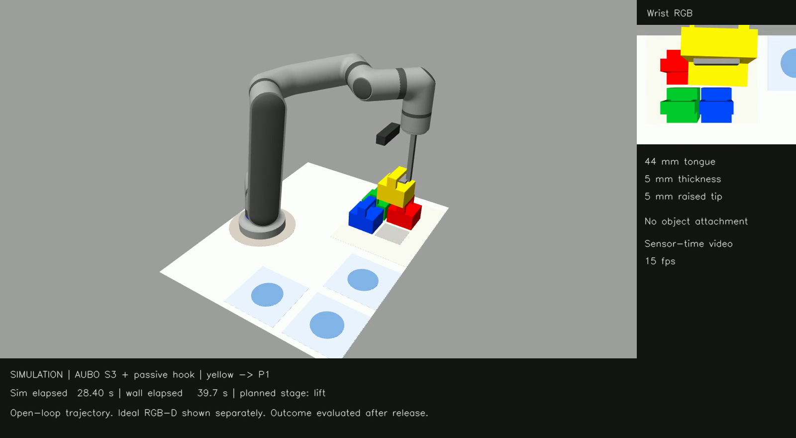

# 美团第四届低空经济与具身智能挑战赛 · 2026

参赛项目工作区，用于管理比赛资料、规则梳理，以及后续的机器人方案、实验记录和交付材料。

**当前开发基线（2026-10-11）：** 用户确认“按照这个版本”（USER-HW-20261011），后续开发采用 [F1u0rite/meituan_challenge_ws 的 FSM Core v0.1](https://github.com/F1u0rite/meituan_challenge_ws/tree/1d940f7c5f12561fed6641457c0b4b630a282b05)，目标环境为 **Ubuntu 24.04 / ROS 2 Jazzy / C++17**。用户随后提示“repo已经补充SDK”（USER-HW-20261011-04），核对后将当前快照推进到 `1d940f7c5f12561fed6641457c0b4b630a282b05`：较初始 `f477f689…` 仅新增部署手册并更新 README，FSM/接口源码未变。初始核心验收见 TEAMMATE-FSM-20261011，新增 SDK/驱动资料见 TEAMMATE-SDK-20261011（均于 2026-10-11 查阅）；[接入顺序与接口映射](docs/hardware-vision-plan.md#5-软件组织与验证顺序)、[源码版本锁定](robot/fsm-baseline.repos)。

**SDK 与驱动资料已补齐到接入计划：** 新手册固定 Jazzy 驱动 `53aab837…`、`aubo_description` `47fa5e02…` 和构建时下载的 `aubo_sdk 0.24.1-rc.3`，提供 Fake Hardware 修复与三终端 SOP。本项目现已在独立 Jazzy 容器完成 5 包构建、GenericSystem、关节/TF 与单点、多点 FollowJointTrajectory 复验；本次自动复现工具资格检查已完成独立 MoveIt Plan → Execute，最大目标误差约 0.00009 rad，但 `move_group` 退出为 -11，退出验收失败（ENV-UPSTREAM-WATCH-20261011）。完整 C++ FSM 链路及实机抓放仍未验收（ENV-FSM-20261011）。见 [SDK/驱动复现入口](robot/README.md#sdk-与-jazzy-驱动资料已核对)。

**阶段验收（2026-10-11）：离线核心与独立 Fake 驱动通过，ROS 任务链路未通过。** 12 包 Jazzy 构建、318 项 C++、269 项 Python、15 项 Mock E2E 已在本项目复跑。实际 Mock 启动时 Task/PickPlace 两个 Python 节点退出，基础 Goal 未能发送；4 条问题及负责人见[验收报告与冻结证据](docs/fsm-acceptance.md)（ENV-FSM-20261011）。

**接线补丁已由上游合并：** USER-HW-20261011-05 授权的 B01/B02/B04 补丁 `1d3dccf…` 已作为 [PR #2](https://github.com/F1u0rite/meituan_challenge_ws/pull/2) 合入 23:35 的 `main@c10f6ed…`（TEAMMATE-MERGE-20261011）。本项目复验 13 包构建、358 C++ / 269 Python / 15 Mock E2E、6 项 ROS 接线及 C++ 独立四场景通过；旧 Python Task 虽可受理 Goal，B03/B05/B06 仍阻断任务。独立 MoveIt 两次规划执行通过、退出失败，其中控制器 -11 出现一次。见[合并后验收](docs/wiring-merge-acceptance.md)（ENV-WIRING-MERGE-20261011）；[原补丁复验](docs/fsm-wiring-fix.md)及失败证据保留（ENV-FSM-FIX-20261011）。本项目未执行此次合并，正式基线仍为 `1d940f7…`。

**今晚 MoveIt 更新监测已于 10 月 12 日 08:00 结束**（USER-HW-20261011-08）：原每 60 秒检查上游各分支与 PR head，更新后按实际 SHA 在独立 Jazzy 容器复跑；现状态 EXPIRED，队列与主对话门禁已排空，14 个实际事件的完整回执/报告哈希已核验，旧复现进程与容器均停止（ENV-CPP-MOCK-WEBUI-20261012）。监测与自动复现边界见[运行说明](docs/upstream-monitor.md)（ENV-UPSTREAM-WATCH-20261011），不提前认定新 C++ FSM 或实机闭环通过。

**自动唤醒主对话已接入**（USER-HW-20261011-09）：相关 SHA 的固定复现结束后，无论成功、失败或超时，均投递至指定主对话，继续阅读变更、补跑与登记证据；持久化去重、三次传输上限及完成回执保证串行。启用与端到端回执检查见[唤醒验收](docs/upstream-wake.md)（ENV-UPSTREAM-WAKE-20261011），实时状态在 `outputs/moveit-watch-20261011/state.json`。

**截止后 C++ Mock / Web UI 集成部分通过：** 按 USER-HW-20261012 / USER-HW-20261012-02 在监测排空后，以截止主线 `f7eaa2c…` 实现并验证候选 `7da4322…`。统一启动、真实 Task→PickPlace、Web 发任务/反馈/结果、六项正负场景、唯一服务器/退出重启检查已完成；40 C++ Action 与39 UI回归通过。正常 Mock 的延迟取消 ACK 后最终 ABORTED/520，C1 交孙嘉明，完整取消验收未通过。代码已推独立 [PR #8](https://github.com/F1u0rite/meituan_challenge_ws/pull/8)，[SOP、验收报告与953文件冻结](docs/cpp-mock-webui-acceptance.md)记录实际源码/UUID/失败；不自动合并或推进正式pin，不等同完整FSM、MoveIt/Fake或实机（TEAMMATE-CPPUI-20261012；ENV-CPP-MOCK-WEBUI-20261012）。

**今晚新交付已复验：C++ Action Mock 通过，完整 MoveIt 接线待交付。** 监测收到 `feature/phase2a-cpp-actions@c0f7017…` 后完成真实主对话回执；13 包构建、358 C++ / 269 Python / 15 Mock E2E、新包依赖和外部 CMake 消费通过，补跑 UBSan 358 项及独立进程四场景通过。基础 T0、三色序列、关联取消、失败锁定和程序退出均有实测记录。此分支仍使用 Mock Planner/Motion，旧 Python 启动故障与独立 MoveIt 退出 -11 保留；没有合并或改变 `1d940f7…` 正式基线。见[候选验收与交接](docs/cpp-action-acceptance.md)（TEAMMATE-ACTION-20261011；ENV-CPP-ACTION-20261011）。

**规划分支补验（10 月 11—12 日）：局部通过，默认入口仍失败。** `feature/moveit-planner@fcdd8ea…` 已交付规划端口与采证 SOP；13 包、347 C++（318 核心 + 29 规划）、269 Python / 15 Mock E2E 通过。固定姿态规划通过，默认 V1/V2 均报 TF_UNAVAILABLE；独立诊断只将 TF 等待改为 5 秒后，V2 七段规划通过，V1 因 136.5 秒轨迹超过 24 秒状态预算而拒绝。MoveIt 退出 -11 继续保留。它是尚不含 C++ Action / PR #2 的独立分支，不能当作完整 FSM/实机；见[规划验收与交接](docs/planner-acceptance.md)（TEAMMATE-PLANNER-20261011；ENV-PLANNER-20261012）。

**交接文档补验（10 月 12 日）：** `main@a04ac68…` 仅改两份 README，未新增 C++ Bringup 或运行代码。当前 358 C++ / 269 Python / 15 Mock E2E、6 ROS 回归及新审计入口通过；新增 Node/Action/QoS 检查已补跑，两轮短时图查询都有漏发现，观察 SOP 仍有缺口。默认失败、诊断及六次正常进程退出分别保存，见[交接文档验收](docs/cpp-handoff-acceptance.md)（TEAMMATE-HANDOFF-20261011；ENV-HANDOFF-20261012）。

**规划与 Action 合并版本补验（10 月 12 日）：** `feature/moveit-planner@4a1a816…` 已同步主线，14 包、387 C++（318 核心 + 40 Action + 29 规划）/ 269 Python / 15 Mock E2E / 6 ROS 回归通过；合并安装环境的 C++ 四场景 40 项检查通过。默认规划固定姿态通过，V1 约 42.07 秒超过 24 秒状态预算，V2 仍 TF_UNAVAILABLE；MoveIt 退出 -11。两模块源码分别沿用父提交，PickPlace 仍绑定 MockPlanner/MockMotion，完整接线未验收。见[合并版本验收](docs/planner-merge-acceptance.md)（TEAMMATE-INTEGRATION-20261012；ENV-PLANNER-MERGE-20261012），正式锁定未推进。

**场景/载荷/起点增量补验（10 月 12 日）：** `30e3c6e…` 的 14 包、393 C++（318+40+35）/ 269 Python / 15 Mock E2E / 6 ROS 通过。默认碰撞探针与 V1/V2 均在场景初始化失败；仅改 TF 等待为 5 秒的诊断中，桌面碰撞拒绝和带占位载荷的 V2 七段规划通过，V1 为 180.42 秒，未复现上游约 40 秒，MoveIt 仍退出 -11。新起点检查/单段重规划尚未接入实际 FJT。见[场景增量验收](docs/planner-scene-acceptance.md)（TEAMMATE-SCENE-20261012；ENV-PLANNER-SCENE-20261012），仅为规划与 Fake 范围，未推进正式锁定。

**视觉适配器补验（10 月 12 日）：** 主线分出的 `0e329f1…` 新增视觉核心与离线 ROS 回放包，14 包 / 358 C++ / 269 Python / 15 Mock E2E / 6 ROS 通过；新 ROS 包零测试使 colcon-test 返回 5。补齐离线依赖后公开视觉测试 62 通过、1 私有证据跳过；默认回放只收到 1/4 帧，一次 5 秒周期诊断收齐并验证 NaN 消息，发布器退出仍失败。实际相机/标定及 FSM 感知消费链未接通，此分支不含规划包。见[视觉适配器验收](docs/vision-adapter-acceptance.md)（TEAMMATE-PERCEPTION-20261012；ENV-VISION-ADAPTER-20261012），未推进正式锁定。

**规划 PR #3 已由上游合入主线（10 月 12 日）：** `main@f7eaa2c…` 与已验收 `4a1a816…` 整棵 Git 树相同；本次 14 包 / 387 C++ / 269 Python / 15 Mock E2E / 6 ROS 通过。默认独立 MoveIt 规划成功，但内部 FJT 客户端未连接，执行 ABORTED / -4；一次额外等待 5 秒的诊断执行通过，退出仍 -11。旧 Python Cancel 本次为 520。见[主线合并验收](docs/planner-main-acceptance.md)（TEAMMATE-PLANNERMAIN-20261012；ENV-PLANNER-MAIN-20261012）；没有新入口，既有规划 SOP 结果沿用独立历史证据，不重复计数。场景与视觉增量尚不在此主线快照，正式锁定仍未推进。

**Phase 2B 独立轨迹端口已补验（10 月 12 日）：** `688d80d…` 新增整条轨迹 FjtMotionPort，14 包 / 424 C++ / 269 Python / 15 Mock E2E / 6 ROS 通过，独立 UBSan 424 项及外部 CMake consumer 通过。GenericSystem 起点不符和取消通过，但成功场景端口丢失运行证明、返回 230，虽然控制器与关节观察到达目标，仍判失败。现有 FSM 的异步取消桥未接入、直接取消仍 FAULT/520；默认 Action 继续 Mock，完整 FSM/实机未验收。见[轨迹执行验收](docs/trajectory-execution-acceptance.md)（TEAMMATE-TRAJECTORY-20261012；ENV-TRAJECTORY-20261012），原失败与 683 文件冻结保留，内核问题本地回交孙嘉明，正式锁定不变。

**标定/TF 交付补验（10 月 12 日）：** `06ab689…` 相对已验规划主线新增38个离线文件，既有运行源码未变。14包 / 387 C++ / 269 Python / 15 Mock E2E / 6 ROS及新增54项标定测试通过；只读Fake运行核验四条TF、腕部→末端Z轴+90°和903个零关节反馈时戳，没有发送Goal。真实清单8条变换仍UNKNOWN、采样表无实测数据；规划latest TF、时钟转换及诊断消费未接通，上游V1/安装前提不作为本项目新选型确认。见[标定验收](docs/calibration-acceptance.md)（TEAMMATE-CALIBRATION-20261012；ENV-CALIBRATION-20261012），532文件冻结，旧任务失败和MoveIt退出-11保留，正式锁定不变。

**轨迹身份与联合门禁补验（10 月 12 日）：** `45f497c…` 保留原424项测试、增加10项身份/时钟回归并合入29项既有Planner测试；15包、463 C++普通及UBSan、269 Python/15 E2E/6 ROS通过，独立Fake四场景通过。默认MoveIt与FJT端口共存出现2个执行客户端，门禁BLOCKED、零Goal；211点规划可被跨包消费但被原窄速度限值拒绝。见[联合门禁验收](docs/trajectory-gate-acceptance.md)（TEAMMATE-TRAJECTORYGATE-20261012；ENV-TRAJECTORY-GATE-20261012）。869文件冻结；旧230未据本轮单次通过关闭，MoveIt退出-11、时钟和异步取消宿主仍未解决，未合并或推进正式基线。

**视觉安全与清理补验（10 月 12 日）：** `e53c09f…` 的53项安全/TF/清理测试、62项公开视觉回归通过（1项私有数据跳过）；默认和两次插桩回放各收到4/4帧，SIGINT均exit 0。见[视觉安全验收](docs/vision-safety-acceptance.md)（TEAMMATE-VISIONSAFETY-20261012；ENV-VISION-SAFETY-20261012），463文件冻结。colcon仍零测试失败；默认发布器未加订阅等待，旧漏帧不因单次通过关闭。独立helper尚未接入FSM，旧消费者反例、完整链路与实机缺口保留。

**轨迹Goal归属补验（10月12日）：** `681bb64…` 首次FJT套件在重复取消用例120秒超时、XML缺失；同一未改二进制61项补跑及独立478项UBSan通过，间歇超时仍回交孙嘉明。新的原生GenericSystem预检缺少实时Status，默认MoveIt共存还有2个FJT客户端，两者均BLOCKED、零Goal；不能沿用45f497c四场景PASS。见[归属与Status验收](docs/trajectory-ownership-acceptance.md)（TEAMMATE-OWNERSHIP-20261012；ENV-TRAJECTORY-OWNERSHIP-20261012），708文件冻结。原始失败保留，正式基线不变，08:00集成/UI任务未提前启动。

**个人分工：系统集成与验收，兼做 Web UI**（USER-HW-20261011-03，2026-10-11 用户会话）。按用户提供的 v2 任务书，张叔阳负责统一启动、接口核验、Mock/Fake 验证、日志与问题分派及视频/报告准备；孙嘉明负责 FSM、Action 状态转换与 Cancel（SPRINT-PLAN-20261011 §01、§06–07）。你的 P0 交付与对接人见 [系统集成与验收计划](docs/hardware-vision-plan.md#7-系统集成与验收主责)；原先确认的 Web UI 工作（USER-HW-20261011-02）继续保留，见 [界面与接口计划](docs/hardware-vision-plan.md#6-用户负责的-web-ui)。用户进一步澄清需要**实机操作台**（USER-HW-20261011-07）。[新版操作台](webui/README.md)默认连接 Jazzy ROS 的任务 Action、设备、相机、关节与日志；无连接显示离线，`bash webui/run.sh` 按仓库参考路径 source 接口工作空间，浏览器使用 `http://127.0.0.1:8767/`。[实现与验证](docs/web-ui.md)记录 33 项离线/HTTP 与 9 项隔离 Jazzy ROS 检查通过（ENV-WEBUI-ROS-20261011），区分接口验证和实机验收；NUC 部署、实际任务闭环与录像仍待验。早期 Mock 记录继续保留（USER-HW-20261011-06；DEMO-WEBUI-MOCK-20261011），演练需显式 `--mock`。

以下 Humble / Gazebo Classic 视频与实验保留为历史复现成果；它们不代表新 Jazzy 基线已完成同样的集成，NUC 的实际系统版本也未在本次核验。

[**观看 / 下载单块钩取 Demo（约 57 秒）**](https://github.com/AfonsoZhang/meituan-robotics-challenge-2026/releases/download/demo-v1.0.0/demo.mp4) · [完整结果与下载包](https://github.com/AfonsoZhang/meituan-robotics-challenge-2026/releases/tag/demo-v1.0.0) · [仿真搭建说明](demo/SETUP.md)

[](https://github.com/AfonsoZhang/meituan-robotics-challenge-2026/releases/download/demo-v1.0.0/demo.mp4)

单块黄块 → P1：落点误差 **2.25 mm**，内框覆盖率 **84.4%**。这是开环仿真展示，腕部 RGB 独立显示；不代表实物承载、三块闭环或鲁棒安全控制已验证。

**新增视觉修正实验：** [观看 +6 mm 偏移修正视频](https://github.com/AfonsoZhang/meituan-robotics-challenge-2026/releases/download/vision-v1.1.0/corrected-6mm.mp4) · [对照视频和完整原始证据](https://github.com/AfonsoZhang/meituan-robotics-challenge-2026/releases/tag/vision-v1.1.0)。修正后落点误差 2.12 mm，对照组也成功；当前只验证单块抓取前定位修正，尚不能证明成功率提升。

当前状态：三份原始比赛 PDF、两张用户提供的 JPG 和 2026-10-11 五人冲刺任务书 v2 已归档。任务书按原始字节保存（SPRINT-PLAN-20261011），其中 10/12 联调与 10/15 交付为团队排期；准确官方截止时刻和提交要求仍见 Q11。两张 JPG 分别为电池 CAD 渲染图与工程尺寸图，并非实拍（BATTERY-RENDER、BATTERY-DRAWING）；图示设计尺寸及内框面积分析见 [电池几何与抓取分析](docs/battery-geometry.md)，图内未明示尺寸单位，当前暂按 mm 解释，实物尺寸仍待核验。

2026-09-06 用户确认机械臂为遨博 S3、相机为 RealSense D435i，采用传统视觉路线，计算计划使用本机；末端现有三种候选：方案一用钩子钩取电池提手（USER-EE-20260906-01），方案二用吸盘侧面吸附（USER-EE-20260906-02），方案三用卡环（USER-EE-20260906-04）。新增方案不替代已有方案，最终选型依据实物和台架对比结果；此前平行两指夹持仅为历史工程候选，当前不以采购夹爪为前提。相机仍计划安装在机械臂末端，采用眼在手上（eye-in-hand）方式，实际安装状态未核实（USER-HW-20260906-03）；支架建议固定在法兰转接件或工具的刚性固定座。三套末端的已有设备、结构与连接方式，以及吸盘所需的实物密封条件、真空系统和控制接口待核实；初步方案先按初赛固定工位展开，尚无实机验证结果。

**视觉回放自然退出补验（10 月 12 日）：** `dc76a0b…` 的适配器57项、公开视觉80项通过，1项私有数据跳过；原生安装程序两次4/4自然退出、两次中途2帧后SIGINT退出均为0，无订阅者等待超时明确失败。新增私有V4.1/V4.2入口均在处理帧前缺目录/数据失败，默认零等待可靠性、colcon零收集和真实FSM消费仍未关闭；四例首次图节点名UNKNOWN，不扩大节点身份结论。486文件与清理见[回放增量验收](docs/vision-replay-acceptance.md)（TEAMMATE-VISIONREPLAY-20261012；ENV-VISION-REPLAY-20261012）。08:00后的C++/Web UI任务尚未开始。

## 项目入口

- [规则摘要与评分](docs/rules-summary.md)：按原始 PDF 页码追溯。
- [待确认事项](docs/open-questions.md)：设备、技术路线和规则歧义。
- [硬件与传统视觉方案](docs/hardware-vision-plan.md)：已确认配置、建议架构、标定与实施顺序。
- [FSM Core v0.1 接入计划](docs/hardware-vision-plan.md#5-软件组织与验证顺序)：Jazzy / C++17 基线、感知与运动端口映射、第二阶段 Mock 验收。
- [FSM 阶段验收结果](docs/fsm-acceptance.md)：Jazzy 构建/离线回归、实际 ROS 启动故障、独立 Fake 轨迹与负责人问题单。
- [FSM 接线补丁与复验](docs/fsm-wiring-fix.md)：B01/B02/B04 修复 PR、六项 ROS 回归及剩余 Action/INIT 阻断。
- [PR #2 合并后验收](docs/wiring-merge-acceptance.md)：合并事实、六项 ROS 回归、C++ Mock 复验与两次 MoveIt 退出观测。
- [C++ Action Mock 候选验收](docs/cpp-action-acceptance.md)：真实监测回执、Phase 2A 新入口补跑、UBSan 与独立进程任务/取消、Phase 2B 交接。
- [Phase 2A 交接文档验收](docs/cpp-handoff-acceptance.md)：两文件变更、新审计与 Node/Action/QoS 检查、图发现失败和后续交接。
- [MoveIt 规划分支验收](docs/planner-acceptance.md)：默认 TF 失败、5 秒诊断、V1 状态预算阻断、V2 七段规划与完整轨迹核验。
- [规划与 Action 合并版本验收](docs/planner-merge-acceptance.md)：14 包 / 387 C++、合并环境的独立 Mock 与默认规划、失败及未接线边界。
- [场景、载荷与起点增量验收](docs/planner-scene-acceptance.md)：393 C++、默认场景失败、碰撞负例、诊断 V2 与未复现的 V1 时长。
- [视觉源码与 ROS 回放适配器验收](docs/vision-adapter-acceptance.md)：公开测试、默认漏帧/有界诊断、NaN 与消费门禁、私有/真实数据缺口。
- [规划 PR #3 主线合并验收](docs/planner-main-acceptance.md)：整树身份、默认 FJT 连接失败、一次等待诊断、退出失败及清理回执。
- [Phase 2B 轨迹执行验收](docs/trajectory-execution-acceptance.md)：424 项回归/UBSan、GenericSystem 两项通过与成功场景 230 失败、FSM 异步停稳缺口。
- [标定/TF 离线与 Fake 验收](docs/calibration-acceptance.md)：54项新测试、只读TF、真实UNKNOWN清单与采集时间/TCP接线边界。
- [轨迹命令身份与 MoveIt 联合门禁验收](docs/trajectory-gate-acceptance.md)：463项普通/UBSan、四场景通过与双客户端阻断、时钟/取消缺口。
- [视觉安全、TF 与回放清理验收](docs/vision-safety-acceptance.md)：53项新测试、三次回放/退出通过，自动收集与FSM消费门禁未接通。
- [轨迹Goal归属与实时Status验收](docs/trajectory-ownership-acceptance.md)：首次120秒超时、61项补跑/478项UBSan与原生门禁阻断分开记录。
- [个人主责：系统集成与验收](docs/hardware-vision-plan.md#7-系统集成与验收主责)：v2 任务书的 P0 交付、协作边界、证据要求和现场联调顺序。
- [实机操作台](webui/README.md)：ROS 任务提交/取消、软件停止、设备/关节、RGB-D 与日志；默认离线不会模拟数据。[验证与截图](docs/web-ui.md)，NUC/实体设备验收待完成。
- [个人负责的 Web UI](docs/hardware-vision-plan.md#6-用户负责的-web-ui)：页面职责、现有监控台复用、ROS 接口映射及分阶段交付。
- [电池几何与抓取分析](docs/battery-geometry.md)：CAD 与尺寸图读图、提手钩取几何与验证要点及内框面积计算。
- [末端方案对比](docs/end-effector-options.md)：方案一提手钩取、方案二侧面吸附、方案三卡环（候选不限于此），以及制作途径、选型与验证依据。
- [仿真方案](docs/simulation-plan.md)：Gazebo + ROS 2 选栈依据、aubo_description 核实结果、S3 运动学、底图可达性实算与推进顺序。
- [Demo 录制评估](docs/demo-readiness.md)：与队友 demo 对比、44/5/5 舌规验证边界、PolyU RA 申请适配和录制前缺口（2026-09-07 整理）。
- [单块 Demo 实录](docs/demo-recording.md)：已录制黄块 → P1，约 57 秒；含视频、轨迹误差图、结果与可复现入口（2026-09-07）。
- [视觉修正实验](docs/vision-correction.md)：单块 RGB-D 抓取前定位修正及初始偏移对照。
- [固定偏移重复对照](docs/vision-repeat.md)：−6/0/+6 mm，各两轮、共 12 次；两种模式均 6/6 通过，尚无成功率优势结论。
- [三块逐次观察集成](docs/vision-sequence.md)：同一世界逐块定位；最终版本两次通过，开发中蓝块掉落及约 11 mm 释放偏差仍保留。
- [力矩鲁棒控制实验](docs/robust-control.md)：重力补偿＋边界层滑模，含基础/增益匹配 PD 对照；仿真接口，不代表实机或形式化安全证明。
- [NUC 实机接入](robot/README.md)：当前 FSM 源码锁定及历史 Humble 接入脚本；Jazzy 部署与实机验证尚未完成。
- [浏览器监控台](demo/README.md#浏览器监控台)：多个 ROS 终端 + 相机实时画面 + 录像回放，`bash demo/dashboard.sh`；只做观察，不参与控制。
- [资料说明](materials/README.md)：原件、提取文本及预览图的使用方式。
- [来源清单](materials/manifest.json)：原始路径、文档页数和 SHA-256。

## 目录

```text
meituan-robotics-challenge-2026/
├── CLAUDE.md
├── README.md
├── docs/
│   ├── rules-summary.md
│   ├── hardware-vision-plan.md
│   ├── battery-geometry.md
│   ├── end-effector-options.md
│   ├── simulation-plan.md
│   └── open-questions.md
└── materials/
    ├── README.md
    ├── manifest.json
    ├── original/      # 比赛 PDF、物料 JPG、团队任务书原件
    ├── extracted/     # FAQ、底图的逐页提取文本
    └── previews/      # 两张底图的屏幕预览
```

## 比赛范围

- 初赛：固定底座机械臂识别并抓取指定颜色电池，完成 T0 基础放置和 P1–P3 指定序列摆放。
- 初赛评分：基础任务 40 分、序列任务 50 分、时间效率 10 分。
- 决赛：机器人抓取单块目标电池，携带通过障碍区，放入指定电池仓。
- 本项目只做初赛，报名已完成（USER-RULE-20260923）；决赛规则仅作资料保留。

以上来自所提供的规则 PDF 第 2–6 页及 FAQ 第 1–4 页；详细限制和补充见规则摘要。

内框判定更新：2026-09-06 用户转述组委会答复，确认电池主体落在内框内的垂直投影面积占其总投影面积至少 70%。项目按此执行内框判定，原 PDF 的不同表述和答复来源保留在规则摘要及 Q15（USER-RULE-20260906-02）。

2026-09-06 用户提出引入仿真，并指定 S3 模型来源为 `AuboRobot/aubo_description` 的 `urdf/` 目录（USER-SIM-20260906-01）。该仓库确有 `urdf/aubo_S3.urdf`（`aubo_S3_10`、`aubo_S3_T0` 是指向它的符号链接），但不含末端工具帧、`<gazebo>`/`<transmission>` 与 `config/`，许可证状态存在冲突（package.xml 写 BSD，仓库无 LICENSE 文件）。用该名义模型与底图矢量坐标实算：各目标位距底座参考圆圆心 287–527 mm，在工具轴竖直向下、法兰高度 150 mm 与 250 mm 两档均可解，**运动学可达性不是瓶颈**；该结论未含碰撞、工具长度与实机 DH 校准。同日用户选定仿真栈为 **Gazebo + ROS 2**，本轮覆盖可达性与碰撞、相机 RGB-D 合成图、三块序列端到端，接触物理先只做钩取，模型暂不归档（USER-SIM-20260906-02）。同日已完成环境搭建：ROS 2 Humble + Gazebo Classic 11.10.2 装好，工作空间 `~/aubo_ros2_ws`，自建 overlay 包 `meituan_sim` 补齐上游缺的 Gazebo 接线；`ros2 launch` 单条命令即可 spawn S3 并由 `joint_trajectory_controller` 驱动六轴（误差 < 1e-4 rad），且零位 TF 与本项目独立 FK 结果一致、可达性求解在仿真中复核通过（ENV-SIM-20260906）。场景资产已建：底图（贴图由归档 PDF 渲染）与 4 块道具电池按底图矢量坐标生成，p1/p2 两个任务页可切换；p2 的 4 个电池位与 P1–P3 共 7 个目标位在工具竖直向下、法兰高 250 mm 约束下实测可达，xy 误差 ≤0.71 mm 且电池零位移。D435i 已按眼在手上建模并出 RGB-D：视场与官方规格一致，深度中心读数与 TF 真值差恰好 50 mm（等于电池本体高度），反投影到基座系落在电池顶面 z=0.0500 与台面 z≈0.000，四色均可分。由此定量确认观察位窗口被相机最小深度 280 mm 与可达性两头夹住。颜色分割与定位管线已建为独立包 `meituan_vision`（不依赖仿真，接实机只需 remap 话题）并跑通回归：4 块电池 × 4 个观察位共 16 次检测全部检出、零误检，相对底图真值定位误差 0.8–1.9 mm，跨视角最大分散 ≤2.86 mm——相对内框 70% 覆盖率 ±17 mm 的容差，仿真条件下视觉不是精度瓶颈。但阈值与外参均取自仿真，实机须重标后重跑同一套回归。钩具已建模（固定被动钩，舌宽 44 mm 由仿真定出）：单块钩取搬运验证达标，落点误差 3.5 mm、序列第一块内框覆盖率 84%；固定被动钩在仿真中可直接完成物理提举，无需抓取插件。三块连续序列已跑通：给 IK 加了碰撞代价（原实现会解到钩具贴大臂的自碰位形），461 个路点全程无碰撞；六次重复中黄→P1 与绿→P2 均 6/6 达标（内框覆盖率 84% / 77%），蓝→P3 仅 2/6。蓝块失败已定位为滑脱而非碰撞：舌宽 44 mm 在 50 mm 开口内只剩 ±3 mm 横向余量，小于控制器 4–6 mm 的跟踪误差；降速与加驻留均未解决。下一步做视觉闭环插入——本项目视觉定位精度 0.8–1.9 mm 远小于该余量，这也反过来论证了眼在手上视觉的必要性（Q16）。详见 [仿真方案](docs/simulation-plan.md)。

## 下一步

软件工作按 USER-HW-20261011 与 TEAMMATE-FSM-20261011 推进：已在独立 Ubuntu 24.04 / Jazzy 容器完成固定版本离线回归与独立 Fake 轨迹验收（ENV-FSM-20261011）；B01/B02/B04 已由上游合并且复验通过，旧 Python B03/B05/B06 留存为未解决路径（ENV-FSM-FIX-20261011；ENV-WIRING-MERGE-20261011）；新分支的 C++ ROS 2 Action Mock 已单独验收通过（ENV-CPP-ACTION-20261011），另一个独立规划分支已补验固定姿态及 V1/V2 输出，默认 TF、V1 状态预算和退出问题尚未解决（ENV-PLANNER-20261012）。规划分支同步主线后的 14 包 / 387 C++ 与独立 Mock 已复验，默认序列仍失败（ENV-PLANNER-MERGE-20261012）；新增场景/起点版本为 393 C++，5 秒 TF 诊断下 V2 与碰撞负例通过，默认入口和 V1 仍失败（ENV-PLANNER-SCENE-20261012）；原规划 PR #3 已由上游合入主线，源码树未变；新观测到内部 FJT 客户端未就绪导致执行失败，5 秒诊断通过但未修复（ENV-PLANNER-MAIN-20261012）。轨迹端口独立分支已补验，但成功执行出现运行证明丢失/230，FSM 取消桥与默认服务绑定仍待完成（ENV-TRAJECTORY-20261012）。标定/TF离线交付与Fake坐标补验通过，但实测参数、采集时刻TF和ROS/Core时钟仍待接入（ENV-CALIBRATION-20261012）。轨迹身份更新后的463项与四个独立Fake场景通过，但默认MoveIt/FJT联合执行权门禁仍BLOCKED，真实规划输出超出当前窄执行能力，时间契约和取消宿主未完成（ENV-TRAJECTORY-GATE-20261012）。视觉增量的局部TF/安全helper及SIGINT清理已补验，但默认自动测试收集和真实FSM消费门禁仍未完成（ENV-VISION-SAFETY-20261012）。随后仍需完成两模块接线与完整任务闭环。新增视觉分支的公开离线测试及诊断 ROS 回放已补验，实时感知与 FSM 消费链仍未接通（ENV-VISION-ADAPTER-20261012）。现有 RGB-D 视觉、放置评测及场景资产作为后续适配输入；Gazebo 迁移版本、相机/工具外参和 NUC 部署仍待验证。详细接口及各步验收见硬件与传统视觉方案第 5 节。Phase 2A 的 Mock 通过不等于 Phase 2B 的 MoveIt / 完整轨迹通过；Web UI 客户端已实现，完整 FSM 与实机联调仍待验。

个人工作按 USER-HW-20261011-03 以系统集成与验收为主，本轮已留存构建记录、通信矩阵、Mock 启动失败与独立 Fake 复现证据；下一步处理基础 Goal 阻断并落实拍摄准备清单（SPRINT-PLAN-20261011 §06）。Web UI 作为兼任工作，优先服务状态观察、日志与回放；既有功能拆分是工程建议，不新增为任务书中的硬性 P0。用户已澄清 Web UI 应面向实机（USER-HW-20261011-07），本轮增加真实 ROS 客户端及可选只读模式，后续接入见 Q19；SSH 隧道方式保留，未连接 NUC 或执行实体运动。

先在本机准备三方案共用的视觉采集和离线识别，同时核验电池实物与 S3 末端接口。方案一检查提手通道、钩具承载、止退和脱钩路径；方案二检查侧面平整与气密条件、真空建立与保持、侧向承载和释放动作；方案三检查卡环与提手/本体的配合、锁止、承载和释放路径。三方案先做台架对比，再验证机械臂搬运、单块放置及三块序列。D435i 采用末端刚性固定，分别检查工具遮挡和布线；换工具须重新标定相应 TCP，相机相对末端的固定关系改变时重新进行手眼标定。S3 控制柜/软件版本仍待明确。具体见硬件与传统视觉方案及末端三方案对比。

历史配置：2026-09-23 用户曾确定实机使用 ROS 2 Humble（USER-HW-20260923、USER-HW-20260923-02），部署在 NUC 上的原生 Ubuntu 22.04（USER-HW-20260923-03、USER-HW-20260923-04）；2026-10-11 后续开发目标已随指定版本改为 Ubuntu 24.04 / Jazzy（USER-HW-20261011），不据此认定 NUC 已升级。开发电脑用于开发和跑仿真，并经 SSH 隧道远程查看 NUC（USER-HW-20260923-06、USER-HW-20260923-07）；S3 用 `aubo_ros2_driver`（USER-HW-20260923-08），与控制柜的兼容性未验证；NUC、S3、D435i 已到位（USER-HW-20260923-11），D435i 用 realsense-ros（USER-HW-20260923-09），实机和仿真规划均选用 MoveIt（USER-HW-20260923-10、USER-SIM-20260923）。Jazzy 驱动版本、NUC 部署和新 FSM 集成见 Q02、Q05、Q17、Q18。末端自制件可用 PolyU 3D 打印（已确认支持 PLA，其他材料待询）或低价网购（USER-EE-20260923），见 Q03；末端候选不局限于三种方案，设计暂以 BATTERY-DRAWING 图纸尺寸为准（USER-EE-20260923-02）。

本仓库已公开到 GitHub，包含资料、demo 入口及自建仿真源码；视频和结果发布于 Release。构建步骤见 `demo/SETUP.md`。尚无实机验证结果。
