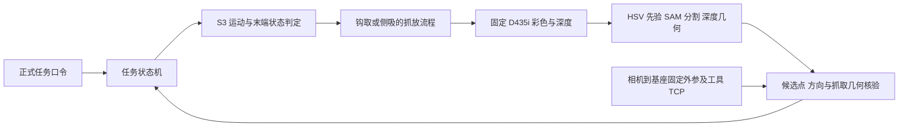

# 硬件与视觉方案

**实机验收全部完成（2026-10-17）：** 用户确认“实机全部完成”（USER-HW-20261017），八阶段均已完成，见[实机阶段清单](#real-hardware-acceptance-20261014)。各阶段的现场源码 SHA、配置/标定数值、成功率与误差、验收时间及原始日志/视频均未提供，不据此填数，不推进正式 pin，不改写冻结证据或历史失败，也不替用户确定最终末端型号。

**相机与视觉资料更新（2026-10-14）：** 用户明确“这是眼在手外”（USER-HW-20261014-03），当前方案按固定工位相机及 `T_base_camera` 外参修订；旧眼在手上计划和仿真保留历史范围。用户提供的 [PR #17](https://github.com/F1u0rite/meituan_challenge_ws/pull/17)已核对到 `5efbd2d…`，为 HSV 先验、SAM 2.1、RGB-D/CAD 候选坐标、独立 JPEG 和可选 T0 场景初始化提供参考（TEAMMATE-VISIONCOORD-20261014）。相机安装方式依据用户确认；PR 的测试范围与项目现场验证分别登记。用户随后明确 **TCP 已做验证**（USER-HW-20261014-04），具体参数和验证记录待补充，不能由该 PR 未覆盖 TCP 推断项目没有验证。正式 pin 及实机验收阶段不变。

**对外方案草稿（2026-10-14）：** [技术方案与答辩讲述稿](technical-proposal.md)按用户“方案内容假设全部完成起草”的要求撰写，并按“舌规”补充展开穿孔承托末端（USER-HW-20261014-02；USER-EE-20261014，用户会话）。这是本次稿件的完成态前提与叙述方向，不新增实机完成确认，不将手持舌规直接视为完整装机钩具，也不改写下述阶段进度或既有开放候选记录。

**舌规设计制造补充（2026-10-14）：** 用户进一步明确舌规采用 PETG、通过 3D 打印成型，要求按参数化建模、打印试配和结构迭代展开（USER-EE-20261014-02）。[对外稿第 3 节](technical-proposal.md#3-末端结构设计与快速迭代)区分功能舌、钩柄及法兰连接，并预留 CAD/打印件/提手试配对照图。PETG 牌号、打印参数、成品尺寸、承载和防脱实测记录待填；该补充不确定钩柄/法兰材料或打印服务方，不变更实际验收状态。

**舌规装机关系澄清（2026-10-14）：** 用户确认 PETG 3D 打印舌规“直接用的”，即该打印件直接作为装机功能舌与上翘尖（USER-EE-20261014-06）。该确认补充实际功能段材料与用途；钩柄、法兰的材料及连接形式仍待补充，不据此新增承载、防脱或第 6–8 阶段验收结论。

**实机验收进度（2026-10-14）：** 用户现场确认第 1–5 阶段已完成；后续从第 6 阶段停止与异常开始，详见[实机阶段清单](#real-hardware-acceptance-20261014)（USER-HW-20261014）。下文历史接入状态保留其当时版本范围。

**C1 独立修复（2026-10-13）：** 已单独提交并推送 [PR #15](https://github.com/F1u0rite/meituan_challenge_ws/pull/15)（`8603e18`，基于 main）；独立分支 366 项 C++ 用例通过，700/400 ms 延迟取消后同栈新任务成功。此前 PR #8 组合另有 365 项测试及七个独立进程场景通过。C1 补丁已从 PR #8 撤出，原内容保留。修复限软件 Mock，未合并、未推进正式 pin；旧失败证据保留。见 [修复报告](c1-cancel-fix.md)（ENV-CANCEL-PR-20261013；USER-HW-20261013-03）。

2026-10-12 当前状态同步：团队main `b418515`已合入标定与Phase 2B；新回归数字及PR #4/#9/#10、Phase 2C结果仅为上游报告，个人尚未复验。PR #8的C++ Mock/UI部分通过、C1未通过，完整FSM/实机未验收。团队手册记录的Fake验证环境为x86_64 / Ubuntu24.04.4 / Jazzy，NUC当前部署仍须现场核对；PR #11的新侧视试装外参仍UNKNOWN。Mac复验准备已终止清理，未执行测试。正式pin不变，详见[当前状态](current-status.md)（TEAMMATE-STATUS-20261012；ENV-STATUS-SYNC-20261012；USER-HW-20261012-03/04）。

2026-10-11 历史基线状态：按用户指定的 FSM Core v0.1 登记后续开发基线，当时尚无实机采集、标定、驱动联通或抓放验收结果；后续进度按上方 2026-10-14 用户确认及实机阶段清单解释。

本文区分用户确认、官方资料和工程建议。比赛事实沿用 [资料说明](../materials/README.md) 中的 RULES、FAQ、MAP 标识及 PDF 页码；新增来源同步登记在 [manifest.json](../materials/manifest.json)。

## 已确认配置与边界

| 项目 | 当前结论 | 来源 / 未确认部分 |
| --- | --- | --- |
| 机械臂 | 遨博 S3 | 用户 2026-09-06 会话，USER-HW-20260906；实机代次、控制柜、软件及 SDK 待核对 |
| 相机 | RealSense D435i，眼在手外（eye-to-hand），相对工位及基座固定 | 型号来自 USER-HW-20260906；安装方式按 USER-HW-20261014-03 更新。具体位置、支架、视角、外参数值与记录待归档；旧 USER-HW-20260906-03 保留为历史安装计划 |
| 技术路线 | 当前对外稿结合 HSV 颜色先验、SAM 2.1 分割和 RGB-D/CAD 几何 | 实现参考 TEAMMATE-VISIONCOORD-20261014；USER-HW-20260906 的传统视觉路线保留其历史范围，赛事申报口径见 Q06 |
| 末端执行方式 | 方案一：钩取提手；方案二：吸盘侧面吸附；方案三：卡环 | 分别来自 USER-EE-20260906-01、USER-EE-20260906-02、USER-EE-20260906-04；三方案并列评估，候选不局限于这三种（USER-EE-20260923-02），具体工具与最终选用方案待实物验证 |
| 软件开发基线 | FSM Core v0.1，Ubuntu 24.04 / ROS 2 Jazzy / C++17 | USER-HW-20261011（用户会话“按照这个版本”）；固定仓库版本见 TEAMMATE-FSM-20261011，下文第 5 节区分上游完成范围和本项目接入缺口 |
| 计算平台 | 实机部署仍计划使用 NUC；实际安装版本待核验 | USER-HW-20260923-03、USER-HW-20260923-04 确认原生 Ubuntu / NUC；当时选定的 Ubuntu 22.04 / Humble（USER-HW-20260923-02）保留为历史，后续开发目标按 USER-HW-20261011 更新。NUC 已到位（USER-HW-20260923-11），型号、USB 3、网口及新基线部署未核实。开发电脑用于开发、仿真并经 SSH 隧道远程查看 NUC（USER-HW-20260923-05、USER-HW-20260923-06、USER-HW-20260923-07）；ENV-LOCAL-20260906 的 WSL 观测不代表 NUC 环境 |
| 道具几何资料 | 带提手圆角盒体；名义底面 70×80、本体高 50、提手高出 30 | 用户提供 BATTERY-RENDER、BATTERY-DRAWING；单位暂按 mm 解释，设计图不等于实测，详见 [几何与抓取分析](battery-geometry.md) |
| 实施范围 | 按初赛固定工位设计 | 用户确认只做初赛、报名已完成（USER-RULE-20260923）；初赛底座不可移动（RULES p2；FAQ p1–2） |

遨博 2023-12-07 的官方发布前介绍明确列出 S3（3 kg）并说明 S 系列搭载 ARCS（AUBO-S3）。这可以作为型号与控制系统的历史参考；用户实机的额定参数、软件版本及适用接口仍须按铭牌和配套手册核对，不套用 i3、iS3 或其他 S 系列机型参数。

历史相机计划为末端安装（USER-HW-20260906-03），2026-10-14 用户明确改按眼在手外描述（USER-HW-20261014-03）。方案一钩取（USER-EE-20260906-01）、方案二侧吸（USER-EE-20260906-02）和方案三卡环（USER-EE-20260906-04）共用固定相机、坐标标定和任务判定框架；末端各自定义 TCP 和工具包络。此前“没有夹爪”保留为历史设备状态，安装方式澄清不替代具体末端选型或实测参数。

## 末端设计与推进顺序

先准备图像采集与离线识别，同时核对实物、S3 法兰与三种末端方案。每套工具分别标定 TCP：钩具记录承托参考点及钩尖偏移；吸盘记录接触中心、法向及工作压缩量造成的偏移；卡环记录卡持参考面、环轴线及锁止位置。固定相机标定到基座的外参；更换工具后更新 TCP、工具包络与遮挡检查，相机或基座相对位置变化时复核外参。实机验证以所选工具和电池到位为条件；第 1–5 阶段用户完成确认不因参数尚待归档而撤销。

尺寸图给出提手下方名义净高 20、横梁前后厚度 26、竖向高度 10，开口宽约 50 依赖立柱对称推算（BATTERY-DRAWING，暂按 mm）。建议先评估固定被动钩从前/后方水平穿孔、上抬托住横梁，再通过落台卸载、下降清出钩尖、水平退钩完成释放。穿孔部分的完整包络须小于实际开口并留余量，不能只检查杆件厚度；具体可逆条件、材料与承载待验证，详见 [钩取几何与流程](battery-geometry.md)。

侧吸方案拟接触本体的 70×50 或 80×50 竖直侧面，数值是图示外包络，实际可密封面须扣除圆角等不可用区域（BATTERY-DRAWING，单位暂按 mm）。需配置与实物匹配的吸盘、支架、真空源、吸附/泄压阀、管路和真空反馈；不假定 S3 已有供气或兼容的电气接口。先验证气密性、切向抗滑、偏心力矩及落台泄压后的撤离，再接入机械臂。结构与受力示例、两方案取舍依据见 [末端两方案与侧吸设计](end-effector-options.md)。

卡环方案拟用环形件套入或卡住提手横梁/本体指定部位；卡持对象、环内尺寸、开口或闭合方式、锁止和释放动作均未确定。先以实体样件验证套入扫掠、承载、防脱、对电池干涉和落台脱离，再确定是否需要电动开合。该方案的几何与接触物理不纳入当前仿真接触范围。

以下终端环境为 2026-09-06 的只读历史检查，仅代表当时工作区；该轮没有进行相机采流或机器人连接，不等于最终设备控制环境或后续阶段状态。

2026-09-06 本机只读盘点（ENV-LOCAL-20260906）：`/usr/bin/python3` 为 Python 3.10.12，当前解释器的包元数据可见 NumPy 2.2.6、opencv-python 4.13.0.92，未找到 opencv-contrib-python 和 pyrealsense2。`lsusb` 无设备输出且退出码为 1，因此此次检查未能枚举相机；这不证明 Windows 主机未连接相机。该检查未导入视觉/设备库，包元数据存在也不等于已通过运行验证。

## 建议架构

按眼在手外布置，采用“机械臂避让遮挡、固定相机采图 + 颜色先验与分割 + 深度几何及固定外参定位 + 状态机抓放 + 放后复核”。相机不随末端移动，图像与目标结果仍关联源帧、采集时间、标定版本和有效性。

这一路线结合可区分的目标颜色、固定工作台和物体几何组织感知（任务依据：RULES p2–3；FAQ p1）。PR #17 增加模型分割，不能继续将该实现概括为纯传统视觉；赛事技术路线申报口径仍见 Q06。控制按动作前后重新观察设计，PR 的坐标处理约 9–10 秒/次的有限上游记录不支持高速视觉伺服表述。

### 1. 相机布置与采集

- 将 D435i 刚性固定在工位支架，保持相对基座的位置稳定。安装位置和角度按初始区、抓取通道及放置区的共同可见性确定，核对支架与机械臂、工具和物体运动包络的间距。
- 机械臂在观察阶段避让视线，待目标稳定后获取当前帧。若固定视角不能覆盖所需区域或方向，应调整工位布置并重新核验标定；不以机械臂移动自动获得新的相机视角。
- 官方 D435i 页面列出彩色视场约 69°×42°、深度视场约 87°×58°，最大分辨率下最小深度距离约 28 cm。布置须按彩色与深度的共同有效视野核验，不能仅凭深度视场估算覆盖。（RS-D435I）
- 观察距离根据待覆盖区域、深度有效范围及固定支架位置确定。若尝试正俯视单帧覆盖整张 700×540 mm 底图（MAP p1–2，PDF 页面尺寸），按上述彩色视场估算的桌面距离下界约为 0.70 m；这是条件推算，实际须给电池高度、边缘畸变和安装误差留余量，具体安装值待记录。
- 验证整个抓放过程中的可见性、工作距离和遮挡；目标深度无效时不继续生成新位姿，按任务阶段重新观察或拒绝。相机移动后须重新检查外参和场景参考，不能沿用原标定。
- 用实物调好补光、曝光和白平衡，参数稳定后保存。采集彩色、深度、时间戳、帧号、实际流模式、内参和深度单位；机器人状态另按已核验的时钟关系关联，不依赖 IMU 提供末端定位。

### 2. 颜色与形状识别

- OpenCV HSV 阈值由实物样本确定，红色需考虑色相环绕。PR #17 以当前帧颜色掩膜、支撑面和顶部深度生成提示，再用 SAM 2.1 tiny 分割，结合几何筛选估计顶部与 CAD 推算的孔中心；当前帧缺失点不复用历史值。（CV-HSV、CV-SHAPE；TEAMMATE-VISIONCOORD-20261014）
- 输出颜色、轮廓、像素中心、可观测方向与质量标记。接近圆形或对称的轮廓不能强行给出可信朝向；进钩或侧吸方向须结合物体姿态与周围通道决定。
- 用主体外轮廓与提手横梁方向共同核验朝向，沿前后方向选择有空间的孔口侧进钩。固定视角无法确认的方向不强行补齐；先核验安装角度与几何约束（BATTERY-DRAWING，工程设计）。渲染图的黄色不用于设置实物颜色阈值。
- 侧吸时在主体上选择可接近的侧面，输出接触点、侧面法向及密封区域质量。固定安装视角需可见该面，或使用经实物核验的几何模型推算；正俯视图不能直接证明竖直侧面平整气密，密封能力须通过实物试验确认。
- 连续多帧确认后再选择目标；颜色歧义、遮挡严重、多个候选无法区分时重新观察。抓错颜色有扣分，因此不能仅凭初始位置代替颜色判断。（RULES p4；FAQ p5）

### 3. 定位、标定与误差

- 标定眼在手外相机到基座的固定变换 `T_base_camera`。固定相机观测刚性安装于末端的标定板，采集多组机器人姿态，满足 `T_base_flange(i) * T_flange_board = T_base_camera * T_camera_board(i)`；具体求解方法与参数文件待记录。OpenCV 文档同时说明 eye-to-hand 情形，使用 API 时须按该布置核对输入变换方向。（CV-CALIB，2026-10-14 复查；USER-HW-20261014-03）
- 用未参与拟合的测量点与机器人姿态独立复核转换后的基座坐标；另行标定桌面坐标及每套工具 TCP/几何偏移，不能只凭重投影误差认定抓取定位合格。
- 深度先与彩色建立对应关系，使用当前帧匹配的内参、畸变模型和深度单位反投影，再变换到基座坐标。不要直接用彩色像素索引未对齐深度，也不要混用两路内参。（RS-ALIGN、RS-PROJECTION）
- 在目标表面内部取有效深度，排除零值、边缘混合像素和离群点；可由有效点拟合表面或作稳健统计。结合已核验的物体模型与工具包络求进钩/承托或侧吸接触位姿，表面点不自动等于工具目标点。
- 按新尺寸图的毫米解释，本体顶面和横梁顶面分别高于底面 50 和 80，横梁下沿由 80−10 推算为 70。应分开提取两层可见表面的深度，以实测开口和钩尖包络求穿孔高度；未直接看到的横梁下沿须标注为模型推算，不能将整个同色区域的单一中值当作进钩高度（BATTERY-DRAWING）。
- 侧吸使用本体竖直侧面的法向和接触高度，不套用横梁的 70/80 高度；平面拟合须有足够的有效侧面点，并排除圆角和边界混合深度。吸盘压缩、滑移会改变物体相对工具的位姿，须在台架和实机试验中标定与复核。
- 桌面单应性可定位底图上的目标区，但相机移动后不能继续套用旧观察位的单应性，也不能把有高度的电池顶面像素当成桌面点。深度质量不足时，只在实测高度、摆放姿态已知且通过验证的条件下，用当前位姿的视线与物体平面求交；条件不满足则重新观察。
- 本方案使用齐次点变换 `p_base = T_base_camera * p_camera`，约定 `T_A_B` 将 B 系坐标转换到 A 系；`camera` 必须与反投影使用的光学坐标系一致。外参不随关节运动变化，目标观测与机器人状态仍按已核对的时钟关系关联。不得将不同设备原始时间戳视为同一时钟；统一内部单位，由适配层转换到实机接口约定。
- PR #17 可输出相机坐标与 `t0_scene` 坐标，后者以当前 T0/桌面及显式方向参考建立；它不是基座系。顶部 80 mm/孔中心 60 mm 为上游高度先验，须核对本项目实物，不能以修正后的高度一致性证明测量精度。`ring_pose_valid=false`、`motion_usable=false` 边界保留，完整方向、相机到基座、TCP、采集时钟映射及 FSM 消费仍需各自的集成证据。（TEAMMATE-VISIONCOORD-20261014）
- 放置精度由视觉定位、外参、TCP、机械臂定位及工具相关误差共同决定。钩具需考虑挠度、摆动和脱钩拖动；侧吸需考虑压缩、滑移、倾斜和释放残余吸力。两方案均在落台、工具完全脱离后重新观察实际电池足迹，不能只根据末端位置或朝向判定入框。

新尺寸图已给出主体俯视外包络 70×80 和本体圆角 R8（BATTERY-DRAWING，暂按 mm 解释），与底图电池 7×8 cm 注记对应；内圈仍按 MAP p2 的圆形示意和 8×8 cm 注记建模。以直立圆角盒体投影、直径 80 mm 内框计算，居中覆盖率约 85.93%，高于下述 70% 门槛。该值是理想几何推算，尺寸图单位、实物姿态及有效边界仍需核验；轴向偏移计算和使用限制见 [几何分析](battery-geometry.md)。

用户已确认此前“垂直投影70%”的含义、适用于内框，并说明来自组委会答复（USER-RULE-20260906-02，用户转述）。项目据此采用内框判定 `r_inner = Area(B ∩ I) / Area(B) ≥ 0.70`：`B` 为电池主体在底图平面上的完整垂直投影，`I` 为对应内框区域，分母为电池主体总投影面积。来源是用户转述的组委会答复，原答复载体尚未归档；与 RULES p4“完整位于内框内”的历史差异保留在 Q15。70% 适用范围已确认，方案按此推进。

工程上先把电池几何和内框放到同一桌面坐标系，再计算投影交集；固定相机的透视图像中，可见色块像素占比不自动等于主体垂直投影面积占比。对遮挡、反光造成的不完整轮廓，结合实测物体几何恢复足迹或重新观察，不能直接用残缺色块缩小分母。摆放位姿与定位容差按 70% 覆盖条件计算，并同时满足外框的完整入框条件。

放后复核分别记录内框投影覆盖率、外框完整包含结果、颜色、位次和释放稳定性。内框采用 `r_inner ≥ 0.70`，外框仍按主体完整位于框内（RULES p4），T0 仍按主体位于 T0 内及稳定释放（RULES p3）；内框的 70% 阈值不扩展到后两项。工程目标应给覆盖率留出测量误差和释放滑移余量，具体余量根据实测误差确定。

### 4. 抓放与任务执行

三方案采用相同的任务口令、观察和释放复核，抓取与释放阶段按工具分别执行；下表为工程建议，尚未实现控制程序。

| 阶段 | 建议动作与完成条件 |
| --- | --- |
| 准备 | 读取当轮颜色/序列口令，核验标定、工作空间、机器人状态与工具固定情况；侧吸另检查真空源、阀及反馈。正式顺序不得写死为文档示例（RULES p3；FAQ p5） |
| 观察 | 机械臂避让遮挡后停稳，固定相机取得新帧；用固定外参把目标转换到基座坐标并确认有效性 |
| 接近与接合 | 方案一：到孔口外预备位，在满足完整钩尖包络的高度水平穿入，确认越梁且不撞本体。方案二：到所选侧面外预备位，沿法向以经验证的小压缩量接触，建立真空，达到实测设定的阈值并稳定保持后续步（几何依据：BATTERY-DRAWING；流程详见末端方案） |
| 承载与试提 | 方案一：上抬承托横梁再试提。方案二：真空确认后小幅试提并持续监测。方案三：确认卡环套入/锁止后小幅试提。三方案均以视觉确认电池离台、随工具运动且无明显滑移，状态不明不继续搬运；不能仅凭卡环状态或真空读数认定带起电池。基础任务包含离台稳定 2 秒（RULES p3–4） |
| 搬运与落台 | 基础任务放入 T0；序列任务按口令依次放入 P1–P3。根据实测摆动或吸附承载约束限制运动，检查工具、电池及已放电池空间；目标位须预留所选工具的撤离通道（RULES p3；工程路径建议） |
| 卸载与释放 | 方案一：落台后下降卸载，确认钩尖低于横梁下沿且舌底不撞本体，再水平退钩。方案二：落台承重后切断抽气并受控泄压，确认残余吸力释放，再沿侧面法向撤离，避免拖动或带倒电池 |
| 释放复核 | 工具完全脱离并避让视线，固定相机获取当前观测；观察至少 3 秒，分别核验颜色、目标位、稳定性和对应区域条件。序列内框按电池主体垂直投影覆盖率 ≥70%，外框按完整入框；基础任务按 T0 原文条件。序列任务随后更新场景再取下一块（RULES p3–4；内框口径：USER-RULE-20260906-02） |
| 异常 | 相机数据过期、控制器报错、目标丢失、真空不足或抓取状态不明时不续接下一搬运段，按已验证的停止/就近落台策略处置并记录原因；不得在悬空时主动泄压。重新观察与重试次数应有上限 |

末端负载计入所选工具、转接件、末端附加真空组件、随动线缆/管路及电池，并核对重心和力矩约束；眼在手外相机及固定支架计入工位碰撞场景。电池单块 200–250 g 来自 FAQ p5，该重量不足以证明钩具/提手强度或吸盘侧向动态承载可用。工作空间检查包含 TCP 姿态、关节限制、工具完整包络、物体摆动/变形范围及线缆与管路余量。

### 5. 软件组织与验证顺序

2026-10-11 用户在提供仓库链接并获知环境差异后回复“按照这个版本”（USER-HW-20261011，用户会话）。后续开发采用 **F1u0rite/meituan_challenge_ws 的 FSM Core v0.1，Ubuntu 24.04 / ROS 2 Jazzy / C++17**。初次审阅锁定到 `main` 提交 `f477f689bb3e3d2a28437a3984458ec43e950c70`；其中第一阶段合并提交为 `c2be85724111f6fb4dfcc62a2c974f7be1233cba`。源码取得方式见 [版本锁定与接入入口](../robot/README.md)。2026-09-23 的 Ubuntu 22.04 / Humble 决策保留在 USER-HW-20260923-02、USER-HW-20260923-04 的后续澄清链中；本次没有核验或升级 NUC。

**SDK 资料更新后的当前快照**：用户随后提示“repo已经补充SDK”（USER-HW-20261011-04）。已核对 `main@1d940f7c5f12561fed6641457c0b4b630a282b05`，仅新增 `docs/setup/AUBO_ROS2_DRIVER_JAZZY.md` 并修改 README，未改 FSM 或接口源码；当前源码锁定随此文档更新推进，初始提交和测试来源继续保留。新增资料登记于 TEAMMATE-SDK-20261011（2026-10-11 查阅），[部署手册](https://github.com/F1u0rite/meituan_challenge_ws/blob/1d940f7c5f12561fed6641457c0b4b630a282b05/docs/setup/AUBO_ROS2_DRIVER_JAZZY.md)及本项目 [SDK/驱动复现入口](../robot/README.md#sdk-与-jazzy-驱动资料已核对)已可用于系统集成交接。

**版本证据**：TEAMMATE-FSM-20261011（2026-10-11 查阅）登记 [固定版本 README](https://github.com/F1u0rite/meituan_challenge_ws/blob/f477f689bb3e3d2a28437a3984458ec43e950c70/README.md)、[最终离线验收报告](https://github.com/F1u0rite/meituan_challenge_ws/blob/f477f689bb3e3d2a28437a3984458ec43e950c70/docs/migration/CPP_FSM_FINAL_SAFETY_GATE.md)和[第二阶段计划](https://github.com/F1u0rite/meituan_challenge_ws/blob/f477f689bb3e3d2a28437a3984458ec43e950c70/docs/migration/PHASE2_ROS2_INTEGRATION_PLAN.md)。仓库根许可证为 MIT；本次仅审阅源码并登记引用，没有复制实现。上游报告的 318 项 C++、269 项 Python、15 项纯 Python Mock E2E，现已在本项目独立 Ubuntu 24.04 / Jazzy 容器复跑通过，12 包构建成功（ENV-FSM-20261011，见[阶段验收](fsm-acceptance.md)）；TSan 动态竞态验收仍未完成。旧 Python ROS 节点仍在仓库中，不能将其存在写成新 C++ Action 外壳已完成。

四个 C++ 核心包 `mtc_core_cpp`、`mtc_task_cpp`、`mtc_manipulation_cpp`、`mtc_motion_execution_cpp` 已由上游交付；核心逻辑不依赖 `rclcpp`，但构建仍使用 ament。以下接口描述最终系统适配，真实感知、MoveIt、轨迹与工具接入仍待实现/验证。后续 Phase 2A 候选 `c0f7017…` 已交付并通过 C++ Action Mock 检查（TEAMMATE-ACTION-20261011；ENV-CPP-ACTION-20261011），其中的模拟端口不替代下表实际适配：

| 基线接口或模块 | 本项目接入内容 | 必须验证的边界 |
| --- | --- | --- |
| `TaskFsm` → `PickPlaceFsm` | 将正式口令传入基础任务或三块序列任务 | T0 / P1–P3 与颜色映射；示例顺序不写死；并发任务拒绝和故障锁定 |
| `PerceptionPort` | 适配现有 RGB-D 检测、采图时 TF 与放后复核 | 6D 位姿、坐标系、时间戳和新鲜度；已有抓前定位不能冒充持续的挂载/落座/释放证据 |
| `PlannerPort` | MoveIt 2 规划接近、搬运和撤离 | S3、相机、工具及电池碰撞几何；规划输出确实进入执行；失败时拒绝默认目标 |
| `MotionPort` / `MotionExecutorCore` | 通过 ROS 2 Action 向 `FollowJointTrajectory` 提交整条时间参数化轨迹 | 单在途命令、按命令 ID 取消、独立停稳证据、超时或反馈未知后禁止自动重发 |
| `ToolPort` / `ToolStrategy` | 按最终工具实现接合、承托、卸载和释放反馈 | 上游被动钩 V1 / 电磁解锁 V2 是软件策略；不据此认定本项目已具备电磁机构，侧吸和卡环也不能直接套用 V2 |
| 放置结果与本项目评测 | 用独立观测核验颜色、位次、稳定性、外框和内框 | 沿用本项目赛事口径；Mock 的 `placement_verified` 不替代实际视觉或物理证据 |

坐标接入须先核对本项目 `flange` 与上游设计中的 `tool0`、`hook_tcp` 的定义，不能按名字直接等同。上游 `ring_frame` 轴向仍是提案，数值 TCP、工具负载与工位参数待标定（TEAMMATE-FSM-20261011 的 TF 约定）。原有三类末端及开放候选范围继续按 Q03 处理；吸盘不做真空接触仿真的约定继续有效。

| 软件推进顺序 | 可检查的产物 | 当前状态与验收重点 |
| --- | --- | --- |
| 1 | 固定提交的 Jazzy 独立工作空间与离线回归记录 | `PASS`：独立 Jazzy 容器完成 12 包构建、318 C++ / 269 Python / 15 Mock E2E；日志与环境见 ENV-FSM-20261011，不外推到 NUC |
| 2 | C++ Task / PickPlace / Motion 的 ROS 2 Action 外壳 | Phase 2A 候选 Mock 检查通过：358 C++、UBSan、外部库消费及独立进程四场景；Task→PickPlace 是 ROS Action，PickPlace→Motion 仍为本地 Mock。状态发布与真实执行边界未补齐，见 ENV-CPP-ACTION-20261011 |
| 3 | MoveIt `PlannerPort` 与完整轨迹执行适配 | 独立规划分支 `fcdd8ea…` 已交付并补验：29 规划单测、固定姿态通过；默认 V1/V2 TF 失败，5 秒 TF 诊断下 V2 七段规划通过、V1 超状态预算被拒绝（TEAMMATE-PLANNER-20261011；ENV-PLANNER-20261012）。整条轨迹进入 Action/FJT、工具间隙与真实 FSM 接线仍未完成；一条轨迹一个 Goal，禁止拆为多次单点命令 |
| 4 | `ros2_control` Mock Hardware 的规划—执行闭环 | 上游手册已报告独立 GenericSystem、FollowJointTrajectory、MoveIt Plan → Execute 的历史成功（TEAMMATE-SDK-20261011）；本项目现已复现独立 Fake 控制器、关节/TF、单点/多点轨迹到位（ENV-FSM-20261011）；本次资格检查已复现独立 MoveIt Plan → Execute，但退出 -11；FSM 完整接线仍未验证（ENV-UPSTREAM-WATCH-20261011）。取消确认、反馈断流、超时、并发拒绝及 V1/V2 的完整运行链路仍待核对 |
| 5 | 本项目 RGB-D、场景与放置评测接入 | 新视觉分支公开测试 62 通过/1 跳过，ROS 默认回放漏帧、5 秒周期诊断通过；实际消费链未接，见 ENV-VISION-ADAPTER-20261012。未完成整体集成；单块 T0 后三块序列；模拟感知与真实相机输入分别标记；另行确定 Gazebo 迁移方式 |
| 6 | NUC、控制柜、相机与实体工具联调记录 | 未验证；按 Q02–Q05、Q17 核实实际设备与标定后开展，Mock 成功不计为实机验收 |

阶段 2–4 对齐上游第二阶段计划；该计划含第一轮测试计数和旧审计待办，具体接口以固定提交源码、最终验收报告核对后落地。基线登记轮次只整理计划；本轮阶段验收已复跑离线核心并启动现有 Python Mock，发现 Task/PickPlace 启动故障（ENV-FSM-20261011）。随后新 C++ Action Mock 外壳已由独立分支交付并复验通过；[本轮候选验收](cpp-action-acceptance.md)区分新入口与仍失败的旧 Python 入口（ENV-CPP-ACTION-20261011）。完整 MoveIt/轨迹链路及 Humble / Classic 迁移仍未完成。

设备选择仍沿用已确认项：S3 用 `aubo_ros2_driver`（USER-HW-20260923-08，AUBO-ROS2），D435i 用 realsense-ros（USER-HW-20260923-09，RS-ROS2），规划用 MoveIt（USER-HW-20260923-10）。此前 Humble 驱动的 `85684075` 记录只对应旧检查。新增资料已明确 Jazzy 驱动 `53aab83735236f0c262ecb11e04ef2600241d9d9`、模型子模块 `47fa5e02…` 与 Fake Xacro 修复；官方 CMake 的 SDK 构建依赖仍为 `aubo_sdk-0.24.1-rc.3-Linux_x86_64+318754d.zip`（TEAMMATE-SDK-20261011，手册 §01–02 及官方 CMake 核对）。本轮已在独立容器通过构建下载 SDK、记录包 SHA-256 并核验库链接（ENV-FSM-20261011）；厂商独立校验值、许可、NUC 部署和控制柜兼容性仍待核实。视觉可保留 Python / OpenCV 实现，通过适配接口接入 C++ FSM；真实流的对齐、编码和单位仍须以 NUC 观测核验。

厂商 ARCS SDK 文档提供 RPC 运动调用及 RTDE 状态订阅等能力（AUBO-SDK），可作为两方案的运动控制候选接口。该文档不证明用户控制器已经支持某个 SDK 版本或真空设备接口；固定被动钩候选本身无需开合通信。

| 顺序 | 可检查的产物 | 验证重点 |
| --- | --- | --- |
| 1 | 设备与实物测量记录、S3 对应手册、两工具台架记录 | 钩取核验孔口、承载和脱钩；侧吸核验可密封面、真空建立/保持、抗滑及力矩和泄压释放；记录各工具 TCP、支架、总负载与接口版本 |
| 2 | 彩色/深度样本、颜色配置和检测叠图 | 停稳采图及位姿配对，四块实物颜色识别，反光/遮挡时的拒识，深度有效率；先离线回放 |
| 3 | 手眼外参、TCP 记录和独立验证误差表 | 多个末端观察姿态下的基座定位一致性与绝对误差，全工作区覆盖、目标高度、坐标轴与单位 |
| 4 | 三方案分别抓放单块到 T0 的连续实验记录 | 分别记录接合、试提、落台、释放成功情况、放置误差、耗时及摆动/滑移/卡环回差/拖动/掉落原因；先验证空载路径再逐步接入实物，依据结果决定最终工具 |
| 5 | 可配置序列任务和放后复核日志 | 按不同测试口令完成三块摆放，分别记录颜色位次、外框完整包含、内框投影覆盖率及 ≥70% 判定、稳定性和耗时 |

测试口令只是调试输入；正式口令由组委会公布（RULES p3；FAQ p5）。每次实验记录软硬件版本、标定版本、口令、时间戳、候选目标及失败原因。重复次数与精度门槛在实物容差明确后制定；目前不声称达到任何成功率或毫米级精度。

### 6. 用户负责的 Web UI

**已确认分工**：用户先回复“Web UI”（USER-HW-20261011-02），提供 v2 任务书后进一步明确“系统集成与验收，兼做 Web UI”（USER-HW-20261011-03，2026-10-11 用户会话）。当前主责见第 7 节，本节保留兼任的界面工作。以下为基于第 5 节固定版本的工程拆分；用户现已选择开发新版操作台（USER-HW-20261011-06），早期完成本地 Mock 版本（DEMO-WEBUI-MOCK-20261011）。用户随后澄清“我要的是实机操作台”（USER-HW-20261011-07），当前默认实现 rclpy 实机客户端，Mock 改为显式选项；真实设备联调跟踪 Q19。界面实现与交互、接口对接和前端验收由此规划；FSM/Action 内核、视觉识别、轨迹规划分别由任务书中的模块负责人交付。

**2026-10-13 接口与验证边界**（USER-HW-20261013-05，用户会话）：保持现有 HTTP API；网页只提交顶层 ExecuteTask，已有任务取消/软件停止保留。其余模块状态通过 ROS Topic 或统一只读接口提供，缺发布器先保留结构与未知显示，正式接口由各模块负责人交付。联合验证仅限 C++ Mock / GenericSystem Fake Hardware，不控制真实机械臂。当前客户端已遵循此控制边界，导出兼容性补齐并通过 76 项 Python 检查（ENV-WEBUI-API-20261013），见 [接口约定](../webui/README.md#接口边界与当前联调范围)。

**2026-10-13 用户明确的 P0**（USER-HW-20261013，用户会话）：任务身份/口令/当前目标/完成数与双层 FSM 图；执行端真实运动、六关节实际/目标/速度、轨迹身份与执行结果；独立通信/在线/Ready/Interlock/FAULT 与停止反馈区域。Cancel ACK ≠ Stop Confirmed，必须保留 PR #8 ABORTED/520。该优先级来自新的用户要求，不回写为原任务书 §06 当晚的硬性 P0。

本轮客户端、PR #8 可应用补丁和隔离接口测试已完成（ENV-WEBUI-P0-20261013）；54 Python / 12 Node / 5 ROS 通过。Task/关节/控制器/FJT 原生反馈已接入，原语、command_id、预计时长与进度需 Motion Execution 负责人提供实际遥测发布器，未知值不推算。字段映射与独立停止判据见 [遥测契约](../webui/telemetry-contract.md)，完整 [UI 报告](web-ui.md)保留新旧验证边界；本轮不修改 FSM/Cancel 内核、不恢复旧 C1 验收或推进正式 pin。

**可复用基础**：本仓库 [浏览器监控台](../demo/README.md#浏览器监控台) 已有 HTML/JavaScript 页面和 Python/aiohttp 后端，可显示 ROS 图与进程、MJPEG 相机流、PTY 终端及 `outputs/` 录像。静态核查见 DEMO-WEBUI-20261011（2026-10-11，本机源码观测）：`/api/status` 尚无业务任务状态，`/api/recordings` 仅列出 MP4 文件，`/ws/term` 是终端通道，尚无 FSM 任务 API。该次静态核查未运行页面、ROS 节点或 NUC；旧代码的存在不代表 Jazzy 联调已通过，原有代码的作者与 AI 披露继续保留。

**当前交付**：[启动与 HTTP 契约](../webui/README.md)、[实现与验证](web-ui.md)。默认 ROS 模式提供真实 Action Goal/Cancel/Result、RequestStop、带来源/时间戳的 Task/Robot/ToolState、关节、RGB-D 和日志。默认核对 `/mtc_aubo_bridge` 且话题必须只有一个发布端，多个来源时禁用数据；设备缺失/过期或 simulation_mode=true 时禁止实机 Goal。33 项离线/HTTP 与 9 项实际 Jazzy ROS fixture 检查通过（ENV-WEBUI-ROS-20261011）；NUC 与完整上游 FSM 联调尚未完成，隔离测试与旧本地 Mock 证据分开。

| Web UI 工作项（早期工程拆分，P0 按上述用户要求） | 页面内容与交付要求 | 现有基础与缺口 |
| --- | --- | --- |
| 任务总览与口令 | 显示任务 ID、基础/序列模式、输入的颜色顺序、T0 或 P1–P3、当前对象、主/子状态与完成数量；口令可配置，正式值以比赛日通知为准（RULES p3；FAQ p5） | 真实 Action 客户端已实现，进度仅来自反馈/TaskState/Result；上游整体任务与实机待验 |
| 设备与工具状态 | 分别显示通信、就绪、运动、停稳确认、工具状态、独立验证与证据等级；标明数据来源、更新时间和运行模式 | 真实业务字段与来源/GID、采样龄期已接入；缺失或过期显示未知，实机来源仍须现场核对 |
| 相机与观察 | 彩色/深度画面切换、连接状态、帧率与画面更新时间；若叠加检测结果，须匹配图像帧与时间戳 | 新版 ROS Image/CompressedImage 观察已接入，支持自动发现唯一相机与显式配置；深度伪彩仅供观察，真实编码/单位/标定与检测叠图待验 |
| 日志、结果与回放 | 按任务 ID 查看事件时间线、错误码与原因、完成位次、最终结果及关联录像；保留失败记录 | 按真实 task/goal ID 关联事件/Result 与 JSON/JSONL，接收 ROS 日志；任务录像关联仍待补 |
| 提交与取消交互 | Mock 环境下验证口令输入、提交中、受理/拒绝、执行反馈、取消等待及终态；防止重复点击与重连重发 | 已实现真实任务提交/精确 Goal Cancel 与软件停止回执；提供 --readonly。SSH 隧道沿用 USER-HW-20260923-07；本轮未执行实体运动（USER-HW-20261011-07） |

**接口对接**：下表来自 TEAMMATE-FSM-20261011 的固定提交（查阅日期 2026-10-11），依据 [接口定义](https://github.com/F1u0rite/meituan_challenge_ws/tree/f477f689bb3e3d2a28437a3984458ec43e950c70/src/mtc_interfaces)与现有 Python 节点的默认名称；这些不是已经提供给浏览器的 HTTP/WebSocket 地址，也不证明新 C++ Action 外壳已实现。

| ROS 接口与默认名称 | 提供给界面的信息或动作 | 对接约束 |
| --- | --- | --- |
| `TaskState`：`/mtc/task/state` | `task_id`、`state`、`substate`、`completed_count`、`total_count`、`last_error_code`、`detail`、消息时间戳 | 作为可重取的任务快照；前端不自行推进 FSM，不用计时器推算完成数 |
| `ExecuteTask`：`/mtc/task/execute` | Goal：`task_id`、`mode`、`ordered_colors`、`timeout_ms`、`placement_stability_sec`；Feedback：`current_index`、`total_count`、`state`、`substate`、`current_slot`、`current_object_id`；Result：`success`、`completed_count`、`completed_slots`、`error_code`、`message` | 桥接保存 task ID 与 Action goal ID 的关联；受理、执行、终态分开显示。稳定时长参数须符合赛事口径，不能由界面任意缩短 |
| `RobotState`：`/mtc/robot/state` | `communication_ok`、`robot_ready`、`motion_active`、`safety_normal`、`stop_confirmed`、`simulation_mode`、`controller_mode`、`detail` | 现有 motion executor 与 aubo bridge 均定义该话题发布端，联调须确定权威发布源；不能混用两个来源的状态。单个 `simulation_mode` 布尔值不足以区分离线回放、Mock 与物理仿真 |
| `ToolState`：`/mtc/tool/state` | `state`、`evidence_level`、`verified`、`tool_type`、`object_id`、`detail` | 工具估计状态与独立验证分开显示；UI 不把 `ATTACHED` 或命令送达解释为已验证抓起 |
| Action Cancel；`RequestStop`：默认 `/mtc/bridge/request_stop`，可配置运动层 `/mtc/motion/request_stop` | 按当前 goal ID 取消任务；软件停止请求的 `reason`、`request_delivered`、`message` | 新版已增加单独软件停止入口；`request_delivered` 不是停稳证据，需另看 `stop_confirmed`；软件停止不标为实体急停 |

建议由 **Web/ROS 桥接**适配以上接口并提供快照与事件流，浏览器负责展示与输入。桥接还需约定连接状态、明确的运行模式、状态来源、接收时间/数据龄期、可执行操作，以及按任务关联的结果/文件索引；这些属于 Web 包装层的数据契约，不能写成已有 ROS 字段。本轮采用原生页面与 HTTP 快照轮询，新增 v1 Web 契约见 webui/README.md；当前 rclpy 桥接按该契约实现，时间戳、发布源和 Action 生命周期以隔离测试验证；真实设备仍需联调确认。

刷新或断线重连后先重新获取当前任务快照与可用操作，不自动重发任务或取消请求；迟到反馈按 task/goal ID 归属，不能覆盖另一任务。相机断流应显著标记画面过期。新的任务 API 不借用 PTY 输入执行 shell 命令。NUC 访问继续使用 SSH 隧道，--readonly 可禁用全部写操作。当前实机控制入口属于 USER-HW-20261011-07 要求的开发范围；未在实体设备执行运动或把 UI 验证当实机验收。

| 交付顺序 | 可检查产物 | 当前进展与验收边界 |
| --- | --- | --- |
| 1. 页面与数据契约 | 任务、设备、相机、日志/回放页面；字段映射；Mock 样例 | 早期 Mock 场景保留；当前默认 ROS，真实相机客户端已实现，录像待接 |
| 2. 只读联调 | Web/ROS 桥接适配及状态、图像、结果记录接入 | 与同一时刻的 ROS 消息核对；验证断流、重连、旧消息与任务切换；核对唯一状态来源 |
| 3. 任务交互验证 | 在隔离 ROS 测试发布器环境提交/取消任务的浏览器操作记录 | 验证非法口令拒绝、重复提交拒绝、超时、取消传播和独立停稳确认；界面终态与后端结果一致 |
| 4. 交付说明 | 启动/连接配置、接口约定、故障显示、测试记录、截图与版本信息 | 新增依赖锁定版本与许可证，保留 AI 协助范围；NUC/Jazzy 与实体设备结果单独记录，不以 Mock 通过替代 |

### 7. 系统集成与验收主责

**依据与分工**：SPRINT-PLAN-20261011 为用户提供的《10 月 11 日晚五人冲刺分工任务书》v2.0，原件见 [归档任务书](../materials/original/美团挑战赛_1011晚五人冲刺分工任务书_v2.md)，以下按 §01、§06–10 引用，无 PDF 页码。任务书列张叔阳主责 System Integration & Validation；用户进一步确认**系统集成与验收，兼做 Web UI**（USER-HW-20261011-03），因此保留第 6 节的界面工作。任务书写的是待交付目标，本节没有将目标记为运行结果。

| 对接人 | 任务书分工与提供给集成的材料 | 张叔阳的接收与验收边界 |
| --- | --- | --- |
| 孙嘉明 | C++ FSM、ROS 2 Action、Motion Execution；Goal/Feedback/Result/Cancel 证据，驱动部署 SOP，接口最终裁决 | 核对实际节点实现与调用链，记录拒绝、异常、取消和停稳结果；问题回交负责人，集成层不接管 FSM/Action 内部状态转换 |
| 常建烁 | MoveIt 2 规划；完整时间参数化轨迹、关节顺序、配置版本及 `PlannerPort` 映射 | 核验输入/输出与执行接线，保留轨迹文件和失败原因；规划算法由常建烁负责 |
| 孙浩然 | 四色检测、稳定 object ID、`BatteryDetectionArray` 发布/回放及位姿有效性说明 | 核对 `/mtc/perception/batteries` 的实际类型、QoS、时间戳与有效性；未观测到的话题保留为约定名称，不标为已上线 |
| 韩明赫 | `TF_AND_CALIBRATION_HANDOFF.md`、坐标链、已测/待测表、验证命令与现场采集顺序 | 核对真实 frame、时钟与 m/rad 单位，检查变换缺失时的拒绝行为；不把估计值或示例外参写成标定完成 |
| 张叔阳 | 系统启动与验证、日志与问题单、视频/报告材料；兼做 Web UI（用户补充） | 统一复现入口与证据归档，组织模块交接及故障分派，界面服务于集成观察与记录 |

**P0 交付清单**（SPRINT-PLAN-20261011 §06、§08）：任务书要求 2026-10-11 22:30 提供产物、实际结果、复现命令和 Git commit。以下为当前计划与证据缺口；没有执行的检查统一写 `NOT RUN`，运行失败写 `FAIL` 并保留日志。

| 编号 | 张叔阳需交付的产物 | 验收证据与当前状态 |
| --- | --- | --- |
| I01 | Ubuntu 24.04 / Jazzy 工作空间的构建与离线检查记录 | 原基线 12 包、318 C++ / 269 Python / 15 Mock E2E 通过（ENV-FSM-20261011）。新候选 `c0f7017…` 为 13 包、358 C++ / 269 Python / 15 Mock E2E，补跑 UBSan 358 项及新审计入口通过（ENV-CPP-ACTION-20261011）；独立规划分支 `fcdd8ea…` 为 13 包 / 347 C++（318+29）/ 269 Python / 15 Mock E2E，尚不含 Action 包及六项 ROS 回归（ENV-PLANNER-20261012）。后续合并版本 `4a1a816…` 为 14 包 / 387 C++ / 269 Python / 15 Mock E2E / 6 ROS（ENV-PLANNER-MERGE-20261012）。新场景版本 `30e3c6e…` 增至 393 C++ / 25 程序，规划新增 6 项，其他计数不变（ENV-PLANNER-SCENE-20261012）。从主线分出的视觉 `0e329f1…` 为 14 包 / 358 C++，不含规划包；额外公开视觉 62 通过/1 跳过，新包 colcon 零测试失败另列（ENV-VISION-ADAPTER-20261012）。逐次记录，不累计、不推进正式锁定或代替 NUC 验证；主线 f7eaa2c 与 4a1a816 整树相同，本次 14 包 / 387 C++ / 269 Python / 15 E2E / 6 ROS 再核验通过（ENV-PLANNER-MAIN-20261012）；Phase 2B 独立分支 688d80d 本次14包、424 C++/22程序、269 Python/15 E2E/6 ROS通过；UBSan424及外部导出目标通过，旧审计程序数/宏展开误判分开保留（ENV-TRAJECTORY-20261012）；标定分支06ab689既有运行树等同f7eaa2c，14包/387 C++/269 Python/15 E2E/6 ROS及额外54标定测试通过；6示例/5反例/格式检查通过（ENV-CALIBRATION-20261012）；45f497c合入既有Planner并增加10身份/时钟测试，15包/463 C++普通及UBSan/269 Python/15 E2E/6 ROS通过；同一测试集合不重复计数（ENV-TRAJECTORY-GATE-20261012）；视觉e53c09f的14包/358 C++/269 Python/15 E2E/6 ROS通过；colcon仍用unittest收集零测试，手动新53项与公开62项通过、1私有证据跳过（ENV-VISION-SAFETY-20261012）；681bb64首次FJT61项套件120秒超时（417项其他C++ XML通过），同二进制61项补跑及独立478项UBSan通过；未关闭间歇挂起（ENV-TRAJECTORY-OWNERSHIP-20261012） |
| I02 | Action / Topic / Node / TF 通信矩阵 | 原 Python 启动故障与 PR 候选 B05 见 ENV-FSM-20261011、ENV-FSM-FIX-20261011。新候选三个 C++ Action 各有唯一服务器，独立域逐节点查询和 Goal/Feedback/Result 已核验；Task→PickPlace 为 ROS 子 Action，但 PickPlace→Motion 为本地 Mock，无完整状态 Topic/感知/TF，见 ENV-CPP-ACTION-20261011。后续交接文档的 CLI 检查两轮出现短时图漏发现，反馈 QoS 匹配、诊断 Action 唯一服务器可见，但观察就绪尚未稳定（ENV-HANDOFF-20261012）；新视觉回放原生类型、RELIABLE/VOLATILE 与 NaN 已在隔离域观测，默认收 1/4、5 秒诊断收 4/4；C++ 仍 MockPerception，未有实际消费链（ENV-VISION-ADAPTER-20261012）；域138只读Fake核验world/base、wrist3/ee、base/ee、world/ee；903零关节戳、无Goal；相机/TCP/工位提案frames仍缺，latest TF和ROS/Core时基尚未接线（ENV-CALIBRATION-20261012） |
| I03 | 独立 Fake Hardware 的驱动复现记录 | 已从 `1d940f7…` 核对 `docs/setup/AUBO_ROS2_DRIVER_JAZZY.md`（TEAMMATE-SDK-20261011）；驱动/SDK 版本、Fake 修复和三终端 SOP 已提供。已在独立容器完成 5 包构建、两控制器 active、六关节/TF、单点与多点 FollowJointTrajectory；独立 Fake 范围 `PASS`（ENV-FSM-20261011）。独立 MoveIt Plan → Execute 本次 `PASS`，退出 -11 为 `FAIL`，依赖声明与驱动 lint 仍有未通过项（ENV-UPSTREAM-WATCH-20261011）；规划分支补验还记录展开 URDF 三关节限位为未求值字面量，运行时强制限位待核验（ENV-PLANNER-20261012）；上游参考目录保持只读；新主线运行的外部图可见 FJT，但 MoveIt 内部客户端未连接，执行 ABORTED/-4；单次额外 5 秒等待诊断执行通过，退出仍 -11，不关闭就绪/退出缺口（ENV-PLANNER-MAIN-20261012）；新FjtMotionPort GenericSystem起点不符/取消通过，success虽到达目标但端口运行证明丢失/230，未验收通过；独立MoveIt本次执行通过、退出仍-11（ENV-TRAJECTORY-20261012）；45f497c本次四个独立Fake场景通过，前次230健康证明失败未关闭；默认MoveIt/FJT共存clients=2、ready=0、零Goal，联合执行仍BLOCKED，退出仍-11（ENV-TRAJECTORY-GATE-20261012）；681bb64新增实时Status证据门禁，原生GenericSystem received/fresh/ready=0，success零Goal BLOCKED；默认MoveIt共存clients=2也BLOCKED，旧45f497c四项执行通过仅为历史（ENV-TRAJECTORY-OWNERSHIP-20261012） |
| I04 | Mock 启动/检查 SOP 或 `scripts/run_mock_smoke.sh` | 驱动/MoveIt SOP 已取得（TEAMMATE-SDK-20261011）；旧 Python 原版与 PR 候选仍有 ENV-FSM-20261011、ENV-FSM-FIX-20261011 的失败。新 C++ 包提供三个独立 Mock 程序与域隔离 SOP，实测四场景通过、六次服务器进程均正常退出（ENV-CPP-ACTION-20261011）；规划分支采证 SOP 已原样运行，默认序列 TF 失败，5 秒等待诊断仅获有条件 V2 规划通过、退出仍失败（ENV-PLANNER-20261012）；合并版本四场景 40 项检查通过，默认 V1 超预算、V2 TF 失败（ENV-PLANNER-MERGE-20261012）；场景版本默认初始化失败，5 秒 TF 诊断下 V2 七段/碰撞拒绝通过、V1 180.42 秒超预算（ENV-PLANNER-SCENE-20261012）；完整 FSM→MoveIt/Fake 统一启动尚未交付；新增Fake显式探针未接入默认Action/Bringup；FSM首段注入与完整任务不同，直接取消保留FAULT/520，异步停稳桥交孙嘉明（ENV-TRAJECTORY-20261012）；命令身份诊断入口已补验，统一宿主仍缺；规划生成时刻不能直接作FJT调度时刻，211点规划超出原窄执行速度限制，未改stamp或放宽门禁（ENV-TRAJECTORY-GATE-20261012）；视觉默认1秒回放本次4/4、两次插桩回放各4/4，SIGINT均exit 0；等待订阅仅在验证脚本，默认就绪可靠性和真实FSM消费门禁仍未完成（ENV-VISION-SAFETY-20261012）；pending UUID精确归属测试补验完成，原生Status/独占证据契约及异步Cancel宿主仍缺；完整Task→PickPlace与Web UI集成保留08:00后范围（ENV-TRAJECTORY-OWNERSHIP-20261012） |
| I05 | 基础任务 Goal 烟测记录与阻断问题单 | 旧 Python 原版 Goal 未发送；PR 候选延迟 Goal 为 ABORTED / 510、完成 0，B03/B05/B06 保留（ENV-FSM-20261011；ENV-FSM-FIX-20261011）。新 C++ Mock 启动空闲 7 秒后 T0 与三色 P1/P2/P3 成功、关联 Task 取消 CANCELED / 0、缺失子服务器 ABORTED / 220 并锁定（ENV-CPP-ACTION-20261011）；这是新路径局部通过，实体停稳与完整 MoveIt 仍待验 |
| I06 | 视频/报告准备清单和数据命名规范 | 核对官方纸质底图、电池、固定第三视角、计时与设备可用性，记录口令、版本和原始素材；要求同时准备视频与报告（FAQ p1–3）。清单字段见下文，实物和机位逐项检查 `NOT RUN` |

**版本与运行边界**：任务书要求从“最新 main”开始；初始快照 `f477f689…` 来自 USER-HW-20261011 / TEAMMATE-FSM-20261011，SDK 更新提示后的当前快照为 `1d940f7c5f12561fed6641457c0b4b630a282b05`（USER-HW-20261011-04、TEAMMATE-SDK-20261011）。本次差异仅为两份文档，已推进锁定并单独校验源码导入；本轮完成独立 Jazzy 构建/离线复跑，ROS Mock 启动失败另列（ENV-FSM-20261011）。后续接收模块时记录实际提交、代码差异、构建结果和接口变化；不能只写浮动 `main`，也不能把旧快照的运行结果外推到新代码。使用独立工作空间/输出目录，保留已有 `build/install/log`。

**接口变更与问题分派**：按任务书 §07，`mtc_interfaces` 和 C++ Core 公共接口的变更须列明字段、原因与影响方，由孙嘉明确认；各模块使用独立 feature 分支，测试后集成。统一启动、测试协调与 Web UI 对接由张叔阳推进，遇到 FSM 状态转换、Cancel 或运动执行内部错误，保留复现证据后交给孙嘉明。该流程是团队交接约定，本次没有代发群消息或代队长确认接口变更。

**本轮有限修复授权与交接**：用户回复“按照你的建议执行”（USER-HW-20261011-05），同意由集成侧提交 B01/B02/B04 小补丁，B03 和 FSM/Cancel 内核仍由孙嘉明负责。候选提交 `1d3dccf23c53d299d457564daeb6438190ea2d77` 已发布为 [PR #2](https://github.com/F1u0rite/meituan_challenge_ws/pull/2)，原提交时请求仓库负责人 `F1u0rite` 审阅；后续上游已在 `c10f6ed…` 合并（TEAMMATE-MERGE-20261011），本项目正式基线未推进。两包构建、6 项 ROS 回归、269 Python / 15 Mock E2E 通过，新增 B05 ActionClient 与 B06 INIT 生命周期及退出观测已列入交接，完整任务仍失败（ENV-FSM-FIX-20261011）。

**今晚后续交付与监测**：用户告知孙嘉明今晚补充 MoveIt，并要求更新后执行剩余复现（USER-HW-20261011-08，用户会话）。已设置各分支/PR head 每 60 秒监测至 10 月 12 日 08:00；按提交单独排队，先完成已知入口的构建/依赖、实际 ROS Mock、独立 MoveIt Plan → Execute 与退出检查。新 C++ 完整启动仍按实际交付入口补充专门验收，不能用独立链路代替。设置记录 ENV-UPSTREAM-WATCH-20261011 及检查范围见[监测说明](upstream-monitor.md)；任务书中各人的整体职责和正式基线锁定不因交付预期自动改变。

**自动主对话验收**（USER-HW-20261011-09）：固定复现终态（含失败、超时、中断）自动唤醒指定主对话，携带 SHA、实际差异与日志；由主对话补齐新交付的检查、分析失败、冻结并登记证据。收到完成回执后才启动下一 SHA，传输有限重试，未完成时保留队列。启用与回执测试见 ENV-UPSTREAM-WAKE-20261011、[唤醒验收](upstream-wake.md)。仅系统集成与验收，FSM/Action/Cancel 内核问题仍按 §7 分派孙嘉明。

**Web UI 的安排**：先满足系统集成 P0，复用旧监控台承载连接状态、相机、任务反馈、日志和录像的观察入口；新增字段以接口矩阵为准。第 6 节的页面改造、桥接及提交/取消交互是兼任工作的工程建议，任务书没有把完整 Web UI 列为今晚 P0，不据此增加硬性交付。界面按钮不能绕过后端 Goal 所有权和取消语义。

**证据与拍摄准备**（目录/字段为工程建议）：每次运行可用 `outputs/integration-<时间>-<提交短号>/` 单独存放环境与源码版本、启动配置、graph、Goal/Feedback/Result、完整日志、结果摘要与问题单。每条问题至少有 `issue_id / 模块 / 负责人 / 复现命令 / 日志路径 / PASS|FAIL|NOT RUN / 解除条件`。实际完成后再按仓库约定冻结摘要、登记 index 与哈希，不能提前把空目录当成实验记录。

拍摄检查表逐项记录 **可用/缺失/未检查、检查人、时间、证据路径**：官方纸质底图、比赛电池与工具、固定第三视角、机械臂及底图/电池完整入镜、计时显示、开场口令及初始状态、连续原始录像、文件备份、技术报告与提交格式。画面和连续录制要求来自 FAQ p1–3；当前任务书的“10/15 提交”仅作为团队交付目标登记，官方准确截止时刻、平台和文件格式待 Q11 核实。

**时间节点与现场交接**（SPRINT-PLAN-20261011 §08–10）：10/11 的 18:00、20:30、22:30、23:00 为任务书中的基线确认、首次对接、交付和验收会节点，不代表已举行；10/12 先做设备/只读状态核验与标定，再按现场条件逐段验证基础单块到 T0；10/13 重复验证，条件具备后扩展序列；10/14 录像与报告，10/15 提交。任务书称“10/12 全部实物预计到位”，与 USER-HW-20260923-11 的“NUC/S3/D435i 已到位”在设备范围、地点和时点上尚未对齐，保留在 Q05，不据此改写旧记录。真实连接与运动仍需现场操作授权和监督，Mock/Fake 结果单独记录。

## 技术来源与使用说明

以下网页于 2026-09-06 查阅；网页参数不代替实机手册。此轮仅用于方案设计，尚未引入第三方实现代码，也未安装或锁定软件版本。

| 来源标识 | 官方来源 | 本项目用途 |
| --- | --- | --- |
| AUBO-S3 | [遨博 S 系列官方介绍，2023-12-07](https://www.aubo-robotics.cn/news-info/137) | S3 型号、历史负载与 ARCS 系统参考；不是实机验收规格 |
| AUBO-SDK | [AUBO SDK 功能模块](https://developer.aubo-robotics.cn/guide_sdk/2_sdk_function_module.html) | 候选运动控制与状态反馈接口，待实机版本匹配 |
| RS-D435I | [RealSense D435i 产品规格](https://www.realsenseai.com/products/depth-camera-d435i/) | 相机型号、彩色/深度视场及近距条件 |
| RS-ALIGN | [librealsense 深度对齐彩色 Python 示例](https://github.com/realsenseai/librealsense/blob/master/wrappers/python/examples/align-depth2color.py) | 采集、深度单位与对齐流程参考；示例标注 Apache-2.0，尚未复制代码 |
| RS-PROJECTION | [RealSense SDK 2.0 投影文档](https://github.com/realsenseai/librealsense/wiki/Projection-in-RealSense-SDK-2.0) | 内外参、坐标约定、深度反投影与单位 |
| CV-HSV | [OpenCV HSV / inRange 教程](https://docs.opencv.org/4.13.0/da/d97/tutorial_threshold_inRange.html) | 颜色分割方法参考 |
| CV-SHAPE | [OpenCV 轮廓与形状接口](https://docs.opencv.org/4.13.0/d3/dc0/group__imgproc__shape.html) | 轮廓和几何筛选方法参考 |
| CV-CALIB | [OpenCV 标定与三维重建](https://docs.opencv.org/4.13.0/d9/d0c/group__calib3d.html) | 相机标定、坐标几何与 eye-to-hand 变换约定；2026-10-14 复查 |
| TEAMMATE-VISIONCOORD-20261014 | [视觉 PR #17](https://github.com/F1u0rite/meituan_challenge_ws/pull/17) | 固定 head `5efbd2d…` 的 SAM/RGB-D 候选坐标、图像与场景初始化及上游验证边界 |

生成式 AI 使用记录：2026-09-06 使用 OpenAI Codex 协助核对公开资料、整理本方案和同步项目文档；硬件信息来自用户与所列官方资料，工程建议尚待实物验证。后续实际引用代码时，记录仓库、版本/提交、许可证和修改范围。比赛允许相关工具但须说明和标注（FAQ p6，Q17）。

2026-10-11 使用 OpenAI Codex 协助静态审阅用户指定的 FSM 仓库、固定源码版本、登记用户决策并同步接入计划；随后按用户确认的 Web UI 分工，核对现有监控台与 ROS 接口并补充第 6 节。未在本项目复制上游实现、复跑其测试、实现新 UI/桥接、部署 Jazzy 或连接实体设备；本次源码观测范围与文件清单见 TEAMMATE-FSM-20261011、DEMO-WEBUI-20261011。

同日使用 OpenAI Codex 协助按原始字节归档用户提供的 v2 任务书（SPRINT-PLAN-20261011），登记“系统集成与验收，兼做 Web UI”的澄清，补充第 7 节的交付、对接与证据清单；未修改任务书原文。此轮为文档更新，表内 `NOT RUN` 项尚无本项目运行结果。

侧吸受力与真空控制的厂商技术来源另见 [末端两方案与侧吸设计](end-effector-options.md)，同样登记于来源清单；未将网页中的通用选型值视为本项目实测参数。

SDK 更新轮次：使用 OpenAI Codex 协助核对 `1d940f7…` 与官方驱动 CMake，核验归档补丁在临时目录可复现，推进源码锁定并补充 I03/I04。上游 Mock 日志仅按报告引用，本项目未构建、下载或运行 SDK，未连接设备（TEAMMATE-SDK-20261011）。

阶段验收轮次：使用 OpenAI Codex 在独立容器复跑构建与测试、采集实际 ROS graph 和失败日志；结果见 ENV-FSM-20261011。上面较早轮次的“未复跑”描述仅记录当时工作范围。

接线修复轮次：使用 OpenAI Codex 编写 B01/B02/B04 补丁与六项 ROS 回归、复跑原有 Python/E2E、执行两次实际 Mock 并提交 PR；证据见 ENV-FSM-FIX-20261011，保留原失败记录，未接管 FSM 状态转换或 Cancel 内核。

早期 Mock UI 实现轮次：按 USER-HW-20261011-06 使用 OpenAI Codex 编写独立 Mock 服务、页面、测试和契约，并执行浏览器 QA；见 DEMO-WEBUI-MOCK-20261011。未改 FSM 内核、旧监控台代码或已冻结实验，未连接 ROS/实机。

实机 UI 实现轮次：按 USER-HW-20261011-07 使用 OpenAI Codex 实现默认 rclpy 客户端、相机/关节/日志、启动配置与测试；ENV-WEBUI-ROS-20261011 区分本机/隔离 Jazzy 接口验证和未完成的实体设备验收。未修改 FSM、驱动内核或旧冻结证据。

### 8. 23:35 合并候选的复验补充

PR #2 已由上游合入 `main@c10f6ed…`，记录于 TEAMMATE-MERGE-20261011；本地锁定继续为 `1d940f7…`。I01 本次 13 包 / 358 C++ / 269 Python / 15 Mock E2E 及 6 项 ROS 回归通过；I02/I04/I05 的现有 C++ 默认程序、唯一 Action 服务器、基础/序列/取消/失败锁定四场景再次通过，仍为 Mock 端口，未新交付统一 Bringup 或 MoveIt/FJT 接线（ENV-WIRING-MERGE-20261011）。UBSan 和外部 consumer 只引用前轮 ENV-CPP-ACTION-20261011，不重复计为本次运行。

旧 Python 任务仍 ABORTED / 220、510、520；独立 MoveIt 两次 Plan → Execute 通过而 move_group 两次 -11，原固定运行的 ros2_control_node 另有一次 -11、补跑未再现。维护者合并说明建议后续关注 C++ Mock Bringup，是上游交接信息，本事件未据此另行启动开发或改变 FSM/Action/Cancel 分工。完整轨迹、状态来源、Web UI、实体停稳与 NUC/实机待验；[合并后报告](wiring-merge-acceptance.md)保存结果和交接，原失败不覆盖。

## 2026-10-12 独立规划交付补验

常建烁的 `feature/moveit-planner@fcdd8ea…` 相对 SDK 基线增加 53 文件，未包含另一分支 C++ Action 或 PR #2；上游原始记录与本机复验分开登记（TEAMMATE-PLANNER-20261011；ENV-PLANNER-20261012）。13 包 / 347 C++ / 269 Python / 15 Mock E2E 与新包依赖通过，默认固定姿态规划通过；默认 V1/V2 均因工具内 TF 不可用失败。仅延长 TF 等待至 5 秒的独立诊断中，V1 因 136.515 秒超过 24 秒预算拒绝，V2 七段完整轨迹校验通过。默认失败未覆盖，MoveIt 两轮均退出 -11。

I02/I04/I05 仍需验证实际异步 PlannerPort 的 2 秒 PLAN_ACQUIRE 时限、完整轨迹与工具动作后的真实起点、唯一执行权和 Cancel 停稳；本次序列入口只规划，不运行完整 FSM 或 FJT。试提/撤离前的软件工具位移、TCP/工位占位值及缺失的场景/附着物碰撞几何不具备实机效力。新发现的 URDF `{-2*pi}`/`{2*pi}` 限位字面量需驱动集成核对，当前仅核验规划器内数值边界。规划问题交常建烁；FSM/Action/Cancel 内核交孙嘉明，本轮仅本地登记交接。详见[规划验收](planner-acceptance.md)，未合并、推进基线或改变实体末端候选。

OpenAI Codex 协助本轮运行已有规划 SOP、有限等待参数诊断、轨迹文件审计与来源同步；未修改规划、FSM 或驱动算法。

## 2026-10-12 Phase 2A 交接文档补验

`main@a04ac68…` 只更新 README / README_FSM，src/tests/config/scripts/docs 与 `c10f6ed…` 相同（TEAMMATE-HANDOFF-20261011）。新的交接文字明确 Task→PickPlace 为 ROS Action、PickPlace 使用本地 Mock Motion，独立 Motion 没有接入；统一 C++ Mock Bringup 仍为待办。交接点 `main@c0f7017` 不改变本项目正式版本锁定。

ENV-HANDOFF-20261012 的 13 包 / 358 C++ / 269 Python / 15 Mock E2E / 6 ROS 回归和文档指向的身份审计通过。I02 的新增观察命令原样运行出现找不到节点/零服务器；一次无 daemon 节点查询加明确 daemon 等待的诊断中，三个 Action 唯一服务器和反馈 QoS 可见，但短时节点列表和 PickPlace info 仍有失败。两轮共六次 Mock 程序正常退出，无新增任务 Goal；SOP 的图发现就绪仍需集成跟踪，不按局部空图判定服务缺失。旧 Python Cancel 本次最终 ABORTED / 220，前轮 520 历史保留；独立 MoveIt 规划执行通过、退出仍 -11。

[交接验收](cpp-handoff-acceptance.md)保留完整两轮失败、418 文件冻结索引与清理。上游新增开发安排只作交接资料，本事件没有创建新的生产 Bringup、改动 FSM/Action/Cancel、代发消息或推进基线；完整轨迹/唯一执行权/停稳问题继续交孙嘉明。OpenAI Codex 协助只读 CLI 探针、日志分析与文档登记，原算法未改。

## 2026-10-12 规划与 Action 合并版本补验

常建烁将 `main@a04ac68…` 同步到规划分支，得到 `4a1a816…`（TEAMMATE-INTEGRATION-20261012）。相对规划父提交改 28 文件、相对主线父提交只增加原有 53 个规划文件；两模块运行源码均与各自父提交相同。I01 本次 14 包 / 387 C++（318+40+29）/ 269 Python / 15 Mock E2E / 6 ROS 通过，交付的新审计只涵盖 358/20，规划 29/4 另按真实 XML 身份核对（ENV-PLANNER-MERGE-20261012）。

I02/I04/I05 的当前合并安装环境补跑 C++ 四场景 40 项检查，六次服务器正常退出。原样规划 SOP 的固定姿态通过，V1 约 42.0717 秒超过 24 秒预算、V2 TF_UNAVAILABLE，两序列无命令输出；MoveIt 退出 -11。V1 本次进入规划阶段与前次默认 TF 失败分开保存，未改默认配置或重复旧等待诊断。源码仍绑定 MockPlanner/AsyncMockMotion，合并文件不证明真实 PlannerPort/FJT 已接通；图观察就绪、状态来源、工具后起点、Cancel 停稳、完整 FSM/实机仍待验。

[合并版本报告](planner-merge-acceptance.md)及 486 文件冻结索引保留原始失败、当前结果和已停止容器。内核事项仅本地回交孙嘉明，规划事项交常建烁；未修改算法、代发消息或推进正式锁定。OpenAI Codex 协助复用验收入口、对照双父提交和同步事实链。

## 2026-10-12 场景、载荷与起点一致性补验

`feature/planning-scene-start-v1@30e3c6e…` 相对上次验收增加/修改 45 个规划及文档文件，非规划源码不变（TEAMMATE-SCENE-20261012）。本次 14 包 / 393 C++（318+40+35）/ 269 Python / 15 Mock E2E / 6 ROS 通过；新增起点/载荷/重规划 6 项单测及缺参数文件两个负例通过（ENV-PLANNER-SCENE-20261012）。真实 FJT 发送侧尚未调用新起点检查/单段重规划，已有 Action 仍绑定 Mock 端口。

默认 SOP 固定姿态通过，碰撞探针及 V1/V2 在场景初始化退出 2；脚本返回 0 不代表通过。唯一参数改为 TF 等待 5 秒的诊断中，table/wrist3_Link 碰撞反例被拒，V2 带请求级占位载荷生成七段；V1 明确使用 joint_interpolated_ik 得到 180.415 秒，超 24 秒预算，与上游提供的 42.080 秒不符，根因未定。两轮 MoveIt 均退出 -11，全部原始失败保留。

桌面/电池/TCP/工位仍为占位模型，按参数静态算出的载荷离桌面 15 mm 与上游“1 cm”文字不符，待常建烁澄清和实际标定。工具前后各 0.03 m 未输出运动仍需真实状态与重规划接线；完整执行/Cancel 内核交孙嘉明，未接管修复。见[本次报告及 545 文件冻结证据](planner-scene-acceptance.md)；没有实体接触、实机、选型或完整 FSM 通过结论。OpenAI Codex 协助验收与事实登记，未改算法或正式锁定。

## 2026-10-12 视觉源码与回放接口补验

`feature/perception-adapter@0e329f1…`（TEAMMATE-PERCEPTION-20261012）相对 `main@a04ac68…` 新增 111 文件，IDL/FSM/Action 不变。该分支未含 MoveIt 规划包；14 包 / 358 C++ / 269 Python / 15 Mock E2E / 6 ROS 通过，新 adapter 零测试使 colcon-test 失败。隔离补齐依赖后公开视觉 62 通过、私有 22 帧证据 1 跳过，16 帧合成输出仅为候选（ENV-VISION-ADAPTER-20261012）。

实际 Jazzy 发布器保留旧时间戳、无效 pose 为 NaN、ring flag=false。默认周期收 1/4 帧，唯一一次改为 5 秒周期的诊断收 4/4；实际发现 RELIABLE/VOLATILE，history/depth 返回 UNKNOWN/0，源码 KEEP_LAST(5) 与运行观测分开。两次退出均重复 shutdown 报错。原默认失败未覆盖，真实相机与完整 FSM 消费链未交付。

现有 Python 静态谓词拒绝实际 false-ring 候选，但人工 true-ring/NaN/旧时间反例会通过；仅为函数检查，未发 Goal。C++ Task 仍用 MockPerception，消费侧 replay/时效/有限数/TF 门禁交孙嘉明，回放/测试登记与源数据交孙浩然，标定交韩明赫。上游配置“official/calibrated”标签不提升为项目规则或实测。见[报告及 589 文件冻结证据](vision-adapter-acceptance.md)；未改内核、合并或推进正式锁定。OpenAI Codex 协助接口验收与事实登记。

## 2026-10-12 规划 PR #3 合入 main 后补验

上游 `f7eaa2c…` 的双父为 a04ac68 / 4a1a816，整树等同既有规划合并版本；只记录上游合并事实，本项目正式锁定仍为 1d940f7（TEAMMATE-PLANNERMAIN-20261012）。本次 I01 的 14 包 / 387 C++ / 269 Python / 15 Mock E2E / 6 ROS、交付的新审计 358/20 与两包安装身份通过（ENV-PLANNER-MAIN-20261012）。没有新增运行入口，因此原规划 SOP、独立四场景和 UBSan/consumer 不重复运行，ENV-PLANNER-MERGE-20261012 的默认 V1 42.0717 秒超预算与 V2 TF 失败仍作为历史问题保留。

I03 新增默认执行失败：规划成功且外部可见 FJT，但 MoveIt 内部客户端未连接，ExecuteTrajectory ABORTED/-4、控制器未收到 Goal。单次隔离域 131 额外等待 5 秒诊断执行通过，最大误差约 0.000089 rad；两次 move_group 均 -11。外部可见性不能作为内部执行就绪证明，固定等待也未被证明可靠。旧 Python Cancel 本次为 ABORTED/520；其 FSM/Action/Cancel/停稳内核交孙嘉明，规划默认 TF/状态预算交常建烁。本轮未接管修复或代发外部消息。

新场景/载荷和视觉分支不在此主线快照，实际 Planner/FJT/工具/感知、统一 Bringup 与完整状态 UI 尚待接通。原/补跑容器已停止，域 131 daemon 的首次清理守卫与实际停止保留；450 文件冻结见[主线合并报告](planner-main-acceptance.md)，OpenAI Codex 协助来源/测试身份核对、一次有限等待诊断及事实登记。无实体操作、合并或正式基线推进。

## 2026-10-12 Phase 2B 整条轨迹端口补验

TEAMMATE-TRAJECTORY-20261012 的 `688d80d…` 相对已验 a04ac68 仅新增13文件，其余源码未变；新增默认关闭、必须明确Fake及限位/运行证明的 FjtMotionPort，单条TimedTrajectory对应单个FJT Goal。此分支不含规划/视觉包，默认Action仍MockPlanner/AsyncMockMotion；正式1d940f7锁定不变。

ENV-TRAJECTORY-20261012：14包、424 C++（318核心+40Action+66轨迹）、269 Python、15 E2E、6 ROS通过；新编译注册审计、四份安装身份、外部consumer、独立UBSan424通过。旧审计预期16/实际22程序且误识别宏占位符，不能把它当漏跑。GenericSystem三场景串行各一次：起点不符零Goal通过、取消取得CANCELED及停稳通过，success却返回运行证明失效/230并锁故障。外部控制器SUCCEEDED与六关节到达目标不能替代端口内部证明，未通过项按原始日志回交孙嘉明。

现有FSM首段注入只证明首段运动；直接Cancel第一次取到pending停稳后保留FAULT/520，异步桥/runtime host和默认Action绑定尚未实现，不接管内核修复。独立MoveIt本次执行通过、move_group仍-11；旧Python220/510/220、依赖/lint及限位缺口保留。规划契约与标定输入归常建烁，系统集成负责可观测性、清理/Bringup/验收。原/补跑容器均停止；683文件冻结及逐项失败分析见[轨迹报告](trajectory-execution-acceptance.md)。OpenAI Codex协助交付入口复跑、独立订阅观察及事实登记，无实机、合并或基线推进。

## 2026-10-12 标定与 TF 离线交付补验

TEAMMATE-CALIBRATION-20261012 的06ab689相对规划主线f7eaa2c仅新增38个离线标定文件；运行src树、规划配置和默认Mock绑定未变。ENV-CALIBRATION-20261012补跑54项测试、6示例、5反例与格式检查通过，全部诊断motion_authorized=false。名义安装外参只是ESTIMATED夹具计算；真实清单8边UNKNOWN、阈值null、手眼/TCP/误差CSV仅表头。上游V1/相机安装“确认”仅记交接前提，本项目既有末端候选及实际安装待核验边界不变。

只读Jazzy Fake运行新增四条TF验证，腕部wrist3_Link至ee_link零平移/Z+π/2，零关节base至ee约[0,-0.2562,0.8072]m；903个不同JointState时戳，FJT客户端0/服务端1、无Goal。按同一过去时刻可查零关节模型不等于运动相机时间同步或实体法兰F已对齐。实际robot_description哈希和4个AUBO Git blob身份已登记，相机/API原件未在本次独立复核。

当前Planner查latest TF、已逆补偿TCP、工位使用TCP位置并沿用抓取姿态；离线拒绝规则没有被运行适配器消费。韩明赫负责实测标定/物理F，孙浩然负责相机参数/观测，常建烁负责观测时刻TF与规划语义，孙嘉明负责完整Pose6D、时钟/失败传播及FSM/Action/Cancel内核；本轮只本地交接。旧Python220/510/220与独立MoveIt执行通过但退出-11保留。原/补跑容器已停止，532文件冻结见[标定报告](calibration-acceptance.md)。OpenAI Codex协助离线入口复现、只读TF采证、清理与事实登记，无内核修复、合并或正式基线推进。

## 2026-10-12 轨迹身份与联合执行权门禁

TEAMMATE-TRAJECTORYGATE-20261012 / ENV-TRAJECTORY-GATE-20261012：45f497c相对688d80d有59路径，53个规划/证据路径与已验f7eaa2c相同，6个身份实现/测试/探针/文档增量。15包、463项普通及UBSan、269 Python/15 E2E/6 ROS通过；原424身份保留，加10新测试和29合入Planner。默认Action仍Mock，场景/视觉/标定独立分支尚未接入。

新不可变命令副本拒绝同ID不同内容，四个原GenericSystem场景各一次通过；identity缓存重读及改路点/timeout/simulation_only三次拒绝保持1 Goal/0 Cancel。健康谓词未修改，前次688d80d的230失败单独保留，不以本轮通过关闭。默认move_group与端口共存时FJT客户端2、ready=0、零Goal，联合执行BLOCKED；单次CLI图列表不完整，直接客户端查询和日志另存。

原fixed_pose生成211点/20.94617995秒规划，外部consumer能链接并转换数据，但原±0.5rad/0.2rad每秒能力拒绝velocity limit exceeded；未执行、改stamp或放宽限位。生成时刻与调度时刻、唯一执行管理者、FSM异步取消宿主仍需孙嘉明、常建烁和集成明确契约。旧Python220/510/520、两次MoveIt退出-11、统计线程/依赖/限位问题保留。869文件见[报告](trajectory-gate-acceptance.md)，源码和正式基线不变，两容器停止后登记回执；OpenAI Codex协助采证和登记，无内核修复或外部消息。

## 2026-10-12 视觉安全、TF 与清理补验

TEAMMATE-VISIONSAFETY-20261012 / ENV-VISION-SAFETY-20261012：e53c09f相对0e329f1仅改8个适配器文件，其余源码不变。新53项安全/TF/清理、公开62项通过（1私有证据跳过）；14包/358 C++/269 Python/15 E2E/6 ROS为本次固定结果，默认colcon仍收集零测试。不同分支的Planner/FJT/标定能力不并入本视觉分支。

默认回放及synthetic、仅换replay标签的两次插桩验证各4/4且SIGINT exit 0，后两者确认实际publisher KEEP_LAST(5)。等待订阅屏障只在测试脚本；此前默认漏帧保留，不作可靠性提升推断。回放完成只取消timer，未证明进程自然退出。

新helper要求可信源/目标帧与采集时刻TF，三个本地Buffer测试通过，仍未接实际FSM；Python静态true-ring/NaN/旧戳反例仍接受但未发布或发Goal。视觉自动登记/就绪交孙浩然，消费者及FSM/Action/Cancel交孙嘉明，可信TF/时钟交韩明赫。旧Python220/510/520、独立MoveIt执行通过但退出-11、依赖/实机缺口保留。463文件与清理见[报告](vision-safety-acceptance.md)；无源码修复/外部消息/合并/基线推进，OpenAI Codex协助复现与登记。

## 2026-10-12 08:00 后的 C++ Mock 与 Web UI 同轮交付（部分通过）

用户会话 USER-HW-20261012 授权在北京时间 2026-10-12 08:00 上游监测结束后，完成统一 C++ Mock Bringup 与真实 Task→PickPlace Action 链路验收；USER-HW-20261012-02 将 Web UI 及必要桥接接口验证并入同轮。08:00 前只登记安排，不开始这些新增实现或复现。截止时若还有已触发事件，先完成其分析、冻结、回执及进程/容器清理，待原监测排空退出后再开始；不重复启动监测，不丢弃尾部事件。

届时核对实际交付的固定 SHA、依赖和接口，在隔离副本提供带参数、命名空间、就绪检查与退出清理的统一 C++ Task/PickPlace/Mock 启动入口。验收须关联 Task 发出的下游 Action Goal UUID、反馈、成功/失败结果、取消传播与最终状态；独立服务器测试或 Cancel 受理不能代替真实链路。Web UI/桥接按同一候选版本验证提交、反馈/结果显示和取消，核查节点、唯一服务器、Topic 类型/QoS，以及启动/停止/重启残留，排除旧 Python 服务器冲突。

沿用 Jazzy、Mock/必要 Fake、无外部网络/设备映射/宿主挂载/端口映射、2 CPU/4 GiB 隔离。允许修改启动、构建、参数、检查脚本、最小 ROS Action 接线及本轮 UI/必要桥接；FSM 状态转换、Action/Cancel 内核语义和 Motion Execution 内核仍归孙嘉明。缺陷保存最小复现并交接，不通过改写内核或放宽检查宣称通过。统一启动与 UI 接口验收不扩大为完整 MoveIt/FSM、NUC 或实机结果。

交付顺序已获授权：先将启动、接线、Web UI 和必要桥接代码推送 `F1u0rite/meituan_challenge_ws` 的独立分支并创建 PR 请求负责人审阅；再将 SOP、验收报告、冻结证据、manifest/来源索引及此前已完成验收但尚未提交的相关监测脚本和证据推送 `AfonsoZhang/meituan-robotics-challenge-2026` 的 `origin/main`。两边互相记录实际验证 SHA、修复提交与 PR；按冻结 index 显式纳入被忽略证据，原始 outputs、缓存、本机配置不上传。不得自动合并或推进正式基线，未通过范围与负责人如实报告。

以上为原授权与顺序。截止后已执行：监测 EXPIRED、14 份实际事件回执及旧进程清理核验后，从已交付 main `f7eaa2c…` 创建候选 `7da4322…`，未合并其余功能分支。统一启动与显式 cpp_mock Web 桥接已验真实 C++ Task→PickPlace；40 C++/39 UI 回归、六项实际链路正负场景和冲突/清理通过，但正常 Mock 的延迟 Cancel 为 ACK 后 ABORTED/520，C1 内核契约仍归孙嘉明。来源 TEAMMATE-CPPUI-20261012 / ENV-CPP-MOCK-WEBUI-20261012；[完整报告及固定提交 SOP](cpp-mock-webui-acceptance.md)列出命令、UUID、953 文件冻结和双仓库回执。[PR #8](https://github.com/F1u0rite/meituan_challenge_ws/pull/8)已请求 F1u0rite 审阅，不自动合并、不推进正式pin。本轮不关闭完整执行链、NUC 或实机。使用 OpenAI Codex 协助实现、验收与归档。

## 2026-10-12 视觉回放自然退出补验

TEAMMATE-VISIONREPLAY-20261012 / ENV-VISION-REPLAY-20261012 的 dc76a0b 相对父版本 e09d00e 修改6文件，自前验 e53c09f 累计18文件；中间仅视觉更新曾被监测过滤，本次一起核对。原14包/358 C++/269 Python/15 Mock E2E/6 ROS通过，colcon零测试、旧审计程序数和Python/MoveIt退出失败保留。原生安装程序新增自然退出与可选订阅等待，57项适配器测试通过；两次完整4/4自然退出、两次中途SIGINT收2帧均exit 0。无订阅者默认入口自然结束不表示送达；开启2秒等待的负例在首帧前明确exit 1。

公开视觉80通过/1私有证据跳过，新增合成确认/过期CAD/数值等价不代表实测姿态或性能。V4.1/V4.2私有入口各exit 1、处理帧前缺目录和输入，完整失败保留。首次DDS快照节点名UNKNOWN、history/depth缺失；只证实消息类型/QoS兼容，代码身份和清理由独立记录核验。默认wait仍为0，未修复colcon登记、真实FSM消费者或实机。486文件、隔离清理和交接见[报告](vision-replay-acceptance.md)，没有改内核、合并或推进基线；该次视觉验收不覆盖后续任务；08:00后C++ Mock/UI已另行部分验收，C1未通过，见当前状态。OpenAI Codex协助原入口复现和来源登记。

## 2026-10-12 Goal归属与实时Status补验

TEAMMATE-OWNERSHIP-20261012 / ENV-TRAJECTORY-OWNERSHIP-20261012：681bb64相对45f497c的7文件改变轨迹端口pending UUID归属、Status合法性/接收龄和终态顺序门禁，新增15项受控真实DDS测试；Snapshot布局变化要求消费者重建。原始15包构建、269 Python/15 E2E/6 ROS通过，但FJT第7项DuplicateCancelOnlyOneBackendCall120秒超时，原XML为missing_result。其他417项C++ XML通过；同一未改二进制61项一次补跑及独立478项UBSan通过。原挂起没有现场线程栈，尚不能判定夹具/端口/中间件原因，交孙嘉明保留最小触发和差异分析。

原生GenericSystem预检未收到Status，零Goal拒绝；测试夹具专用心跳不能当原生契约。默认move_group共存形成2个FJT客户端，再次零Goal BLOCKED。没有预热动作/伪造Status/放宽参数，原生其余执行场景NOT RUN，不沿用上轮四项PASS。完整FSM、异步Cancel/停稳宿主、Planner/FJT时间及独占执行契约仍未完成。固定MoveIt退出-11和旧Python220/510/520继续保留。708文件及清理见[验收报告](trajectory-ownership-acceptance.md)。此为08:00前的历史记录；统一C++Mock/UI已另行部分验收且C1未通过，未修改内核、合并或推进正式基线；OpenAI Codex协助复现和登记。

## 2026-10-13 Web UI P1 接入增量

用户会话 USER-HW-20261013-02 明确视觉/Planner/工具观察优先级。客户端现订阅 BatteryDetectionArray，RGB-D 与检测分别标注时间戳和龄期，目标列表高亮仅取任务反馈 ID。二维框缺少像素与图像帧契约，按用户要求留待视觉接入；RViz/3D 不纳入首轮。

当前 TEAMMATE-WEBUI-P1-20261013 核对显示 Planner 有内部报告但无对应实时 ROS 状态发布器，ToolState 无试提/落座字段。新增可选只读消费契约见 [P1 约定](../webui/p1-contract.md)：缺省不订阅，不将规划成功填成三项检查通过，不将 Attached/命令完成填成独立挂载，验证记录须匹配任务/电池/工具。负责人交付实际发布端后仍需模块与实机联调；客户端与隔离测试不推进正式 pin 或代替真实挂载证据。62 Python / 20 Node / 6 P1 ROS 与 5 P0 ROS 检查通过（ENV-WEBUI-P1-20261013）；详细验证见 [Web UI 报告](web-ui.md)。

本轮使用 OpenAI Codex 协助实现观察适配、界面、测试与文档；未改 FSM/Planner/工具控制内核，旧失败证据保持原状。

## 2026-10-13 Web UI P2 调试增量

USER-HW-20261013-04 明确八模块正常/异常/未知和日志追踪。现有客户端增加只读 PickPlace、显式 UUID 关系、按坐标链 TF 查询及标定消费者；持久化记录可按 task_id / Goal / 模块筛选、查看状态转换与最近失败、完整导出已记录事件。未接入模块和缺失 Fault/标定证据保持未知。来源核对 TEAMMATE-WEBUI-P2-20261013；[字段与接入边界](../webui/p2-contract.md)。

73 Python / 30 Node / 6 P2 ROS 与 6 P1、5 P0 ROS 回归通过（ENV-WEBUI-P2-20261013），安装包重复验证另列于 [UI 报告](web-ui.md)。实际标定及跨层 FJT trace 发布器、现场 TF 名称与 NUC/实机仍待联调；集成侧未接管任何控制内核，正式 pin 不变。使用 OpenAI Codex 协助实现和记录。

## 2026-10-14 实机验收阶段与后续顺序

来源 USER-HW-20261014（用户会话）：用户在本轮八阶段验收说明后确认“5及之前已完成”，随后要求将进度同步到内容中。第 1–5 阶段按用户现场确认登记为已完成；这不是本次 Codex 连接设备或独立复验的结果。

后续用户明确 TCP 已做验证（USER-HW-20261014-04）。该项属于已有标定与几何工作的补充确认；对应工具/TCP 版本、位姿数值、验证方法、误差及结果记录待补齐，不新增第 6–8 阶段通过结论。

| 阶段 | 验收范围 | 当前状态 |
| --- | --- | --- |
| 1 | 版本锁定 | 已完成（用户现场确认） |
| 2 | 设备与安全 | 已完成（用户现场确认） |
| 3 | 只读接入 | 已完成（用户现场确认） |
| 4 | 标定与几何 | 已完成（用户现场确认） |
| 5 | 空载运动 | 已完成（用户现场确认） |
| 6 | 停止与异常 | 已完成（用户确认，USER-HW-20261017） |
| 7 | 单块完整任务 | 已完成（用户确认，USER-HW-20261017） |
| 8 | 三块与重复运行 | 已完成（用户确认，USER-HW-20261017） |

现场使用的源码 SHA、依赖/控制柜版本、设备标识、配置与标定数值、验收时间、原始日志和视频路径尚未在本次会话提供，待补充到来源索引。后续沿用现场已验版本与配置；具体 SHA 不以历史 pin、独立分支或“最新 main”代填。本次不改变正式源码锁定，不据阶段完成确认关闭特定旧版本缺陷，也不推定最终末端方案；原报告和冻结失败证据保持原样。

2026-10-17 用户确认第 6–8 阶段已完成（USER-HW-20261017），下表保留为当时拟定的第 6 阶段用例；各用例的实际执行记录未提供，不逐项标注通过。原建议：第 6 阶段按以下顺序执行，现场运动与异常测试沿用已批准的安全方案，未知停止时限/静止窗口不使用 Fake 阈值代填：

| 用例 | 检查内容 | 判定与记录 |
| --- | --- | --- |
| 6.1 关联取消 | Task→PickPlace→执行端取消传播 | 关联各层 Goal UUID，分别记录 Cancel ACK、最终状态/错误码及新鲜实测状态支持的停稳确认 |
| 6.2 停止与恢复 | 软件停止、硬件急停分别验证 | UI 与控制柜及实际运动一致；恢复后不自动续跑旧任务；网页取消不能替代硬件急停 |
| 6.3 请求与输入异常 | 非法/重复 Goal、感知过期、规划失败 | 按契约拒绝或失败退出，无非预期运动；错误原因可追踪 |
| 6.4 失联与重启 | 受控失联、程序停止与重启 | 断流明确显示未知，停稳无法确认时不继续任务；无旧 Goal 重放、重复服务器或自动恢复运动 |

第 7 阶段从 Web UI 发送顶层任务，核对真实 Task→PickPlace→规划/执行→驱动调用链，以及真实视觉和工具反馈。用实际抓起、搬运、落座、释放及录像核验结果，保留 UUID、状态和关键时间；单独 Server 测试不替代这条任务链。第 8 阶段更换口令和合法初始摆放，按测试前约定的次数与判据重复运行，统计所有成功/失败、耗时、放置误差与恢复结果，不筛除失败。

每个用例保留预期/实际结果、时间、UUID、错误码、停稳证据、视频与日志路径，并标注 PASS/FAIL/NOT RUN。现有第 1–5 阶段证据直接引用；源码、标定或运动参数变更后只补验受影响部分。现场原始数据取得后再按项目流程冻结并登记 index SHA，不提前创建空证据或填入实测数值。

使用 OpenAI Codex 协助将用户现场确认同步到阶段清单、状态入口及来源索引；本次仅修改文档，没有执行实机命令或新增运行测试。
