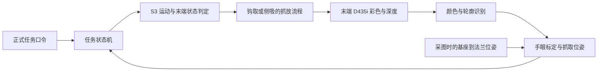

# 硬件与传统视觉方案

更新日期：2026-10-11。状态：按用户指定的 FSM Core v0.1 登记后续开发基线；已有仿真证据保留，尚无实机采集、标定、驱动联通或抓放验收结果。

本文区分用户确认、官方资料和工程建议。比赛事实沿用 [资料说明](../materials/README.md) 中的 RULES、FAQ、MAP 标识及 PDF 页码；新增来源同步登记在 [manifest.json](../materials/manifest.json)。

## 已确认配置与边界

| 项目 | 当前结论 | 来源 / 未确认部分 |
| --- | --- | --- |
| 机械臂 | 遨博 S3 | 用户 2026-09-06 会话，USER-HW-20260906；实机代次、控制柜、软件及 SDK 待核对 |
| 相机 | RealSense D435i，计划末端安装（eye-in-hand，眼在手上） | 型号来自 USER-HW-20260906；安装方式由 USER-HW-20260906-03 确认，具体支架、固件和连接环境待确定，安装完成状态未核实 |
| 技术路线 | 传统视觉 | 同上；具体算法和控制架构为下文工程建议 |
| 末端执行方式 | 方案一：钩取提手；方案二：吸盘侧面吸附；方案三：卡环 | 分别来自 USER-EE-20260906-01、USER-EE-20260906-02、USER-EE-20260906-04；三方案并列评估，候选不局限于这三种（USER-EE-20260923-02），具体工具与最终选用方案待实物验证 |
| 软件开发基线 | FSM Core v0.1，Ubuntu 24.04 / ROS 2 Jazzy / C++17 | USER-HW-20261011（用户会话“按照这个版本”）；固定仓库版本见 TEAMMATE-FSM-20261011，下文第 5 节区分上游完成范围和本项目接入缺口 |
| 计算平台 | 实机部署仍计划使用 NUC；实际安装版本待核验 | USER-HW-20260923-03、USER-HW-20260923-04 确认原生 Ubuntu / NUC；当时选定的 Ubuntu 22.04 / Humble（USER-HW-20260923-02）保留为历史，后续开发目标按 USER-HW-20261011 更新。NUC 已到位（USER-HW-20260923-11），型号、USB 3、网口及新基线部署未核实。开发电脑用于开发、仿真并经 SSH 隧道远程查看 NUC（USER-HW-20260923-05、USER-HW-20260923-06、USER-HW-20260923-07）；ENV-LOCAL-20260906 的 WSL 观测不代表 NUC 环境 |
| 道具几何资料 | 带提手圆角盒体；名义底面 70×80、本体高 50、提手高出 30 | 用户提供 BATTERY-RENDER、BATTERY-DRAWING；单位暂按 mm 解释，设计图不等于实测，详见 [几何与抓取分析](battery-geometry.md) |
| 实施范围 | 按初赛固定工位设计 | 用户确认只做初赛、报名已完成（USER-RULE-20260923）；初赛底座不可移动（RULES p2；FAQ p1–2） |

遨博 2023-12-07 的官方发布前介绍明确列出 S3（3 kg）并说明 S 系列搭载 ARCS（AUBO-S3）。这可以作为型号与控制系统的历史参考；用户实机的额定参数、软件版本及适用接口仍须按铭牌和配套手册核对，不套用 i3、iS3 或其他 S 系列机型参数。

用户先确认相机计划末端安装（USER-HW-20260906-03），后选择钩子（USER-EE-20260906-01），又新增方案二吸盘侧吸（USER-EE-20260906-02）和方案三卡环（USER-EE-20260906-04）。三种工具共用传统视觉与任务判定框架。相机保持眼在手上的方式，建议固定在法兰转接件或工具固定座。此前“没有夹爪”保留为历史设备状态；具体末端硬件是否已有仍待核对。

## 末端设计与推进顺序

先在本机准备图像采集与离线颜色识别，同时核对实物、S3 法兰与三种末端方案。每套工具分别标定 TCP：钩具记录承托参考点及钩尖偏移；吸盘记录接触中心、法向及工作压缩量造成的偏移；卡环记录卡持参考面、环轴线及锁止位置。相机支架固定后完成手眼标定；更换工具后重标工具 TCP，相机相对法兰的安装关系改变时重做手眼标定。实机验证以所选工具和电池到位为条件。

尺寸图给出提手下方名义净高 20、横梁前后厚度 26、竖向高度 10，开口宽约 50 依赖立柱对称推算（BATTERY-DRAWING，暂按 mm）。建议先评估固定被动钩从前/后方水平穿孔、上抬托住横梁，再通过落台卸载、下降清出钩尖、水平退钩完成释放。穿孔部分的完整包络须小于实际开口并留余量，不能只检查杆件厚度；具体可逆条件、材料与承载待验证，详见 [钩取几何与流程](battery-geometry.md)。

侧吸方案拟接触本体的 70×50 或 80×50 竖直侧面，数值是图示外包络，实际可密封面须扣除圆角等不可用区域（BATTERY-DRAWING，单位暂按 mm）。需配置与实物匹配的吸盘、支架、真空源、吸附/泄压阀、管路和真空反馈；不假定 S3 已有供气或兼容的电气接口。先验证气密性、切向抗滑、偏心力矩及落台泄压后的撤离，再接入机械臂。结构与受力示例、两方案取舍依据见 [末端两方案与侧吸设计](end-effector-options.md)。

卡环方案拟用环形件套入或卡住提手横梁/本体指定部位；卡持对象、环内尺寸、开口或闭合方式、锁止和释放动作均未确定。先以实体样件验证套入扫掠、承载、防脱、对电池干涉和落台脱离，再确定是否需要电动开合。该方案的几何与接触物理不纳入当前仿真接触范围。

当前终端环境来自只读系统检查，仅代表本次工作区运行环境，不等于已确认的最终设备控制环境。后续应先验证 D435i 在所选运行环境中可枚举和采集，再固定依赖版本；尚未进行相机采流或机器人连接。

2026-09-06 本机只读盘点（ENV-LOCAL-20260906）：`/usr/bin/python3` 为 Python 3.10.12，当前解释器的包元数据可见 NumPy 2.2.6、opencv-python 4.13.0.92，未找到 opencv-contrib-python 和 pyrealsense2。`lsusb` 无设备输出且退出码为 1，因此此次检查未能枚举相机；这不证明 Windows 主机未连接相机。该检查未导入视觉/设备库，包元数据存在也不等于已通过运行验证。

## 建议架构

按已确认的末端安装，建议采用“末端相机到观察位停稳采图 + 颜色分割 + 深度与手眼标定定位 + 状态机抓放 + 放后复核”。相机随机械臂运动，每次采图都要关联当时的末端位姿。

这一路线的适用性是工程判断：初赛目标颜色可区分、工作台固定，适合先用可解释的颜色与几何处理验证闭环（任务依据：RULES p2–3；FAQ p1）。初版在动作前后重新观察，不等同于运动过程中连续更新速度的视觉伺服；实际申报类别需结合组委会口径确认（FAQ p3，Q10）。

### 1. 相机布置与采集

- 建议把 D435i 刚性固定到法兰转接件或工具固定座，保持相机相对法兰的位姿恒定。支架设计需核验钩具进退或吸盘侧向接近路径、视线遮挡以及线缆/真空管走向；不把相机固定到吸盘的柔性或活动部分。
- 设置初始区观察位和放置区复核位；机械臂到位停稳后采集新帧，记录对应法兰位姿，避免使用移动前缓存的图像。若单一观察位无法覆盖所需区域，可分区观察并统一转换到基座坐标系。
- 官方 D435i 页面列出彩色视场约 69°×42°、深度视场约 87°×58°，最大分辨率下最小深度距离约 28 cm。布置须按彩色与深度的共同有效视野核验，不能仅凭深度视场估算覆盖。（RS-D435I）
- 观察距离根据当前要覆盖的区域、深度有效范围、支架偏移及 S3 可达姿态确定。若尝试正俯视单帧覆盖整张 700×540 mm 底图（MAP p1–2，PDF 页面尺寸），按上述彩色视场估算的桌面距离下界约为 0.70 m；该条件推算不代表 S3 能到达该观察姿态，也不是本方案必须采用的距离。可改用分区观察，实际仍需给电池高度、画面边缘和安装误差留余量。
- 观察位与最终抓取位分别验证。下探时若目标进入深度近距无效区，使用已在有效观察位确认的基座坐标完成经过验证的接近动作，不使用无效深度继续修正位姿；需要再定位时先回到有效观察距离。
- 用实物调好补光、曝光和白平衡，参数稳定后保存。采集彩色、深度、时间戳、实际流模式、内参、深度单位及对应法兰位姿；初版用停稳采图，不依赖 IMU 提供末端定位。

### 2. 颜色与形状识别

- 建议以 OpenCV HSV 阈值分割起步，阈值由实物样本确定；红色需考虑色相环绕。使用 ROI、形态学处理、连通域/轮廓及实测尺寸筛选候选，排除底图文字、色块、反光和阴影。（方法参考：CV-HSV、CV-SHAPE）
- 输出颜色、轮廓、像素中心、可观测方向与质量标记。接近圆形或对称的轮廓不能强行给出可信朝向；进钩或侧吸方向须结合物体姿态与周围通道决定。
- 用主体圆角外轮廓与提手横梁方向共同估计朝向，沿前后方向选择有空间的孔口侧进钩；必要时增加斜视观察位确认孔口（BATTERY-DRAWING，工程设计）。渲染图的黄色不用于设置实物颜色阈值。
- 侧吸时在主体上选择可接近的侧面，输出接触点、侧面法向及密封区域质量。增加可见该面的斜视观察位，或由经实物核验的几何模型推算；正俯视图不能直接证明竖直侧面平整气密，密封能力须通过实物试验确认。
- 连续多帧确认后再选择目标；颜色歧义、遮挡严重、多个候选无法区分时重新观察。抓错颜色有扣分，因此不能仅凭初始位置代替颜色判断。（RULES p4；FAQ p5）

### 3. 定位、标定与误差

- 标定相机到法兰的固定变换 `T_flange_camera`。建议将标定板固定在工作台上，采集多组不同末端位置与朝向的图像/机器人位姿；用标定板到相机、法兰到基座的成对位姿求手眼外参。OpenCV `calibrateHandEye` 的 `gripper2base` 输入在此使用法兰坐标，输出 `cam2gripper` 对应相机到法兰；必须核对变换方向，采样应包含绕不平行轴的转动。（CV-CALIB）
- 用未参与拟合的观察姿态和测量点验证：同一固定目标经不同末端观察位变换后应得到一致的基座位置，并与独立实测坐标比较。另行标定桌面坐标及每套工具 TCP/几何偏移，不能只凭图像重投影误差认定抓取定位合格。
- 深度先与彩色建立对应关系，使用当前帧匹配的内参、畸变模型和深度单位反投影，再变换到基座坐标。不要直接用彩色像素索引未对齐深度，也不要混用两路内参。（RS-ALIGN、RS-PROJECTION）
- 在目标表面内部取有效深度，排除零值、边缘混合像素和离群点；可由有效点拟合表面或作稳健统计。结合已核验的物体模型与工具包络求进钩/承托或侧吸接触位姿，表面点不自动等于工具目标点。
- 按新尺寸图的毫米解释，本体顶面和横梁顶面分别高于底面 50 和 80，横梁下沿由 80−10 推算为 70。应分开提取两层可见表面的深度，以实测开口和钩尖包络求穿孔高度；未直接看到的横梁下沿须标注为模型推算，不能将整个同色区域的单一中值当作进钩高度（BATTERY-DRAWING）。
- 侧吸使用本体竖直侧面的法向和接触高度，不套用横梁的 70/80 高度；平面拟合须有足够的有效侧面点，并排除圆角和边界混合深度。吸盘压缩、滑移会改变物体相对工具的位姿，须在台架和实机试验中标定与复核。
- 桌面单应性可定位底图上的目标区，但相机移动后不能继续套用旧观察位的单应性，也不能把有高度的电池顶面像素当成桌面点。深度质量不足时，只在实测高度、摆放姿态已知且通过验证的条件下，用当前位姿的视线与物体平面求交；条件不满足则重新观察。
- 本方案使用齐次点变换 `p_base = T_base_flange(t) * T_flange_camera * p_camera`，约定 `T_A_B` 将 B 系坐标转换到 A 系；`camera` 必须与反投影使用的相机光学坐标系一致。机器人位姿与图像应按已核对的时钟关系配对，初版在停稳后取新帧与稳定的位姿反馈；不能把不同设备的原始时间戳直接视为同一时钟。统一内部长度与角度单位，由适配层转换到实机接口约定。
- 放置精度由视觉定位、外参、TCP、机械臂定位及工具相关误差共同决定。钩具需考虑挠度、摆动和脱钩拖动；侧吸需考虑压缩、滑移、倾斜和释放残余吸力。两方案均在落台、工具完全脱离后重新观察实际电池足迹，不能只根据末端位置或朝向判定入框。

新尺寸图已给出主体俯视外包络 70×80 和本体圆角 R8（BATTERY-DRAWING，暂按 mm 解释），与底图电池 7×8 cm 注记对应；内圈仍按 MAP p2 的圆形示意和 8×8 cm 注记建模。以直立圆角盒体投影、直径 80 mm 内框计算，居中覆盖率约 85.93%，高于下述 70% 门槛。该值是理想几何推算，尺寸图单位、实物姿态及有效边界仍需核验；轴向偏移计算和使用限制见 [几何分析](battery-geometry.md)。

用户已确认此前“垂直投影70%”的含义、适用于内框，并说明来自组委会答复（USER-RULE-20260906-02，用户转述）。项目据此采用内框判定 `r_inner = Area(B ∩ I) / Area(B) ≥ 0.70`：`B` 为电池主体在底图平面上的完整垂直投影，`I` 为对应内框区域，分母为电池主体总投影面积。来源是用户转述的组委会答复，原答复载体尚未归档；与 RULES p4“完整位于内框内”的历史差异保留在 Q15。70% 适用范围已确认，方案按此推进。

工程上先把电池几何和内框放到同一桌面坐标系，再计算投影交集；末端相机的透视图像中，可见色块像素占比不自动等于主体垂直投影面积占比。对遮挡、反光造成的不完整轮廓，结合实测物体几何恢复足迹或重新观察，不能直接用残缺色块缩小分母。摆放位姿与定位容差按 70% 覆盖条件计算，并同时满足外框的完整入框条件。

放后复核分别记录内框投影覆盖率、外框完整包含结果、颜色、位次和释放稳定性。内框采用 `r_inner ≥ 0.70`，外框仍按主体完整位于框内（RULES p4），T0 仍按主体位于 T0 内及稳定释放（RULES p3）；内框的 70% 阈值不扩展到后两项。工程目标应给覆盖率留出测量误差和释放滑移余量，具体余量根据实测误差确定。

### 4. 抓放与任务执行

三方案采用相同的任务口令、观察和释放复核，抓取与释放阶段按工具分别执行；下表为工程建议，尚未实现控制程序。

| 阶段 | 建议动作与完成条件 |
| --- | --- |
| 准备 | 读取当轮颜色/序列口令，核验标定、工作空间、机器人状态与工具固定情况；侧吸另检查真空源、阀及反馈。正式顺序不得写死为文档示例（RULES p3；FAQ p5） |
| 观察 | 末端相机到达有效观察位，停稳采集并配对法兰位姿；把目标转换到基座坐标后确认有效性 |
| 接近与接合 | 方案一：到孔口外预备位，在满足完整钩尖包络的高度水平穿入，确认越梁且不撞本体。方案二：到所选侧面外预备位，沿法向以经验证的小压缩量接触，建立真空，达到实测设定的阈值并稳定保持后续步（几何依据：BATTERY-DRAWING；流程详见末端方案） |
| 承载与试提 | 方案一：上抬承托横梁再试提。方案二：真空确认后小幅试提并持续监测。方案三：确认卡环套入/锁止后小幅试提。三方案均以视觉确认电池离台、随工具运动且无明显滑移，状态不明不继续搬运；不能仅凭卡环状态或真空读数认定带起电池。基础任务包含离台稳定 2 秒（RULES p3–4） |
| 搬运与落台 | 基础任务放入 T0；序列任务按口令依次放入 P1–P3。根据实测摆动或吸附承载约束限制运动，检查工具、电池及已放电池空间；目标位须预留所选工具的撤离通道（RULES p3；工程路径建议） |
| 卸载与释放 | 方案一：落台后下降卸载，确认钩尖低于横梁下沿且舌底不撞本体，再水平退钩。方案二：落台承重后切断抽气并受控泄压，确认残余吸力释放，再沿侧面法向撤离，避免拖动或带倒电池 |
| 释放复核 | 工具完全脱离后退至复核位，停稳采图并更新位姿变换；观察至少 3 秒，分别核验颜色、目标位、稳定性和对应区域条件。序列内框按电池主体垂直投影覆盖率 ≥70%，外框按完整入框；基础任务按 T0 原文条件。序列任务随后更新场景再取下一块（RULES p3–4；内框口径：USER-RULE-20260906-02） |
| 异常 | 相机数据过期、控制器报错、目标丢失、真空不足或抓取状态不明时不续接下一搬运段，按已验证的停止/就近落台策略处置并记录原因；不得在悬空时主动泄压。重新观察与重试次数应有上限 |

末端负载应计入 D435i、相机支架、所选工具、转接件、末端附加真空组件、线缆/管路及电池，并核对重心和力矩约束。电池单块 200–250 g 来自 FAQ p5；该重量不足以证明钩具/提手强度或吸盘侧向动态承载可用。工作空间检查须包含 TCP 姿态、关节限制、工具完整包络、物体摆动/变形范围及线缆与管路余量。

### 5. 软件组织与验证顺序

2026-10-11 用户在提供仓库链接并获知环境差异后回复“按照这个版本”（USER-HW-20261011，用户会话）。后续开发采用 **F1u0rite/meituan_challenge_ws 的 FSM Core v0.1，Ubuntu 24.04 / ROS 2 Jazzy / C++17**。初次审阅锁定到 `main` 提交 `f477f689bb3e3d2a28437a3984458ec43e950c70`；其中第一阶段合并提交为 `c2be85724111f6fb4dfcc62a2c974f7be1233cba`。源码取得方式见 [版本锁定与接入入口](../robot/README.md)。2026-09-23 的 Ubuntu 22.04 / Humble 决策保留在 USER-HW-20260923-02、USER-HW-20260923-04 的后续澄清链中；本次没有核验或升级 NUC。

**SDK 资料更新后的当前快照**：用户随后提示“repo已经补充SDK”（USER-HW-20261011-04）。已核对 `main@1d940f7c5f12561fed6641457c0b4b630a282b05`，仅新增 `docs/setup/AUBO_ROS2_DRIVER_JAZZY.md` 并修改 README，未改 FSM 或接口源码；当前源码锁定随此文档更新推进，初始提交和测试来源继续保留。新增资料登记于 TEAMMATE-SDK-20261011（2026-10-11 查阅），[部署手册](https://github.com/F1u0rite/meituan_challenge_ws/blob/1d940f7c5f12561fed6641457c0b4b630a282b05/docs/setup/AUBO_ROS2_DRIVER_JAZZY.md)及本项目 [SDK/驱动复现入口](../robot/README.md#sdk-与-jazzy-驱动资料已核对)已可用于系统集成交接。

**版本证据**：TEAMMATE-FSM-20261011（2026-10-11 查阅）登记 [固定版本 README](https://github.com/F1u0rite/meituan_challenge_ws/blob/f477f689bb3e3d2a28437a3984458ec43e950c70/README.md)、[最终离线验收报告](https://github.com/F1u0rite/meituan_challenge_ws/blob/f477f689bb3e3d2a28437a3984458ec43e950c70/docs/migration/CPP_FSM_FINAL_SAFETY_GATE.md)和[第二阶段计划](https://github.com/F1u0rite/meituan_challenge_ws/blob/f477f689bb3e3d2a28437a3984458ec43e950c70/docs/migration/PHASE2_ROS2_INTEGRATION_PLAN.md)。仓库根许可证为 MIT；本次仅审阅源码并登记引用，没有复制实现。上游报告的 318 项 C++、269 项 Python、15 项纯 Python Mock E2E，现已在本项目独立 Ubuntu 24.04 / Jazzy 容器复跑通过，12 包构建成功（ENV-FSM-20261011，见[阶段验收](fsm-acceptance.md)）；TSan 动态竞态验收仍未完成。旧 Python ROS 节点仍在仓库中，不能将其存在写成新 C++ Action 外壳已完成。

四个 C++ 核心包 `mtc_core_cpp`、`mtc_task_cpp`、`mtc_manipulation_cpp`、`mtc_motion_execution_cpp` 已由上游交付；核心逻辑不依赖 `rclcpp`，但构建仍使用 ament。采用以下接口组织本项目的后续接入，状态均为**待实现 / 待验证**：

| 基线接口或模块 | 本项目接入内容 | 必须验证的边界 |
| --- | --- | --- |
| `TaskFsm` → `PickPlaceFsm` | 将正式口令传入基础任务或三块序列任务 | T0 / P1–P3 与颜色映射；示例顺序不写死；并发任务拒绝和故障锁定 |
| `PerceptionPort` | 适配现有 RGB-D 检测、采图时 TF 与放后复核 | 6D 位姿、坐标系、时间戳和新鲜度；已有抓前定位不能冒充持续的挂载/落座/释放证据 |
| `PlannerPort` | MoveIt 2 规划接近、搬运和撤离 | S3、相机、工具及电池碰撞几何；规划输出确实进入执行；失败时拒绝默认目标 |
| `MotionPort` / `MotionExecutorCore` | 通过 ROS 2 Action 向 `FollowJointTrajectory` 提交整条时间参数化轨迹 | 单在途命令、按命令 ID 取消、独立停稳证据、超时或反馈未知后禁止自动重发 |
| `ToolPort` / `ToolStrategy` | 按最终工具实现接合、承托、卸载和释放反馈 | 上游被动钩 V1 / 电磁解锁 V2 是软件策略；不据此认定本项目已具备电磁机构，侧吸和卡环也不能直接套用 V2 |
| 放置结果与本项目评测 | 用独立观测核验颜色、位次、稳定性、外框和内框 | 沿用本项目赛事口径；Mock 的 `placement_verified` 不替代实际视觉或物理证据 |

坐标接入须先核对本项目 `flange` 与上游设计中的 `tool0`、`hook_tcp` 的定义，不能按名字直接等同。上游 `ring_frame` 轴向仍是提案，数值 TCP、工具负载与工位参数待标定（TEAMMATE-FSM-20261011 的 TF 约定）。原有三类末端及开放候选范围继续按 Q03 处理；吸盘不做真空接触仿真的约定继续有效。

| 软件推进顺序 | 可检查的产物 | 当前状态与验收重点 |
| --- | --- | --- |
| 1 | 固定提交的 Jazzy 独立工作空间与离线回归记录 | `PASS`：独立 Jazzy 容器完成 12 包构建、318 C++ / 269 Python / 15 Mock E2E；日志与环境见 ENV-FSM-20261011，不外推到 NUC |
| 2 | C++ Task / PickPlace / Motion 的 ROS 2 Action 外壳 | 未实现；核对现有接口、错误码、状态发布来源和取消传播；FSM 事件串行推进 |
| 3 | MoveIt `PlannerPort` 与完整轨迹执行适配 | 未实现；确定轨迹传递接口，一条轨迹一个 Goal，禁止拆为多次单点命令 |
| 4 | `ros2_control` Mock Hardware 的规划—执行闭环 | 上游手册已报告独立 GenericSystem、FollowJointTrajectory、MoveIt Plan → Execute 的历史成功（TEAMMATE-SDK-20261011）；本项目现已复现独立 Fake 控制器、关节/TF、单点/多点轨迹到位（ENV-FSM-20261011）；MoveIt 及 FSM 完整接线仍未验证。取消确认、反馈断流、超时、并发拒绝及 V1/V2 的完整运行链路仍待核对 |
| 5 | 本项目 RGB-D、场景与放置评测接入 | 未集成；单块 T0 后三块序列；模拟感知与真实相机输入分别标记；另行确定 Gazebo 迁移方式 |
| 6 | NUC、控制柜、相机与实体工具联调记录 | 未验证；按 Q02–Q05、Q17 核实实际设备与标定后开展，Mock 成功不计为实机验收 |

阶段 2–4 对齐上游第二阶段计划；该计划含第一轮测试计数和旧审计待办，具体接口以固定提交源码、最终验收报告核对后落地。基线登记轮次只整理计划；本轮阶段验收已复跑离线核心并启动现有 Python Mock，发现 Task/PickPlace 启动故障（ENV-FSM-20261011）。第二阶段新 C++ 外壳及 Humble / Classic 迁移仍未完成。

设备选择仍沿用已确认项：S3 用 `aubo_ros2_driver`（USER-HW-20260923-08，AUBO-ROS2），D435i 用 realsense-ros（USER-HW-20260923-09，RS-ROS2），规划用 MoveIt（USER-HW-20260923-10）。此前 Humble 驱动的 `85684075` 记录只对应旧检查。新增资料已明确 Jazzy 驱动 `53aab83735236f0c262ecb11e04ef2600241d9d9`、模型子模块 `47fa5e02…` 与 Fake Xacro 修复；官方 CMake 的 SDK 构建依赖仍为 `aubo_sdk-0.24.1-rc.3-Linux_x86_64+318754d.zip`（TEAMMATE-SDK-20261011，手册 §01–02 及官方 CMake 核对）。本轮已在独立容器通过构建下载 SDK、记录包 SHA-256 并核验库链接（ENV-FSM-20261011）；厂商独立校验值、许可、NUC 部署和控制柜兼容性仍待核实。视觉可保留 Python / OpenCV 实现，通过适配接口接入 C++ FSM；真实流的对齐、编码和单位仍须以 NUC 观测核验。

厂商 ARCS SDK 文档提供 RPC 运动调用及 RTDE 状态订阅等能力（AUBO-SDK），可作为两方案的运动控制候选接口。该文档不证明用户控制器已经支持某个 SDK 版本或真空设备接口；固定被动钩候选本身无需开合通信。

| 顺序 | 可检查的产物 | 验证重点 |
| --- | --- | --- |
| 1 | 设备与实物测量记录、S3 对应手册、两工具台架记录 | 钩取核验孔口、承载和脱钩；侧吸核验可密封面、真空建立/保持、抗滑及力矩和泄压释放；记录各工具 TCP、支架、总负载与接口版本 |
| 2 | 彩色/深度样本、颜色配置和检测叠图 | 停稳采图及位姿配对，四块实物颜色识别，反光/遮挡时的拒识，深度有效率；先离线回放 |
| 3 | 手眼外参、TCP 记录和独立验证误差表 | 多个末端观察姿态下的基座定位一致性与绝对误差，全工作区覆盖、目标高度、坐标轴与单位 |
| 4 | 三方案分别抓放单块到 T0 的连续实验记录 | 分别记录接合、试提、落台、释放成功情况、放置误差、耗时及摆动/滑移/卡环回差/拖动/掉落原因；先验证空载路径再逐步接入实物，依据结果决定最终工具 |
| 5 | 可配置序列任务和放后复核日志 | 按不同测试口令完成三块摆放，分别记录颜色位次、外框完整包含、内框投影覆盖率及 ≥70% 判定、稳定性和耗时 |

测试口令只是调试输入；正式口令由组委会公布（RULES p3；FAQ p5）。每次实验记录软硬件版本、标定版本、口令、时间戳、候选目标及失败原因。重复次数与精度门槛在实物容差明确后制定；目前不声称达到任何成功率或毫米级精度。

### 6. 用户负责的 Web UI

**已确认分工**：用户先回复“Web UI”（USER-HW-20261011-02），提供 v2 任务书后进一步明确“系统集成与验收，兼做 Web UI”（USER-HW-20261011-03，2026-10-11 用户会话）。当前主责见第 7 节，本节保留兼任的界面工作。以下为基于第 5 节固定版本的工程拆分；用户现已选择开发新版操作台（USER-HW-20261011-06），早期完成本地 Mock 版本（DEMO-WEBUI-MOCK-20261011）。用户随后澄清“我要的是实机操作台”（USER-HW-20261011-07），当前默认实现 rclpy 实机客户端，Mock 改为显式选项；真实设备联调跟踪 Q19。界面实现与交互、接口对接和前端验收由此规划；FSM/Action 内核、视觉识别、轨迹规划分别由任务书中的模块负责人交付。

**可复用基础**：本仓库 [浏览器监控台](../demo/README.md#浏览器监控台) 已有 HTML/JavaScript 页面和 Python/aiohttp 后端，可显示 ROS 图与进程、MJPEG 相机流、PTY 终端及 `outputs/` 录像。静态核查见 DEMO-WEBUI-20261011（2026-10-11，本机源码观测）：`/api/status` 尚无业务任务状态，`/api/recordings` 仅列出 MP4 文件，`/ws/term` 是终端通道，尚无 FSM 任务 API。该次静态核查未运行页面、ROS 节点或 NUC；旧代码的存在不代表 Jazzy 联调已通过，原有代码的作者与 AI 披露继续保留。

**当前交付**：[启动与 HTTP 契约](../webui/README.md)、[实现与验证](web-ui.md)。默认 ROS 模式提供真实 Action Goal/Cancel/Result、RequestStop、带来源/时间戳的 Task/Robot/ToolState、关节、RGB-D 和日志。默认核对 `/mtc_aubo_bridge` 且话题必须只有一个发布端，多个来源时禁用数据；设备缺失/过期或 simulation_mode=true 时禁止实机 Goal。33 项离线/HTTP 与 9 项实际 Jazzy ROS fixture 检查通过（ENV-WEBUI-ROS-20261011）；NUC 与完整上游 FSM 联调尚未完成，隔离测试与旧本地 Mock 证据分开。

| Web UI 工作项（工程建议） | 页面内容与交付要求 | 现有基础与缺口 |
| --- | --- | --- |
| 任务总览与口令 | 显示任务 ID、基础/序列模式、输入的颜色顺序、T0 或 P1–P3、当前对象、主/子状态与完成数量；口令可配置，正式值以比赛日通知为准（RULES p3；FAQ p5） | 真实 Action 客户端已实现，进度仅来自反馈/TaskState/Result；上游整体任务与实机待验 |
| 设备与工具状态 | 分别显示通信、就绪、运动、停稳确认、工具状态、独立验证与证据等级；标明数据来源、更新时间和运行模式 | 真实业务字段与来源/GID、采样龄期已接入；缺失或过期显示未知，实机来源仍须现场核对 |
| 相机与观察 | 彩色/深度画面切换、连接状态、帧率与画面更新时间；若叠加检测结果，须匹配图像帧与时间戳 | 新版 ROS Image/CompressedImage 观察已接入，支持自动发现唯一相机与显式配置；深度伪彩仅供观察，真实编码/单位/标定与检测叠图待验 |
| 日志、结果与回放 | 按任务 ID 查看事件时间线、错误码与原因、完成位次、最终结果及关联录像；保留失败记录 | 按真实 task/goal ID 关联事件/Result 与 JSON/JSONL，接收 ROS 日志；任务录像关联仍待补 |
| 提交与取消交互 | Mock 环境下验证口令输入、提交中、受理/拒绝、执行反馈、取消等待及终态；防止重复点击与重连重发 | 已实现真实任务提交/精确 Goal Cancel 与软件停止回执；提供 --readonly。SSH 隧道沿用 USER-HW-20260923-07；本轮未执行实体运动（USER-HW-20261011-07） |

**接口对接**：下表来自 TEAMMATE-FSM-20261011 的固定提交（查阅日期 2026-10-11），依据 [接口定义](https://github.com/F1u0rite/meituan_challenge_ws/tree/f477f689bb3e3d2a28437a3984458ec43e950c70/src/mtc_interfaces)与现有 Python 节点的默认名称；这些不是已经提供给浏览器的 HTTP/WebSocket 地址，也不证明新 C++ Action 外壳已实现。

| ROS 接口与默认名称 | 提供给界面的信息或动作 | 对接约束 |
| --- | --- | --- |
| `TaskState`：`/mtc/task/state` | `task_id`、`state`、`substate`、`completed_count`、`total_count`、`last_error_code`、`detail`、消息时间戳 | 作为可重取的任务快照；前端不自行推进 FSM，不用计时器推算完成数 |
| `ExecuteTask`：`/mtc/task/execute` | Goal：`task_id`、`mode`、`ordered_colors`、`timeout_ms`、`placement_stability_sec`；Feedback：`current_index`、`total_count`、`state`、`substate`、`current_slot`、`current_object_id`；Result：`success`、`completed_count`、`completed_slots`、`error_code`、`message` | 桥接保存 task ID 与 Action goal ID 的关联；受理、执行、终态分开显示。稳定时长参数须符合赛事口径，不能由界面任意缩短 |
| `RobotState`：`/mtc/robot/state` | `communication_ok`、`robot_ready`、`motion_active`、`safety_normal`、`stop_confirmed`、`simulation_mode`、`controller_mode`、`detail` | 现有 motion executor 与 aubo bridge 均定义该话题发布端，联调须确定权威发布源；不能混用两个来源的状态。单个 `simulation_mode` 布尔值不足以区分离线回放、Mock 与物理仿真 |
| `ToolState`：`/mtc/tool/state` | `state`、`evidence_level`、`verified`、`tool_type`、`object_id`、`detail` | 工具估计状态与独立验证分开显示；UI 不把 `ATTACHED` 或命令送达解释为已验证抓起 |
| Action Cancel；`RequestStop`：默认 `/mtc/bridge/request_stop`，可配置运动层 `/mtc/motion/request_stop` | 按当前 goal ID 取消任务；软件停止请求的 `reason`、`request_delivered`、`message` | 新版已增加单独软件停止入口；`request_delivered` 不是停稳证据，需另看 `stop_confirmed`；软件停止不标为实体急停 |

建议由 **Web/ROS 桥接**适配以上接口并提供快照与事件流，浏览器负责展示与输入。桥接还需约定连接状态、明确的运行模式、状态来源、接收时间/数据龄期、可执行操作，以及按任务关联的结果/文件索引；这些属于 Web 包装层的数据契约，不能写成已有 ROS 字段。本轮采用原生页面与 HTTP 快照轮询，新增 v1 Web 契约见 webui/README.md；当前 rclpy 桥接按该契约实现，时间戳、发布源和 Action 生命周期以隔离测试验证；真实设备仍需联调确认。

刷新或断线重连后先重新获取当前任务快照与可用操作，不自动重发任务或取消请求；迟到反馈按 task/goal ID 归属，不能覆盖另一任务。相机断流应显著标记画面过期。新的任务 API 不借用 PTY 输入执行 shell 命令。NUC 访问继续使用 SSH 隧道，--readonly 可禁用全部写操作。当前实机控制入口属于 USER-HW-20261011-07 要求的开发范围；未在实体设备执行运动或把 UI 验证当实机验收。

| 交付顺序 | 可检查产物 | 当前进展与验收边界 |
| --- | --- | --- |
| 1. 页面与数据契约 | 任务、设备、相机、日志/回放页面；字段映射；Mock 样例 | 早期 Mock 场景保留；当前默认 ROS，真实相机客户端已实现，录像待接 |
| 2. 只读联调 | Web/ROS 桥接适配及状态、图像、结果记录接入 | 与同一时刻的 ROS 消息核对；验证断流、重连、旧消息与任务切换；核对唯一状态来源 |
| 3. 任务交互验证 | 在隔离 ROS 测试发布器环境提交/取消任务的浏览器操作记录 | 验证非法口令拒绝、重复提交拒绝、超时、取消传播和独立停稳确认；界面终态与后端结果一致 |
| 4. 交付说明 | 启动/连接配置、接口约定、故障显示、测试记录、截图与版本信息 | 新增依赖锁定版本与许可证，保留 AI 协助范围；NUC/Jazzy 与实体设备结果单独记录，不以 Mock 通过替代 |

### 7. 系统集成与验收主责

**依据与分工**：SPRINT-PLAN-20261011 为用户提供的《10 月 11 日晚五人冲刺分工任务书》v2.0，原件见 [归档任务书](../materials/original/美团挑战赛_1011晚五人冲刺分工任务书_v2.md)，以下按 §01、§06–10 引用，无 PDF 页码。任务书列张叔阳主责 System Integration & Validation；用户进一步确认**系统集成与验收，兼做 Web UI**（USER-HW-20261011-03），因此保留第 6 节的界面工作。任务书写的是待交付目标，本节没有将目标记为运行结果。

| 对接人 | 任务书分工与提供给集成的材料 | 张叔阳的接收与验收边界 |
| --- | --- | --- |
| 孙嘉明 | C++ FSM、ROS 2 Action、Motion Execution；Goal/Feedback/Result/Cancel 证据，驱动部署 SOP，接口最终裁决 | 核对实际节点实现与调用链，记录拒绝、异常、取消和停稳结果；问题回交负责人，集成层不接管 FSM/Action 内部状态转换 |
| 常建烁 | MoveIt 2 规划；完整时间参数化轨迹、关节顺序、配置版本及 `PlannerPort` 映射 | 核验输入/输出与执行接线，保留轨迹文件和失败原因；规划算法由常建烁负责 |
| 孙浩然 | 四色检测、稳定 object ID、`BatteryDetectionArray` 发布/回放及位姿有效性说明 | 核对 `/mtc/perception/batteries` 的实际类型、QoS、时间戳与有效性；未观测到的话题保留为约定名称，不标为已上线 |
| 韩明赫 | `TF_AND_CALIBRATION_HANDOFF.md`、坐标链、已测/待测表、验证命令与现场采集顺序 | 核对真实 frame、时钟与 m/rad 单位，检查变换缺失时的拒绝行为；不把估计值或示例外参写成标定完成 |
| 张叔阳 | 系统启动与验证、日志与问题单、视频/报告材料；兼做 Web UI（用户补充） | 统一复现入口与证据归档，组织模块交接及故障分派，界面服务于集成观察与记录 |

**P0 交付清单**（SPRINT-PLAN-20261011 §06、§08）：任务书要求 2026-10-11 22:30 提供产物、实际结果、复现命令和 Git commit。以下为当前计划与证据缺口；没有执行的检查统一写 `NOT RUN`，运行失败写 `FAIL` 并保留日志。

| 编号 | 张叔阳需交付的产物 | 验收证据与当前状态 |
| --- | --- | --- |
| I01 | Ubuntu 24.04 / Jazzy 工作空间的构建与离线检查记录 | 记录实际源码 SHA、环境、包清单、命令、退出码和日志；任务书以 12 包为检查起点。本轮独立 Jazzy 容器构建 12/12 包及 318 C++、269 Python、15 Mock E2E 通过；原始命令、退出码和 XML 见 ENV-FSM-20261011，不代替 NUC 验证 |
| I02 | Action / Topic / Node / TF 通信矩阵 | 原基线 3 个 Python 节点存活，Task/PickPlace 启动退出（ENV-FSM-20261011）。候选补丁 `1d3dccf…` 下 4 个节点存活，Task/Motion 服务器可用，PickPlace 因 B05 退出；逐节点服务器查询与 wait_for_server 已核对，不能把通用 Action 列表中的客户端当成服务器。Mock 无完整感知/TF，新 C++ 节点未交付；见 ENV-FSM-FIX-20261011 |
| I03 | 独立 Fake Hardware 的驱动复现记录 | 已从 `1d940f7…` 核对 `docs/setup/AUBO_ROS2_DRIVER_JAZZY.md`（TEAMMATE-SDK-20261011）；驱动/SDK 版本、Fake 修复和三终端 SOP 已提供。已在独立容器完成 5 包构建、两控制器 active、六关节/TF、单点与多点 FollowJointTrajectory；独立 Fake 范围 `PASS`（ENV-FSM-20261011）。MoveIt Plan → Execute 仍为 `NOT RUN`；上游参考目录保持只读 |
| I04 | Mock 启动/检查 SOP 或 `scripts/run_mock_smoke.sh` | 驱动/MoveIt 三终端 SOP 已由新手册提供（TEAMMATE-SDK-20261011）。原 Python Mock 因 B01/B02 启动失败（ENV-FSM-20261011）；本轮三项接线补丁和独立 overlay 命令已提交 PR，Task 可启动但 PickPlace 在 B05 退出，仍不能标为通过的整体 SOP；新 C++ FSM 整体启动待交付，见 ENV-FSM-FIX-20261011 |
| I05 | 基础任务 Goal 烟测记录与阻断问题单 | 原版 Goal 未发送（ENV-FSM-20261011）；候选补丁两次延迟基础 Goal 均已受理并保存 Feedback/Result，但此前 INIT 已超时进入 FAULT，返回 ABORTED / 510，完成数 0，整体仍为 FAIL。B01/B02/B04 已定向修复、待审阅；B03/B05/B06 由孙嘉明处理，见[补丁复验](fsm-wiring-fix.md)（ENV-FSM-FIX-20261011）。Cancel/迟到取消与停稳证据仍按模块交付验收 |
| I06 | 视频/报告准备清单和数据命名规范 | 核对官方纸质底图、电池、固定第三视角、计时与设备可用性，记录口令、版本和原始素材；要求同时准备视频与报告（FAQ p1–3）。清单字段见下文，实物和机位逐项检查 `NOT RUN` |

**版本与运行边界**：任务书要求从“最新 main”开始；初始快照 `f477f689…` 来自 USER-HW-20261011 / TEAMMATE-FSM-20261011，SDK 更新提示后的当前快照为 `1d940f7c5f12561fed6641457c0b4b630a282b05`（USER-HW-20261011-04、TEAMMATE-SDK-20261011）。本次差异仅为两份文档，已推进锁定并单独校验源码导入；本轮完成独立 Jazzy 构建/离线复跑，ROS Mock 启动失败另列（ENV-FSM-20261011）。后续接收模块时记录实际提交、代码差异、构建结果和接口变化；不能只写浮动 `main`，也不能把旧快照的运行结果外推到新代码。使用独立工作空间/输出目录，保留已有 `build/install/log`。

**接口变更与问题分派**：按任务书 §07，`mtc_interfaces` 和 C++ Core 公共接口的变更须列明字段、原因与影响方，由孙嘉明确认；各模块使用独立 feature 分支，测试后集成。统一启动、测试协调与 Web UI 对接由张叔阳推进，遇到 FSM 状态转换、Cancel 或运动执行内部错误，保留复现证据后交给孙嘉明。该流程是团队交接约定，本次没有代发群消息或代队长确认接口变更。

**本轮有限修复授权与交接**：用户回复“按照你的建议执行”（USER-HW-20261011-05），同意由集成侧提交 B01/B02/B04 小补丁，B03 和 FSM/Cancel 内核仍由孙嘉明负责。候选提交 `1d3dccf23c53d299d457564daeb6438190ea2d77` 已发布为 [PR #2](https://github.com/F1u0rite/meituan_challenge_ws/pull/2)，并请求仓库负责人 `F1u0rite` 审阅；尚未合并，正式基线未推进。两包构建、6 项 ROS 回归、269 Python / 15 Mock E2E 通过，新增 B05 ActionClient 与 B06 INIT 生命周期及退出观测已列入交接，完整任务仍失败（ENV-FSM-FIX-20261011）。

**Web UI 的安排**：先满足系统集成 P0，复用旧监控台承载连接状态、相机、任务反馈、日志和录像的观察入口；新增字段以接口矩阵为准。第 6 节的页面改造、桥接及提交/取消交互是兼任工作的工程建议，任务书没有把完整 Web UI 列为今晚 P0，不据此增加硬性交付。界面按钮不能绕过后端 Goal 所有权和取消语义。

**证据与拍摄准备**（目录/字段为工程建议）：每次运行可用 `outputs/integration-<时间>-<提交短号>/` 单独存放环境与源码版本、启动配置、graph、Goal/Feedback/Result、完整日志、结果摘要与问题单。每条问题至少有 `issue_id / 模块 / 负责人 / 复现命令 / 日志路径 / PASS|FAIL|NOT RUN / 解除条件`。实际完成后再按仓库约定冻结摘要、登记 index 与哈希，不能提前把空目录当成实验记录。

拍摄检查表逐项记录 **可用/缺失/未检查、检查人、时间、证据路径**：官方纸质底图、比赛电池与工具、固定第三视角、机械臂及底图/电池完整入镜、计时显示、开场口令及初始状态、连续原始录像、文件备份、技术报告与提交格式。画面和连续录制要求来自 FAQ p1–3；当前任务书的“10/15 提交”仅作为团队交付目标登记，官方准确截止时刻、平台和文件格式待 Q11 核实。

**时间节点与现场交接**（SPRINT-PLAN-20261011 §08–10）：10/11 的 18:00、20:30、22:30、23:00 为任务书中的基线确认、首次对接、交付和验收会节点，不代表已举行；10/12 先做设备/只读状态核验与标定，再按现场条件逐段验证基础单块到 T0；10/13 重复验证，条件具备后扩展序列；10/14 录像与报告，10/15 提交。任务书称“10/12 全部实物预计到位”，与 USER-HW-20260923-11 的“NUC/S3/D435i 已到位”在设备范围、地点和时点上尚未对齐，保留在 Q05，不据此改写旧记录。真实连接与运动仍需现场操作授权和监督，Mock/Fake 结果单独记录。

## 技术来源与使用说明

以下网页于 2026-09-06 查阅；网页参数不代替实机手册。此轮仅用于方案设计，尚未引入第三方实现代码，也未安装或锁定软件版本。

| 来源标识 | 官方来源 | 本项目用途 |
| --- | --- | --- |
| AUBO-S3 | [遨博 S 系列官方介绍，2023-12-07](https://www.aubo-robotics.cn/news-info/137) | S3 型号、历史负载与 ARCS 系统参考；不是实机验收规格 |
| AUBO-SDK | [AUBO SDK 功能模块](https://developer.aubo-robotics.cn/guide_sdk/2_sdk_function_module.html) | 候选运动控制与状态反馈接口，待实机版本匹配 |
| RS-D435I | [RealSense D435i 产品规格](https://www.realsenseai.com/products/depth-camera-d435i/) | 相机型号、彩色/深度视场及近距条件 |
| RS-ALIGN | [librealsense 深度对齐彩色 Python 示例](https://github.com/realsenseai/librealsense/blob/master/wrappers/python/examples/align-depth2color.py) | 采集、深度单位与对齐流程参考；示例标注 Apache-2.0，尚未复制代码 |
| RS-PROJECTION | [RealSense SDK 2.0 投影文档](https://github.com/realsenseai/librealsense/wiki/Projection-in-RealSense-SDK-2.0) | 内外参、坐标约定、深度反投影与单位 |
| CV-HSV | [OpenCV HSV / inRange 教程](https://docs.opencv.org/4.13.0/da/d97/tutorial_threshold_inRange.html) | 颜色分割方法参考 |
| CV-SHAPE | [OpenCV 轮廓与形状接口](https://docs.opencv.org/4.13.0/d3/dc0/group__imgproc__shape.html) | 轮廓和几何筛选方法参考 |
| CV-CALIB | [OpenCV 标定与三维重建](https://docs.opencv.org/4.13.0/d9/d0c/group__calib3d.html) | 相机标定、坐标几何与 `calibrateHandEye` 的 eye-in-hand 变换约定 |

生成式 AI 使用记录：2026-09-06 使用 OpenAI Codex 协助核对公开资料、整理本方案和同步项目文档；硬件信息来自用户与所列官方资料，工程建议尚待实物验证。后续实际引用代码时，记录仓库、版本/提交、许可证和修改范围。比赛允许相关工具但须说明和标注（FAQ p6，Q17）。

2026-10-11 使用 OpenAI Codex 协助静态审阅用户指定的 FSM 仓库、固定源码版本、登记用户决策并同步接入计划；随后按用户确认的 Web UI 分工，核对现有监控台与 ROS 接口并补充第 6 节。未在本项目复制上游实现、复跑其测试、实现新 UI/桥接、部署 Jazzy 或连接实体设备；本次源码观测范围与文件清单见 TEAMMATE-FSM-20261011、DEMO-WEBUI-20261011。

同日使用 OpenAI Codex 协助按原始字节归档用户提供的 v2 任务书（SPRINT-PLAN-20261011），登记“系统集成与验收，兼做 Web UI”的澄清，补充第 7 节的交付、对接与证据清单；未修改任务书原文。此轮为文档更新，表内 `NOT RUN` 项尚无本项目运行结果。

侧吸受力与真空控制的厂商技术来源另见 [末端两方案与侧吸设计](end-effector-options.md)，同样登记于来源清单；未将网页中的通用选型值视为本项目实测参数。

SDK 更新轮次：使用 OpenAI Codex 协助核对 `1d940f7…` 与官方驱动 CMake，核验归档补丁在临时目录可复现，推进源码锁定并补充 I03/I04。上游 Mock 日志仅按报告引用，本项目未构建、下载或运行 SDK，未连接设备（TEAMMATE-SDK-20261011）。

阶段验收轮次：使用 OpenAI Codex 在独立容器复跑构建与测试、采集实际 ROS graph 和失败日志；结果见 ENV-FSM-20261011。上面较早轮次的“未复跑”描述仅记录当时工作范围。

接线修复轮次：使用 OpenAI Codex 编写 B01/B02/B04 补丁与六项 ROS 回归、复跑原有 Python/E2E、执行两次实际 Mock 并提交 PR；证据见 ENV-FSM-FIX-20261011，保留原失败记录，未接管 FSM 状态转换或 Cancel 内核。

早期 Mock UI 实现轮次：按 USER-HW-20261011-06 使用 OpenAI Codex 编写独立 Mock 服务、页面、测试和契约，并执行浏览器 QA；见 DEMO-WEBUI-MOCK-20261011。未改 FSM 内核、旧监控台代码或已冻结实验，未连接 ROS/实机。

实机 UI 实现轮次：按 USER-HW-20261011-07 使用 OpenAI Codex 实现默认 rclpy 客户端、相机/关节/日志、启动配置与测试；ENV-WEBUI-ROS-20261011 区分本机/隔离 Jazzy 接口验证和未完成的实体设备验收。未修改 FSM、驱动内核或旧冻结证据。
