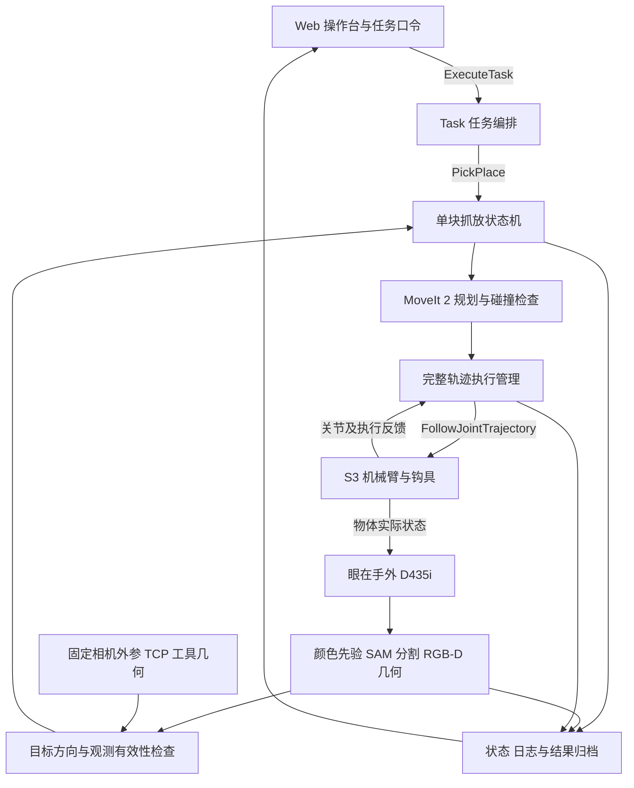

# 基于眼在手外视觉与定制钩具的电池自动抓取与序列摆放技术方案

2026 美团第四届低空经济与具身智能挑战赛 · 初赛技术方案（提交版）

参赛团队：【待填】　所属单位：【待填】

## 摘要

针对固定工位上的多色道具电池抓取与序列摆放任务，团队构建了由遨博 S3 机械臂、固定式 RealSense D435i RGB-D 相机、舌规式穿孔承托钩具和 Web 操作台组成的机器人系统。系统采用眼在手外感知方式，通过颜色先验引导 SAM 2.1 分割，结合深度与 CAD 几何估计电池顶部及提手孔中心候选，在核对目标方向、工具偏置和进入空间后生成抓放目标。

末端结构围绕电池提手进行定制设计。团队将舌宽、舌厚和上翘尺寸参数化，使用 PETG 3D 打印舌规检查穿入间隙、承托位置和退出空间，并将该打印舌规直接作为装机功能段，结合钩柄与法兰连接组成完整钩具。机械结构与“穿入—承托提升—搬运—落台卸载—退钩”动作协同，使抓取和释放均具有明确的几何条件。

软件基于 Ubuntu 24.04、ROS 2 Jazzy 与 C++17，以分层状态机组织任务，结合 MoveIt 2 规划和完整关节轨迹执行，实现单块搬运、三块逐次摆放及放后复核。系统根据实际观测和执行反馈推进任务，并将任务口令、运行版本、状态变化、日志和视频关联归档，形成可追溯的运行流程。

**关键词：** 眼在手外；RGB-D；PETG 3D 打印；舌规式钩具；SAM 2.1；分层状态机

## 1. 任务需求与技术目标

系统面向初赛固定工位任务，机械臂底座在运行过程中保持固定。基础任务根据颜色指令，将一块目标电池搬运至 T0；序列任务根据当轮口令，将三块目标电池依次放入 P1、P2、P3。颜色顺序由任务输入给定。（[1]，PDF 第 2–4 页；[2]，PDF 第 5 页）

技术目标包括：准确选择目标电池；在有限的提手孔口内完成穿入和承托；稳定搬运并按序放置；卸载后可靠退出；对实际放置区域与稳定性进行复核；在异常时停止任务并保留可检查的原因。

| 任务要求 | 系统实现 |
| --- | --- |
| 目标颜色与位次正确 | 将颜色、目标标识和目标位绑定，逐块执行并更新场景 |
| 抓取后稳定离台 | 进钩后先试提，确认电池实际离台并随工具运动；基础任务保持离台稳定 2 秒 |
| 放置满足区域要求 | 以释放后的电池主体投影判断 T0、外框和内框结果 |
| 释放后保持稳定 | 完成卸载和退钩后，连续观察至少 3 秒 |
| 任务过程完整可查 | 保留任务输入、状态日志、原始观测与固定第三视角连续视频 |

任务与稳定性要求见 [1]（PDF 第 3–4 页），视频要求见 [2]（PDF 第 2–3 页）。

序列内框按组委会补充答复的转述口径，采用以下覆盖率判据：

```text
r_inner = Area(B ∩ I) / Area(B) ≥ 0.70
```

其中，B 为电池主体在底图平面上的完整垂直投影，I 为相应内框。该比例仅适用于序列内框。

T0 和序列外框仍要求主体完整位于对应区域内。（[1]，PDF 第 3–4 页）控制目标设置在目标区域中心附近，以减少释放偏移的影响。

## 2. 系统总体架构

系统由末端机构、感知与标定、任务决策、运动规划与执行、操作与记录五部分组成。固定相机观察当前场景，任务层选择目标，单块抓放层组织动作，执行层负责轨迹运行与反馈；释放后再通过实际观测确认任务结果。



*图 1　系统任务控制与观测反馈关系。*

| 模块 | 配置与职责 |
| --- | --- |
| 机械臂 | 遨博 S3，执行接近、进钩、搬运、释放及观察时的视线避让 |
| RGB-D 相机 | RealSense D435i，相对工位与基座固定 |
| 末端工具 | PETG 3D 打印舌规直接作为功能舌与上翘尖，结合钩柄与法兰连接组成完整钩具 |
| 计算与通信 | NUC、Ubuntu 24.04、ROS 2 Jazzy |
| 感知模块 | OpenCV 颜色处理、SAM 2.1 tiny 分割、深度及 CAD 几何处理、ROS 2 数据适配 |
| 控制与规划 | C++17 分层 FSM、ROS 2 Action、MoveIt 2、轨迹执行管理和机械臂驱动 |
| 操作与记录 | Web 任务入口、只读状态展示、日志导出、连续视频与任务结果归档 |

## 3. 末端结构设计与快速迭代

### 3.1 PETG 舌规与完整装机钩具

末端利用电池顶部提手的孔口和横梁完成抓取：功能舌穿入孔口，在横梁下方形成承托；上翘尖越过横梁后，对相应方向的滑出形成几何限制。释放时先将电池落台并卸载，再下降清尖，沿进入通道退钩。该结构通过机械臂位姿变化完成接合与释放。

PETG 3D 打印舌规用于提手试配，并直接作为装机钩具的功能舌与上翘尖；钩柄和法兰连接负责传递载荷、固定工具及建立安装基准。各部分的作用如下：

| 部分 | 结构与作用 |
| --- | --- |
| 功能舌与上翘尖 | PETG 3D 打印成型并直接装机，穿过孔口、承托横梁，并形成特定方向的限位；舌宽、舌厚和上翘尺寸随试配调整 |
| 初版模型手持段 | 初版模型包含 40 mm 手持延伸，便于人工控制试配姿态和观察配合 |
| 钩柄 | 连接功能段与安装端，传递载荷，确定功能段相对法兰的空间偏置 |
| 法兰连接 | 将完整工具固定到 S3 末端，建立安装基准并传递载荷 |

完整工具的 TCP、质量、重心和碰撞包络随工具版本管理；固定相机及其支架作为工位结构单独建模。

### 3.2 参数化建模与孔口匹配

参数化模型将舌宽 w、舌厚 t、上翘高度 h、上翘段长度和功能段长度 L 分别设置，使调整能够对应到具体的穿入、承托或退出问题。

| 参数 | 初版设计参数 | 对应约束 |
| --- | --- | --- |
| 舌宽 w | 44 mm | 孔口横向间隙与承托范围 |
| 舌厚 t | 5 mm | 穿入净高、受载变形与卸载空间 |
| 上翘高度 h | 5 mm | 越梁后的搭接与退钩前清尖下降量 |
| 上翘段长度 | 5 mm | 越梁距离及前后方向的进入、退出空间 |
| 功能段长度 L | 50 mm | 承托位置、跨梁距离及周边干涉 |

初版“44×5×5”分别表示舌宽、舌厚和上翘高度，初版舌规模型整体包络为 90×44×10 mm。以上为模型设计尺寸；STL 不含标准单位，模型尺寸按 mm 解释。

按电池图纸的正视与俯视尺寸推算，提手下方名义净高为 20；在两侧立柱对称的假设下，孔口名义宽度约为 50。图内未标单位，此处暂按 mm 解释，试配与装机以实测为准。按名义孔宽与 44 mm 舌宽估算，两侧各约有 3 mm 静态余量；该余量还需容纳打印偏差、目标偏航、标定和 TCP 误差以及轨迹执行偏差。

对固定姿态穿入，功能段包络满足以下几何条件：

```text
t + h + c_top + c_bottom < H
```

H 为孔口净高，c_top、c_bottom 为上下预留间隙。落台卸载后还需存在可行的下降量，使上翘尖低于横梁下沿，同时舌底保持在电池本体上方。设计因此同时检查完整进入路径、承托位置和退出路径。

### 3.3 PETG 打印与试配迭代

团队以“参数化 CAD—PETG 打印—提手试配—结构修订—装机核对”组织迭代，将同一版本的模型、样件和试配记录关联保存。

1. **建立配合模型。** 依据提手孔口、横梁及本体顶面的尺寸，设置功能段参数和进入方向，检查尖端与舌体的完整包络。
2. **打印并检查样件。** 记录 PETG 牌号和批次、切片配置、打印方向及样件编号，测量舌宽、舌厚、上翘尺寸和外观。
3. **核对穿入间隙。** 沿预定方向试穿，记录横向和竖向余量、局部干涉，以及姿态偏差对进入的影响。
4. **核对承托与退出。** 检查横梁的实际承托位置、钩尖越梁状态，以及落台卸载后的下降和退钩空间。
5. **修订并复核。** 根据干涉、承托偏置或退出受限情况修改相应参数，重印复核；在完整装机结构中进一步检查钩柄、法兰、TCP、运动包络和相机遮挡。

| 项目 | 说明 |
| --- | --- |
| 材料 | PETG |
| 成型 | 3D 打印，按功能舌与上翘结构设置打印方向和支撑，检查尺寸及表面质量 |
| 适配 | 检查穿入间隙、承托位置和退出空间，根据试配结果调整结构 |

| A：参数化 CAD 模型 | B：PETG 打印件 | C：电池提手试配 |
| --- | --- | --- |
| 【待放 CAD 截图】标注 w、t、h、L 及上翘段尺寸 | 【待放实物照片】展示功能舌、上翘尖及成型外观 | 【待放试配照片】标注穿入间隙、横梁承托位置与退钩方向 |

*图 2　CAD 模型—PETG 打印件—提手试配对照。PETG 舌规与电池提手孔口适配。三幅图使用同一版本，并标注关键尺寸与配合位置。*

### 3.4 几何设计与动作流程

| 动作阶段 | 几何设计的作用 | 动作完成依据 |
| --- | --- | --- |
| 穿入 | 舌宽、舌厚及上翘包络适配孔口；功能段沿核验后的通道进入 | 功能段进入到位，钩尖越过横梁，通道内无未处理干涉 |
| 承托提升 | 功能段长度和接触位置保证横梁落在承托区域；上翘尖提供相应方向的几何限位 | 实际观测确认电池离台并随工具运动 |
| 搬运 | 钩柄和法兰传递载荷；完整工具与电池包络参与规划 | 轨迹完成且电池保持随动，状态反馈有效 |
| 落台卸载 | 目标面支撑电池，功能舌不再承担电池重量 | 电池落座，具备下降清尖条件 |
| 退钩 | 下降空间使尖端离开横梁约束，再沿通道退出 | 工具与电池脱离，电池保持在目标区域并稳定 |

电池提手的载荷经功能舌、钩柄和法兰连接传递至机械臂，结构设计同时考虑承托、防脱和卸载退出。任务运行中，系统将试提和放后复核作为独立阶段，确认实际抓取、落座和释放结果。

## 4. 眼在手外感知与坐标标定

### 4.1 颜色先验、分割与深度几何

固定相机在抓取前、逐块切换及释放后获取当前 RGB-D 数据。视觉模块先利用 HSV 颜色掩膜获得候选区域，结合支撑平面和顶部深度生成提示点，再由 SAM 2.1 tiny 完成区域分割。分割结果经过几何与深度检查后得到顶部中心，并按 CAD 偏移推算提手孔中心候选。颜色、分割、有效深度和几何约束共同决定候选是否保留。

孔中心推算点与直接观测的顶部点分别保存。同色候选重复、有效深度不足或方向不明确时，输出歧义或无效状态；当前帧缺失的目标保留缺失，不用历史点补齐。高度约束用于几何修正，原始点、修正点与修正量同时保留，绝对定位精度由独立参考测量评价。

运动目标由孔中心、提手方向、进入侧、工具偏置和通道空间共同构成。候选 XYZ 坐标经过方向、坐标转换、新鲜度和工具几何检查后，形成完整抓取位姿并进入规划。候选坐标与可执行目标分别管理。

### 4.2 固定相机外参与 TCP

相机采用眼在手外布置，相对工位和机械臂基座固定。系统统一相机光学系、机械臂基座、末端法兰、工具中心点（TCP）及底图工位坐标。约定 `T_A_B` 表示从 B 坐标系到 A 坐标系的变换，则齐次目标点转换为：

```text
p_base = T_base_camera · p_camera
```

`T_base_camera` 为固定相机到基座的外参，运行时与相应的安装及标定版本绑定。相机或基座发生相对位移后复核外参；更换工具后更新相应 TCP、工具包络及遮挡检查。标定方法及独立复核误差摘要【待填】。

工具 TCP 已验证，并与固定相机外参分别管理。验证方法及误差摘要【待填】。

T0 场景初始化以 T0 台面中心为原点，轴向由带正向约定的长边及台面法向定义。矩形边框存在 180° 方向歧义，由当前人工方向参考或固定共面 ArUco 参考消除，现场采用方式【待填】。启用 `t0_scene` 时，将场景坐标转换到基座后用于规划；参考缺失或失效时停止使用相应变换。场景初始化状态与机器人标定、TCP 和整机就绪分别管理。

### 4.3 观测更新与数据有效性

每次观察前，机械臂移至不遮挡目标的位置并停稳；随后采集新帧，检查目标标识、坐标系、深度、方向和数据年龄。三块任务在上一块释放后重新观察，使后续规划使用更新后的电池位置和障碍物信息。

图像展示与坐标推理分别更新。原始 JPEG 在推理期间继续发布，标注图绑定产生该结果的源帧；界面分别显示图像和检测结果的时间。SDK 采集时间与 ROS 发送时间分别保存，数据年龄检查以统一的时间基准进行。视频更新频率与坐标更新频率分别统计，控制采用抓前定位、逐块更新和放后复核的分阶段闭环。

## 5. 任务编排与运动执行

Task 层管理任务类型、颜色顺序、目标位和完成数；PickPlace 层组织单块电池的观察、抓取、搬运及释放；执行层管理完整轨迹、在途命令、执行结果和停止确认。各层通过 ROS 2 Action 与约定接口连接。

```text
任务输入 → 就绪检查 → 当前场景观察 → 目标与通道核验
        → 规划与穿入 → 承托试提 → 搬运 → 落台卸载
        → 下降退钩 → 区域及稳定性复核 → 更新场景
        → 下一目标 / 任务完成
```

MoveIt 2 结合当前关节状态、工具几何和工位障碍物规划轨迹。碰撞场景包含桌面、相机支架、其他电池以及完整钩具；搬运时考虑携带电池的占用空间，已放置的电池继续参与后续规划。规划中的物体附着模型用于描述占用空间，抓取成立由实际试提观测确认。

执行端接收完整的时间参数化关节轨迹，保留关节名称、顺序、时间、位置及可用的速度和加速度信息，通过 `FollowJointTrajectory` 接入机械臂驱动。发送前核对实际起点与计划起点，执行期间保持单一运动控制权，并按原任务和 Goal 标识跟踪反馈与终态。

系统分别处理取消请求受理、任务进入终态和机械臂实际停稳三个事件。超时、目标失效、规划失败或抓放结果不明时进入明确的异常分支；执行结果未知时不自动重发。恢复后重新检查设备与场景，再建立新任务。软件停止与实体急停分别记录，停稳依据新鲜的实际状态和经验证的判据确认。

## 6. 操作界面与过程追溯

Web 操作台提供顶层 `ExecuteTask` 入口、定向任务取消和软件停止。关节、轨迹、工具及规划信息通过只读状态接入，低层运动由统一执行链管理。

| 显示区域 | 内容 |
| --- | --- |
| 任务进度 | 当前口令、电池与目标位、Task/PickPlace 阶段、完成数和结果 |
| 视觉与工具 | 相机图像、检测源帧、各自更新时间、候选有效性、试提与释放观测 |
| 运动状态 | 六关节实际与目标状态、轨迹执行状态、取消受理、终态和独立停稳确认 |
| 系统健康 | 模块正常/异常/未知、TF 可用性、标定有效性与数据新鲜度 |
| 日志记录 | 关联任务和 Goal 的状态变化、错误原因、关键时刻与导出文件 |

缺失、过期或尚无独立观测支持的状态显示为未知。每次任务绑定软件与配置版本、工具和标定版本、任务输入、关键标识、运行日志及视频，便于从结果回溯到具体观测和执行阶段。电池挂载、落座和释放状态由物体观测支持，独立于计划动作名称。

任务视频使用固定第三视角、单镜头连续录制，清晰覆盖机械臂、末端、底图、电池和计时信息，并保留任务口令、初始状态及开始触发。（[2]，PDF 第 2–3 页）

## 7. 工程特点与团队分工

**面向提手孔口的定制适配。** 舌规参数与孔口几何直接对应，PETG 打印舌规经试配调整后直接作为装机功能段。迭代重点覆盖穿入、承托和退出三个连续环节。

**感知、标定与工具几何共同确定动作。** 固定相机提供目标候选，进入方向、相机外参和 TCP 将其转换为工具动作；候选坐标、完整位姿和可执行目标按各自条件检查。

**以物体实际结果完成任务闭环。** 试提确认带起电池，落台后检查卸载，退钩后复核区域与稳定性，使任务完成条件覆盖电池本身的状态。

**以统一接口和记录支持集成。** 分层状态机、完整轨迹执行及 Web 状态展示共同组织任务，运行版本、任务标识、日志和视频支持问题定位与结果复核。

| 成员 | 主要职责 |
| --- | --- |
| 孙嘉明 | FSM、ROS 2 Action、Motion Execution 与驱动技术交接 |
| 常建烁 | MoveIt 2 规划、碰撞场景与轨迹有效性 |
| 孙浩然 | 电池与提手感知、目标标识和位姿质量 |
| 韩明赫 | 相机标定、TF、TCP 与工位几何 |
| 张叔阳 | 系统集成与验收、启动与检查、Web UI、日志和演示材料 |

## 8. 第三方技术与辅助工具披露

系统使用 ROS 2、MoveIt 2、OpenCV、RealSense 软件和 AUBO 驱动等基础组件，部署版本、许可证及修改清单【待填】。团队完成机构适配、感知提示与几何处理、任务编排、接口集成和操作台开发。

SAM 2.1 tiny 使用 `facebookresearch/sam2` 的预训练模型 `sam2.1_hiera_tiny.pt`；对应源码与模型检查点适用 Apache-2.0，第三方依赖按各自许可证记录。[3] 颜色提示、CAD/RGB-D 后处理与 ROS 适配由团队实现。

使用 OpenAI Codex 协助技术文档整理，使用 Claude Code 辅助舌规建模与仿真开发。（[2]，PDF 第 6 页，Q17）

## 参考资料

[1] 《2026年挑战赛规则及赛题说明》：初赛任务与判定要求，PDF 第 2–4 页。

[2] 《2026挑战赛FAQ》：视频、任务口令与技术披露，PDF 第 2–3、5–6 页。

[3] facebookresearch/sam2：[SAM 2 源码与模型说明](https://github.com/facebookresearch/sam2/blob/2b90b9f5ceec907a1c18123530e92e794ad901a4/README.md)、[Apache-2.0 许可证](https://github.com/facebookresearch/sam2/blob/2b90b9f5ceec907a1c18123530e92e794ad901a4/LICENSE)。
