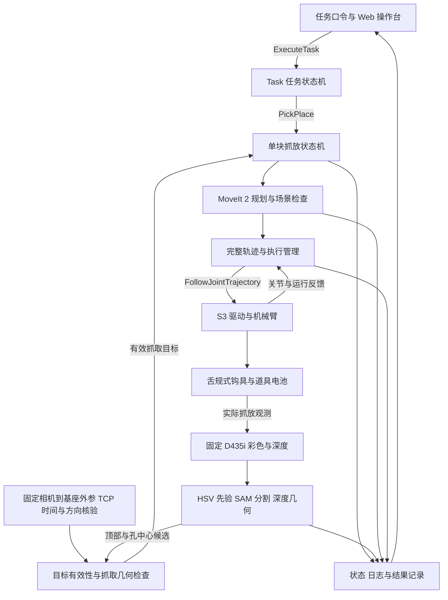

# 基于眼在手外 RGB-D 视觉与舌规式钩具的电池识别及序列摆放系统

2026 美团第四届低空经济与具身智能挑战赛 · 初赛技术方案初稿  
用途：对外介绍与答辩｜版本：v0.2｜日期：2026-10-14

> **写作前提：** 根据用户“方案内容假设全部完成起草”的要求，正文及答辩稿按目标系统已经完成集成与验收的情景撰写，末端按用户补充的“舌规”及“PETG 3D 打印舌规”设计制造要求展开（USER-HW-20261014-02；USER-EE-20261014；USER-EE-20261014-02，用户会话）。完成态表述是本稿的写作假设，不是新增实测结论；未提供的制造参数与实机数值用【待填】保留。实际验收进度仍以[当前状态](current-status.md)为准。附录中的既有实验数据则沿用原始证据及其适用范围。

> **本版依据：** 相机布置按用户最新确认的“这是眼在手外”修订（USER-HW-20261014-03）。**TCP 已做验证（用户确认，USER-HW-20261014-04）**，具体参数和验证记录待补充。视觉实现参考 PR #17 固定版本（TEAMMATE-VISIONCOORD-20261014）；该 PR 的测试范围与项目现场验证分别记录，不能因 TCP 不在该 PR 的验证范围内而表述为项目未做 TCP 验证。正文中的完整系统能力仍受上述写作假设约束。

## 摘要

本系统面向固定工位上的多色道具电池识别、单块搬运与指定序列摆放任务，采用遨博 S3 机械臂、眼在手外固定布置的 RealSense D435i 相机，以及由舌规功能几何发展而来的穿孔承托钩具。团队通过参数化建模与 PETG 3D 打印舌规试配，完成提手孔口与末端功能结构的定制适配。视觉结合 HSV 颜色先验、SAM 2.1 分割与 RGB-D 几何估计电池顶部及提手孔中心候选；完成态系统在确认进入方向、数据有效性与工具几何后，通过固定的相机到基座外参生成规划目标，再由分层状态机组织观察、进钩、试提、搬运、落台、退钩和放后复核。

软件采用 Ubuntu 24.04、ROS 2 Jazzy 与 C++17，结合 MoveIt 2 规划、完整关节轨迹执行和 Web 操作台，形成从任务口令输入到实际放置结果确认的闭环。系统的设计重点是把舌规穿孔间隙、视觉定位、运动执行和释放误差纳入同一任务流程，并使每次任务的状态、异常与结果均可追溯。

关键词：眼在手外；RGB-D；SAM 2.1；PETG 舌规；分层状态机；序列摆放

## 1. 任务目标与设计要求

本项目聚焦初赛固定工位任务，机器人底座在运行过程中保持固定。基础任务根据颜色指令，将一块目标电池搬运至 T0；序列任务根据当轮口令，将三块目标电池依次放入 P1、P2、P3。口令作为运行输入配置，系统不把演示中的颜色顺序写成固定逻辑。（RULES p2–3；FAQ p1、p5；USER-RULE-20260923，用户会话）

| 任务要求 | 对应的系统设计 |
| --- | --- |
| 正确识别与选择目标 | 联合颜色、几何和深度信息，绑定目标标识，拒绝无效或过期观测 |
| 稳定抓取与搬运 | 使用穿孔承托结构，试提后确认实际带起电池，并限制接近与搬运阶段的运动参数 |
| 按口令放入指定位置 | Task 层保存颜色与目标位映射，逐块执行，放置后更新场景 |
| 满足区域和稳定性要求 | 分别判断颜色位次、主体入框、内框覆盖率和释放后稳定性 |
| 连续自主运行与异常处置 | 以状态机管理动作条件、任务取消、停止确认和恢复流程 |
| 过程可展示、结果可复核 | 操作台提供状态与日志，第三视角连续视频保留完整任务过程 |

初赛分值由基础任务 40 分、序列任务 50 分、时间效率 10 分组成。基础任务包含离台稳定 2 秒、释放后稳定 3 秒；序列任务分别评价颜色位次、外框、内框和释放稳定性。（RULES p3–4；FAQ p3）

内框按用户转述的组委会答复计算：

```text
r_inner = Area(B ∩ I) / Area(B) ≥ 0.70
```

其中，B 是电池主体在底图平面上的完整垂直投影，I 是相应内框。该标准仅适用于序列内框；T0 与序列外框仍要求主体完整位于相应区域内。原 RULES p4 的内框措辞与后续答复不同，差异及来源保留在 [Q15](open-questions.md)。（USER-RULE-20260906-02，用户转述组委会；RULES p3–4）

系统以目标区域中心附近为放置目标，通过实际释放后的观测留出误差余量，不以刚好达到 70% 作为控制目标，也不把末端到位直接视为电池放置成功。

## 2. 系统总体架构

系统由感知与标定、任务决策、运动规划与执行、末端机构以及操作与记录五部分组成。任务控制链负责决定和执行动作；状态反馈链负责确认设备、工具和物体的实际情况。



| 组成 | 本方案配置与职责 |
| --- | --- |
| 机械臂 | 遨博 S3，完成抓放、撤离及观察时的遮挡避让 |
| 视觉传感器 | RealSense D435i，采用眼在手外布置，相对工位与基座固定获取 RGB-D；安装位置、角度与覆盖范围【待填】 |
| 末端机构 | PETG 3D 打印舌规直接作为装机功能舌与上翘尖，结合钩柄和法兰连接组成完整钩具（USER-EE-20261014-06）。TCP 数值【待填】 |
| 计算平台 | NUC 原生 Ubuntu 24.04 / ROS 2 Jazzy；实际设备型号与部署版本【待填】 |
| 感知软件 | Python / OpenCV 颜色先验、SAM 2.1 tiny 分割、深度与 CAD 几何、ROS 2 适配；候选坐标与完整抓取位姿分层校验 |
| 控制软件 | C++17 分层 FSM 与 ROS 2 Action，连接感知、规划、执行和工具状态 |
| 运动软件 | MoveIt 2 输出时间参数化轨迹，经执行管理与 aubo_ros2_driver 接入机械臂 |
| 操作与记录 | Web HTTP 接口、ROS 状态消费、任务追踪、日志导出及第三视角录像 |

硬件依据：USER-HW-20260906、USER-HW-20260923-03、USER-HW-20260923-04、USER-HW-20260923-08、USER-HW-20260923-09、USER-HW-20260923-10、USER-HW-20261011；相机安装方式按 USER-HW-20261014-03 更新，本稿末端方向依据 USER-EE-20261014，均为用户会话。视觉实现参考 TEAMMATE-VISIONCOORD-20261014；接口设计依据 SPRINT-PLAN-20261011 §02–07；具体工程结构见[硬件与视觉方案](hardware-vision-plan.md)。

## 3. 末端结构设计与快速迭代

### 3.1 PETG 舌规与完整装机钩具

道具电池顶部提手提供了可利用的穿孔和承托面。末端沿提手开口进入，使功能舌位于横梁下方，上抬后由功能舌承托横梁，并通过上翘尖限制相应方向的滑出。该被动结构通过机械臂位姿完成接合与释放，任务流程不依赖主动夹爪开合。

历史 `44×5×5` 舌规中的三个数分别表示舌宽、舌厚和上翘高度；其功能段长度为 50 mm。历史 STL 另含 40 mm 手持段，整体包络为 90×44×10 mm。STL 不自带标准单位，上述尺寸按历史导出说明解释为 mm；它们是已有设计与网格核验值，不是打印成品的实测尺寸。（DEMO-AUDIT-20260907，本地静态观测；[舌规核验记录](demo-readiness.md)）

舌规采用 PETG 材料，通过 3D 打印成型（USER-EE-20261014-02，用户会话）。用户进一步确认该打印舌规直接用于装机，作为功能舌与上翘尖，结合钩柄和法兰转接件形成完整末端（USER-EE-20261014-06，用户会话）。眼在手外相机及其固定支架属于工位组件。各部分的职责如下：

| 部分 | 结构与作用 |
| --- | --- |
| 功能舌与上翘尖 | PETG 3D 打印成型并直接装机；功能舌穿过提手孔口并承托横梁，上翘尖参与限制相应方向的退出 |
| 初版模型手持段 | 历史 STL 含 40 mm 手持延伸，便于人工控制进入姿态和观察间隙 |
| 钩柄 | 将功能段的载荷传至安装端，并确定功能段相对法兰的空间偏置；整体包络进入规划与碰撞模型 |
| 法兰连接 | 将钩柄固定至 S3 末端，建立安装基准并传递载荷 |

完整末端登记 TCP、钩尖偏移、质量、重心与碰撞包络。PETG 材料确认适用于舌规，不自动扩展为钩柄、法兰连接或相机支架均使用 PETG；历史舌规 STL 也不包含完整装机连接。（结构关系依据：DEMO-AUDIT-20260907；本次设计制造要求：USER-EE-20261014-02）

### 3.2 参数化建模与打印试配

团队将舌宽、舌厚、功能段长度和上翘尺寸作为独立模型参数，围绕实测提手孔口和完整进入路径调整几何。每次修改保存 CAD/导出模型版本、打印配置和试配记录，使结构变化能够对应到具体的间隙、承托或退出问题。

| 参数 | 历史设计起点 | 调整目的 |
| --- | --- | --- |
| 舌宽 w | 44 mm | 在孔口横向间隙与承托接触范围之间取得合适配合 |
| 舌厚 t | 5 mm | 同时检查穿入净高、落台后下降空间及功能段受载变形 |
| 上翘高度 h | 5 mm | 检查越梁后的几何搭接与释放时所需的清尖下降量 |
| 上翘段长度 | 5 mm | 检查尖端能否越过横梁，以及前后进入和退出的空间 |
| 功能段长度 L | 50 mm | 确保承托位置和跨梁距离合适，并核对周边干涉 |

表中数值沿用历史 STL 按 mm 解释的几何核验，是参数化设计的迭代起点，属于模型名义尺寸。（DEMO-AUDIT-20260907）

迭代流程贯通“参数化 CAD → PETG 打印样件 → 提手试配 → 参数修订 → 装机结构核对”：

1. **建立配合模型。** 以提手孔口宽高、横梁厚度和下沿位置为约束，设置舌宽、舌厚、上翘尺寸和进入方向，并检查功能段完整包络。
2. **打印并测量样件。** 使用 PETG 成型，记录材料批次、打印配置和样件编号；测量功能段尺寸与外观，区分模型尺寸和打印后的实际尺寸。
3. **检查穿入间隙。** 在实际提手上沿预定方向试穿，记录横向和竖向余量、圆角或局部凸起干涉，以及姿态偏差对进入的影响。
4. **检查承托与退出。** 核对横梁实际接触位置、尖端越梁情况，并模拟落台卸载后的下降和退钩路径，确认所需空间。几何试配与承载、防脱试验分别记录。
5. **按结果修改模型。** 将干涉位置、承托偏置和退出空间问题对应到模型参数，修改后重印复核；在完整钩具中进一步核对钩柄、法兰和 TCP，并检查运动包络与工位相机支架的间距及视线遮挡。

本流程沿用本文的完成态叙述；具体迭代轮数、各版参数变化、试配照片及结论【待填】，不预设已经采用某一修正量。定制适配的依据是每版样件与电池提手的对应记录。

### 3.3 几何间隙与进入方向

电池尺寸图的名义主体外包络为 70×80、本体高 50，提手下方名义净高为 20；在两侧立柱对称的假设下，提手开口宽约 50。图内未标单位，此处暂按 mm 解释；这些设计名义值用于解释结构关系，装机参数以实测为准。（BATTERY-DRAWING，正视与俯视图，无 PDF 页码）

按上述名义孔宽，44 mm 功能舌两侧各有约 3 mm 间隙。该数值是静态几何余量，实际插入还受到偏航、外参、TCP、轨迹跟踪、打印公差和局部圆角影响。因此，视觉不仅确定电池中心，还确定提手轴向及可进入的一侧，规划同时检查钩尖和钩柄的扫掠空间。

对保持固定姿态进入的结构，孔高 H、舌厚 t、上翘高度 h 与上下余量应满足：

```text
t + h + c_top + c_bottom < H
```

落台卸载后，还需存在合适的下降量 Δ，使钩尖低于横梁下沿、舌底高于本体表面，随后沿进入通道退出。系统将“可进入、可承载、可退出”作为一组连续几何约束，避免只检查穿孔而忽略释放。（工程设计依据见[电池几何与抓取分析](battery-geometry.md)）

### 3.4 几何设计与抓放动作

动作主线为“穿入—承托提升—搬运—落台卸载—退钩”。舌宽、舌厚和尖端包络影响穿入；功能段长度与横梁接触位置影响承托；完整钩具的变形、连接和物体相对运动影响搬运；上翘尺寸与本体顶面间隙共同决定卸载后的清尖和退出空间。

| 阶段 | 动作与完成条件 |
| --- | --- |
| 观察与对准 | 机械臂避让视线并停稳，固定相机取得新帧，识别目标和提手方向，确定进入侧 |
| 进钩 | 从孔口外预备位沿进入方向移动，使完整功能段穿入、钩尖越过横梁 |
| 承托与试提 | 上抬承托，确认电池离台且随工具运动；基础任务保持离台稳定 2 秒 |
| 搬运 | 按携带电池的几何包络执行轨迹，约束加减速和姿态变化 |
| 落台与卸载 | 电池在目标面落座后继续完成卸载，使横梁不再由功能舌承重 |
| 清尖与退钩 | 下降到可退出高度，再沿通道退钩，避免重新带起或拖动电池 |
| 放后复核 | 工具完全脱离后观察至少 3 秒，检查颜色、位次、区域与稳定性 |

被动钩不提供主动锁紧反馈，系统使用实际离台、跟随运动、落座和释放观测确认抓放结果。控制器返回成功仅表明相应运动请求的执行状态，不能替代物体结果判断。试提失败、物体丢失或释放状态不明时，任务进入相应异常处理，不继续搬运下一块。（流程依据：RULES p3–4；SPRINT-PLAN-20261011 §07、§09）

### 3.5 制造记录与对照图

PETG 材料及 3D 打印成型方式已由用户明确。现有资料中的几何核验和仿真结果没有给出本批 PETG 打印件的材料性能、实际打印参数、承载能力或防脱试验结果，相关条目保留如下，不套用通用 PETG 参数或历史 PLA 描述。

| 记录项 | 本稿填写位置 |
| --- | --- |
| 材料与用途 | PETG，3D 打印成型，直接装机使用 |
| 打印设备与切片 | 设备、喷嘴、切片软件及配置版本【待填】 |
| 成型参数 | 层高、壁数、填充率/方式、打印方向、支撑、喷嘴/热床温度与速度【待填】 |
| 试配结论 | 围绕穿入间隙、承托位置和退出空间的关键结构调整与试配结论【待填】 |
| 承载能力 | 试样与完整组件版本、载荷、持续时间、重复次数、变形及失效观察【待填】 |
| 防脱与释放 | 测试姿态、运动条件、滑移/脱落次数、退钩位移及原始记录【待填】 |

上翘尖提供的是特定方向的几何约束；本稿不以材料名称、模型形状或顺利试穿替代动态防脱效果。装机承载还包含钩柄、法兰连接和电池提手自身，结果按实际组件配置报告。

**图 1 预留：CAD 模型—PETG 打印件—提手试配。** 采用三联图展示同一版本的设计、成型与配合，保留比例尺、版本或样件编号。

| A 参数化 CAD 模型 | B PETG 打印件 | C 电池提手试配 |
| --- | --- | --- |
| 【待放 CAD 截图】标注舌宽 w、舌厚 t、上翘高度 h 和功能段长度 L | 【待放样件实拍】展示功能舌、上翘尖及成型外观 | 【待放试配实拍】以能看清孔口的视角标注穿入间隙、横梁承托位置和退钩方向 |

图注填写：CAD 版本【待填】、样件编号【待填】、电池编号【待填】、本版调整点及试配结论【待填】。后续对比版本沿用相同观察角度，展示参数变化如何改善配合；本轮仅预留图位，没有以示意图充当实物照片。

## 4. 眼在手外感知与坐标标定

### 4.1 颜色先验、模型分割与深度几何

固定相机在抓取前、逐块切换和释放后获取当前 RGB-D 帧。视觉模块以 HSV 颜色掩膜定位候选区域，结合支撑平面与顶部深度产生正负提示点，再由 SAM 2.1 tiny 分割提手顶部区域。随后对分割区域进行几何与深度检查，估计顶部中心，并依据 CAD 偏移推算提手孔中心。模型提供分割结果，颜色、几何、有效深度与方向检查共同决定候选是否可用。（TEAMMATE-VISIONCOORD-20261014，2026-10-14 查阅）

同色候选重复、深度缺失或几何条件不足时，系统保留无效或歧义状态；本帧缺失的点不从历史结果补齐。提手孔中心属于模型推算点，应与直接观测的顶部点分别记录。对齐深度按对应内参、畸变模型和深度单位反投影，内部坐标使用米。（RS-ALIGN、RS-PROJECTION；TEAMMATE-VISIONCOORD-20261014）

参考实现按直立电池和共同支撑面使用顶部 80 mm、孔中心 60 mm 的高度先验，原始点、修正后点及修正量同时保存。这两项是 PR 中记录的上游物理尺寸约束；本项目实际电池、支撑面和尺寸记录仍须对应核验，不能将约束后的高度一致性当作绝对定位精度。T0 输出表示期望的电池孔中心位置，转换成钩具 TCP 目标还需工具几何关系。（TEAMMATE-VISIONCOORD-20261014）

完成态系统将颜色、候选点、进入方向、工具偏置和通道空间组合为抓取目标。候选 XYZ 本身不构成完整位姿；仅识别颜色或点位置、尚不能确定朝向时，不进入进钩规划。固定视角下通过机械臂避让消除可消除的遮挡；仍不可观测的方向按经核验的几何约束处理，条件不满足则拒绝本次抓取。

### 4.2 固定相机到基座的标定

相机采用眼在手外方式，相对工位和机器人基座固定。系统统一相机光学系、基座、末端法兰、钩具 TCP 与底图工位坐标；采用 `T_A_B` 表示从 B 系到 A 系的变换，齐次目标点按固定外参转换：

```text
p_base = T_base_camera · p_camera
```

`T_base_camera` 是相机光学系到基座系的固定变换。标定可由固定相机观测刚性安装在末端的标定板，采集多组机器人位姿与标定板观测求解；本稿采用以下坐标关系说明方向，具体标定方法与文件版本【待填】：

```text
T_base_flange(i) · T_flange_board = T_base_camera · T_camera_board(i)
```

工具 TCP 与相机外参分别管理。TCP 已做验证（USER-HW-20261014-04，用户会话），对应工具版本、TCP 位姿、验证方法、误差及结果记录【待填】。相机外参使用未参与拟合的测量点和机器人姿态独立复核，并将底图与各目标位登记到同一坐标体系。相机或基座发生相对移动时复核并更新外参；仅更换末端工具时更新相应 TCP、工具包络与遮挡检查。（CV-CALIB，2026-10-14 复查 eye-to-hand 说明；USER-HW-20261014-03，用户会话）

固定外参不随机械臂关节运动而变化，但图像、深度、目标状态与机器人状态仍须满足采集时间、新鲜度和帧标识契约。观察时机械臂避让视线，待目标稳定后取新帧；外参失效、深度不足或观测过期时重新检查。控制采用抓前定位、逐块更新和放后复核的分阶段闭环，坐标推理周期单独计入任务耗时。

### 4.3 场景初始化与图像展示

视觉参考实现可利用当前 RGB-D 的桌面平面、唯一 T0 边框及方向参考建立 `t0_scene`：原点为 T0 在台面上的中心，X 轴沿带正向约定的长边，Z 轴为台面向上法向。矩形本身存在 180° 方向歧义，方向须由当前视图人工指定或固定在台面且满足共面条件的 ArUco 标记给出；现场采用方式与布置记录【待填】。（TEAMMATE-VISIONCOORD-20261014）

`t0_scene` 是视觉场景坐标系。若规划使用它，需要另行核验 `T_base_scene`，按 `p_base = T_base_scene · T_scene_camera · p_camera` 转换；场景初始化 READY 不能替代相机到基座标定、TCP 或整机就绪。相机移动、参考丢失和安装变化的处理须与当前标定版本对应。

图像展示与坐标推理分开更新：原始 JPEG 在推理期间继续发布，标注图使用产生该检测结果的同一源帧。操作台分别显示图像时间、检测时间和有效性，避免把较快的视频流误读为同频率坐标更新。采集时间与 ROS 发送时间分别标识，未验证的跨时钟映射不作同步依据。（TEAMMATE-VISIONCOORD-20261014）

最终放置误差同时包含感知、标定、TCP、执行以及钩具与电池相对运动的影响。系统分别记录定位误差、轨迹跟踪误差和电池落点误差；当前参考实现的验证范围列于附录 A，完成态叙述不补写为 PR 已实现整机闭环。

## 5. 分层状态机与运动执行

Task 层管理基础任务或三块序列、目标颜色与放置位的对应关系，以及任务完成数；PickPlace 层管理每块电池从观察到释放复核的动作；执行层管理完整轨迹、在途命令、结果和停止确认。层间通过 ROS 2 Action 与约定端口连接，使任务推进条件与具体设备驱动分离。（SPRINT-PLAN-20261011 §02、§07）

```text
读取口令 → 就绪检查 → 观察目标 → 规划与进钩 → 试提确认
        → 搬运与落台 → 卸载退钩 → 稳定性与区域复核
        → 更新场景 → 下一目标 / 任务完成
```

MoveIt 2 根据当前关节状态、目标位姿、工具和电池包络规划接近、搬运及撤离路径。桌面、其他电池、相机与钩柄进入碰撞场景，已放好的电池在后续动作中继续作为障碍物。携带电池的规划模型用于检查占用空间，抓取是否成立仍由物理观测确认。

规划结果以完整的时间参数化关节轨迹交给执行端，保留关节名与顺序、时间、位置及可用的速度/加速度信息，经 `FollowJointTrajectory` 执行。系统核对实际起点与计划起点，保持单一执行权；不会用大量单点命令替代一条完整轨迹，也不会在执行结果未知时自动重发。（USER-HW-20260923-10；SPRINT-PLAN-20261011 §02–03、§07）

取消与停止分为三个独立事件：请求被受理、任务进入终态、机械臂停稳得到确认。取消按原 Goal 或命令标识向下传播，迟到请求不作用于后续任务。轨迹或状态反馈超时、目标无效、规划失败等情况进入明确的失败或故障分支；恢复后重新检查设备和场景，不自动续跑旧命令。

软件停止与实体急停分别处理。停稳判断使用新鲜的实际状态及已验证的判据，网页按钮、Cancel ACK 或状态机阶段不能替代物理停稳证据。该设计提供可检查的异常处置流程，不构成形式化安全证明。（USER-HW-20261013；SPRINT-PLAN-20261011 §02、§09）

## 6. Web 操作台与过程记录

Web 操作台提供统一任务入口和运行观察。网页提交顶层 `ExecuteTask`，保留定向任务取消与软件停止；关节、轨迹、工具和规划信息通过只读状态接入，避免形成第二条低层运动控制链。（USER-HW-20261013-05，用户会话）

| 界面区域 | 展示内容与作用 |
| --- | --- |
| 任务与流程 | 当轮口令、当前电池、目标位、完成数、Task/PickPlace 阶段与结果 |
| 运动与停止 | 六关节实际/目标对比、轨迹状态、取消受理、最终结果与独立停稳确认 |
| 视觉与工具 | RGB-D/JPEG、检测源帧及各自更新时间、候选坐标与位姿有效性、试提和落座的独立验证记录 |
| 系统健康 | 模块正常/异常/未知状态，TF 可用性与标定有效性分别显示 |
| 日志追踪 | 任务、Goal 与模块的关联记录，状态转换、失败原因及事件导出 |

缺失或过期数据显示为未知；物体挂载、落座和释放状态由对应观测支持，不从计划动作名称推断。跨层任务关系依据显式标识关联，不凭事件发生时间接近进行匹配。记录包括软件版本、配置与标定版本、任务输入、关键时间、UUID、错误码以及日志和视频位置。（USER-HW-20261013、USER-HW-20261013-02、USER-HW-20261013-04；接口说明见[Web UI](web-ui.md)）

## 7. 验证体系与成果表达

### 7.1 验证层级

在本稿的完成态情景中，系统已完成离线模块、Mock/Fake 接口以及实机任务三个层级的验证。实机验收覆盖版本锁定、设备与安全、只读接入、标定与几何、空载运动、停止与异常、单块完整任务，以及三块与重复运行八个阶段。

| 层级 | 核查内容 | 支撑材料 |
| --- | --- | --- |
| 离线与仿真 | 颜色与几何处理、状态转换、抓放逻辑和误差分析 | 固定输入、测试结果、模型/代码版本及失败样本 |
| Mock / Fake | Action 链、规划与轨迹接口、取消传播、唯一执行权及退出重启 | 各层 UUID、反馈与终态、ROS 图和进程记录 |
| 实机任务 | 实际观察、进钩、带载搬运、退钩、稳定放置与重复执行 | 独立物体观测、连续录像、逐次结果和现场版本 |

各层结果分别统计。实机重复试验在固定的版本、标定、工具和判据下进行，记录全部成功、失败与未执行任务；序列成功以整轮三块满足要求为准，不将各块独立通过次数拼接为整轮成功率。版本变更前后的试验分组呈现。

### 7.2 实机指标填写表

下表是正式成果页的数据位置，未填写项不代表数值为零或已达到某一指标。不得用附录中的仿真数据替填。

| 指标 | 统计口径 | 实机结果 |
| --- | --- | --- |
| 有效颜色识别 | 固定样本或任务集，分别列正确、误识别和拒识次数 | 【待填：样本数与逐类结果】 |
| 定位与标定误差 | 独立参考点的位置误差，注明坐标系和测量方法 | 【待填：均值、最大值，mm】 |
| TCP 验证 | 对应工具及 TCP 版本、验证方法、判据与结果记录 | 已做验证（用户确认）；参数、误差及原始记录【待填】（USER-HW-20261014-04） |
| 基础任务通过 | 同一版本下满足单块任务判据的次数 / 全部计划次数 | 【待填：n/N、失败及未执行原因】 |
| 三块整轮通过 | 三块颜色、位次、区域和稳定性均合格的轮次 / 全部计划轮次 | 【待填：n/N、口令与测试条件】 |
| 释放后中心误差 | 工具脱离、稳定后电池主体中心相对目标中心的平面误差 | 【待填：均值、最大值，mm】 |
| 入框与稳定性 | T0/外框完整包含、内框覆盖率及连续稳定观察分别记录 | 【待填：逐次结果与最小覆盖率】 |
| 任务耗时 | 同一计时起止定义下的连续任务时间，包含观察与复核 | 【待填：基础/序列各轮用时，s】 |
| 取消与恢复 | 请求时刻、ACK、终态、独立停稳及恢复后任务结果 | 【待填：场景、耗时与证据】 |

视频按 FAQ p2–3 使用固定第三视角、单镜头连续录制，清晰包含机械臂、末端、底图、电池与计时信息，并记录任务口令、初始状态和开始触发。FAQ 建议每任务 180 秒以内、最多 250 秒；是否满足以实际完整录像为准。正式底图按本队已确认的组委会寄送底图准备。（USER-RULE-20260923-03，用户会话）

## 8. 工程特色与团队贡献

**舌规几何与视觉定位共同决定抓取动作。** 系统围绕有限孔口间隙处理进入方向、钩尖包络和退出路径，使末端机构设计与感知、规划保持一致。定位目标从单一中心点扩展为包含朝向与通道条件的抓取位姿。

**以 PETG 样件完成定制适配与快速迭代。** 参数化模型将舌宽、舌厚和上翘尺寸与提手孔口约束对应起来，打印样件用于核对穿入、承托和退出。每轮试配反馈进入下一版模型，形成可展示的 CAD、实物与配合记录，并与完整装机钩具的连接和动作要求衔接。（USER-EE-20261014-02）

**把释放后的物体状态纳入任务结果。** 抓取、轨迹和放置分别确认，尤其关注落台后清尖、退钩带来的位移。电池真正落在指定区域并稳定，才构成相应任务阶段的成功。

**通过分层接口组织集成与故障定位。** 视觉、标定、规划、执行和操作台使用明确的数据契约；同一任务可追踪至各层 Goal、执行结果和物体观测，使问题能够定位到具体模块及运行阶段。

**把演示与验证材料关联起来。** 每轮任务绑定版本、配置、日志、视频和评测结果，保留失败记录。团队的贡献集中在机构适配、感知处理、任务编排、接口集成和系统验证；MoveIt、ROS 2 及厂商驱动等通用能力按来源披露。

| 成员 | 主要贡献范围 |
| --- | --- |
| 孙嘉明 | FSM、ROS 2 Action、Motion Execution 与驱动技术交接 |
| 常建烁 | MoveIt 2 规划、碰撞场景和轨迹有效性 |
| 孙浩然 | 电池与提手感知、目标标识及位姿质量 |
| 韩明赫 | 相机标定、TF、TCP 与工位几何 |
| 张叔阳 | 系统集成、统一启动与检查、回归验收、Web UI、日志和演示材料 |

分工来源：SPRINT-PLAN-20261011 §01、§06–07；USER-HW-20261011-03（用户会话）。团队任务书用于说明职责，不作为某项运行成功的证据。

## 9. 答辩讲述稿

以下讲述稿沿用本文“目标系统全部完成”的假设，正式使用前配入实际视频与实测结果。

> 我们的方案面向固定工位上的多色电池识别与序列摆放。系统使用遨博 S3，D435i 采用眼在手外固定布置。视觉结合颜色先验、SAM 2.1 分割和深度几何获得电池顶部及提手孔中心候选，再通过方向与工具几何检查、固定的相机到基座标定，生成抓放目标，按当轮颜色口令完成单块或三块任务。
>
> 末端采用舌规式穿孔承托结构。我们把舌宽、舌厚和上翘尺寸做成可调整的模型参数，用 PETG 3D 打印舌规检查穿入间隙、横梁承托位置和退出空间，再根据试配结果修改结构。该 PETG 打印舌规直接作为装机功能段，结合传递载荷的钩柄和固定到机械臂的法兰连接组成完整钩具。对照图展示同一版本的 CAD 模型、打印件和提手配合。
>
> 动作按“穿入—承托提升—搬运—落台卸载—退钩”执行。上翘尖和功能舌既要能穿过孔口，也要在放下电池后有空间退出。这个结构要求视觉、工具尺寸和运动路径共同保证进得去、提得稳、退得出，所以我们不仅识别电池中心，也处理提手方向和进入通道。具体材料性能、打印参数、承载与防脱效果以对应样件和完整组件的试验记录说明。
>
> 工具 TCP 已经做过验证，并与眼在手外相机到基座的固定外参分别管理。TCP 参数、验证方法和结果在材料中对应到具体工具版本，相关数值与记录保留填写位置。
>
> 软件把任务编排、单块抓放和轨迹执行分层管理。相机保持固定，每块电池抓前由机械臂避让遮挡后重新观察，释放后独立检查实际位置和稳定性；三块任务据此逐次更新场景。操作台能看到当前阶段、关节反馈和失败原因，分别显示图像与检测结果的更新时间，并把取消受理、任务结束与实际停稳分开显示。
>
> 我们完成了从模块验证到实机任务的集成流程，能够用同一次运行的口令、日志、轨迹和连续视频解释任务结果。接下来的演示将展示完整抓放过程，结果页分别给出基础任务与三块整轮的重复统计、落点误差和实际耗时。

## 附录 A. 已有实验数据及其使用范围

本附录区分本地归档证据、上游报告和用户现场确认，不依赖本文的完成态假设。它们可用于说明研发过程，不能替代本项目完整实机任务指标或正式比赛成绩。

| 既有记录 | 可引用结果 | 适用范围 |
| --- | --- | --- |
| 单块钩取仿真 | 黄块到 P1，落点中心误差 2.255 mm，内框覆盖率 84.429% | 2026-09-07 单次录制运行，开环轨迹与仿真物理；不是舌规实物装机或实机精度（DEMO-RECORDING-20260907） |
| 固定偏移视觉对照 | −6/0/+6 mm 各两次，两种模式各 6/6 通过 | 12 次仿真，未体现成功率提升；不外推真实硬件（VISION-REPEAT-20260908） |
| 三块逐次观察 | 最终同版本两次通过；开发期有 IK 拒绝和蓝块掉落 | 开发尝试不可合并统计稳定成功率；其中一次含观察的世界内总时间约 288.5 s，不能据抓取片段声称满足视频时限（VISION-SEQUENCE-20260908） |
| Jazzy 固定基线 | 12 包构建、318 项 C++、269 项 Python、15 项 Mock E2E 通过 | 独立容器的离线与 Mock 结果；同轮实际 ROS 任务启动失败仍保留（ENV-FSM-20261011） |
| Web UI P2 | 73 项 Python、30 项 Node、6 项 P2 ROS 检查通过 | 隔离接口验证，实际标定及跨层轨迹发布器的当时缺口仍保留（ENV-WEBUI-P2-20261013） |
| PR #17 相机短时测试（上游报告） | D435i 有限补跑 3/3 次获得四色与 T0；217 帧原始图像约 7.50 FPS；坐标处理 8.93–10.02 s/次 | 同一 PR 记录较早运行有红/黄漏检；未测绝对位置误差、未操作机器人，不代表持续检出率或实时伺服（TEAMMATE-VISIONCOORD-20261014） |
| TCP 验证（用户确认） | 用户先说明“有做验证”，随后明确对象为“TCP” | 已做验证；具体工具/TCP 版本、方法、误差和结果记录待补充，非本轮 Codex 独立复跑（USER-HW-20261014-04） |

对应报告：[单块仿真](demo-recording.md)、[重复对照](vision-repeat.md)、[三块开发记录](vision-sequence.md)、[基线验收](fsm-acceptance.md)、[Web UI 验证](web-ui.md)。旧 Humble / Gazebo Classic 实验与 Jazzy 集成属于不同环境，不合并为同一整机测试总数。

**PR #17 的实际边界。** 2026-10-14 查阅时，GitHub 元数据显示该 PR 已合入 `feature/perception-adapter`，head 为 `5efbd2d…`、合并提交为 `4e7ddd4…`；这不证明已进入 `main` 或现场部署版本。PR 正文报告 425 项通过、10 项跳过，部分配套文档保留较早的 413/10 记录，分别保留。当前候选消息仍为 `ring_pose_valid=false`、`motion_usable=false`；孔中心不是完整抓取位姿，相机到基座外参、TCP、采集时钟映射、跨机 DDS 和 C++ FSM 消费不在该 PR 验证范围。这个范围仅限定 PR #17，项目 TCP 已做验证的用户确认另列于上表；本轮仅阅读和整合文档，未复跑这些测试。（TEAMMATE-VISIONCOORD-20261014；USER-HW-20261014-04；[PR #17](https://github.com/F1u0rite/meituan_challenge_ws/pull/17)）

历史眼在手上仿真继续按原配置解释；本稿眼在手外的安装依据是 USER-HW-20261014-03，不将旧仿真结果改写成新布置的验证。

既有本地同 SHA 监测报告为“部分通过”，另保留 ROS 场景坐标标签不一致及 T0 丢失后人工方向参考重用问题；标签问题的后续补丁属于另一版本，不作为 PR #17 原版已修复的依据。本轮仅只读复核该报告及其索引，未新增测试（ENV-PR17-DOC-20261014；[本机既有监测报告](../outputs/monitor-resume-20261013/worktree/docs/scene-init-monitor-acceptance-20261014.md)）。

## 附录 B. 来源与发布前填写项

比赛约束来自 RULES p2–4、FAQ p1–3、p5–6；本轮对扫描版 RULES 的第 2、3、4 页逐页渲染并目视核对。物料几何采用 BATTERY-DRAWING 的正视与俯视设计图；历史舌规参数来自 DEMO-AUDIT-20260907。用户路线、写作前提与末端指示在[来源清单](../materials/manifest.json)登记，事实状态与[待确认事项](open-questions.md)保持一致。

方案使用的 ROS 2、MoveIt 2、OpenCV、RealSense 软件与 AUBO 驱动、模型，按实际部署版本列入最终依赖表。团队 FSM 历史固定版本的许可证为 MIT（TEAMMATE-FSM-20261011，2026-10-11 查阅）；该许可不自动覆盖驱动、模型与 SDK。AUBO-DESC 的包内 BSD 声明与缺少根 LICENSE 的历史差异，以及 SDK 许可和厂商校验值事项，继续按来源记录处理。（AUBO-DESC，2026-09-06 查阅；TEAMMATE-SDK-20261011，2026-10-11 查阅）

新增模型来源为 `facebookresearch/sam2`，参考实现固定源码 `2b90b9f5ceec907a1c18123530e92e794ad901a4`，使用 `sam2.1_hiera_tiny.pt`。官方固定版本 README/许可证声明模型检查点等适用 Apache-2.0；上游安装文档记录检查点 SHA-256 为 `7402e0d864fa82708a20fbd15bc84245c2f26dff0eb43a4b5b93452deb34be69`，本轮未下载复核权重。颜色提示、几何后处理与 ROS 输出适配来自团队实现，不将预训练分割模型列为团队原创。（CV-SAM2；TEAMMATE-VISIONCOORD-20261014，2026-10-14 查阅）

正式发布前填入：团队名称与署名、打印参数、关键试配结论及图 1 素材、承载和防脱试验记录、相机安装和 TCP/外参版本、现场源码 SHA 与软硬件版本、第 7.2 节实机结果，以及各项结果对应的连续视频和原始日志。比赛提交入口、准确截止时刻和模板沿用 Q11 的官方通知核验，不把团队排期写成官方要求。

使用 OpenAI Codex 协助本稿的结构组织、技术表述、来源核对和文字起草；历史仿真及舌规含 Claude Code 辅助工作，具体代码与模型修改范围见 [demo 来源记录](../demo/data/provenance.json)、[仿真来源记录](../simulation/provenance.json)和 [Web UI 来源记录](../webui/provenance.json)。本轮仅起草文档，未新增代码、仿真或实机测试，未将假设完成态登记为验收结果。披露依据为 FAQ p6，Q17。
