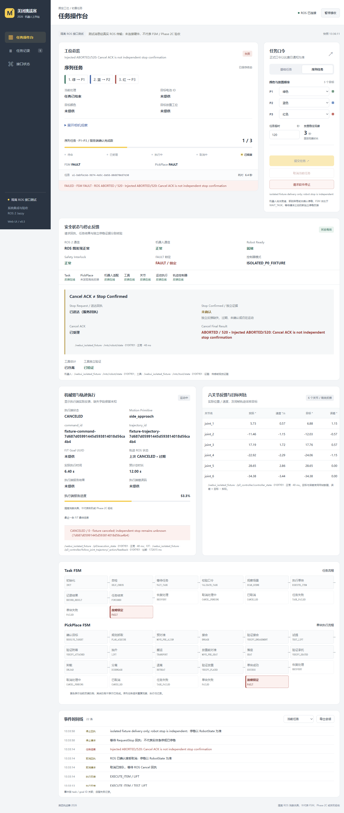
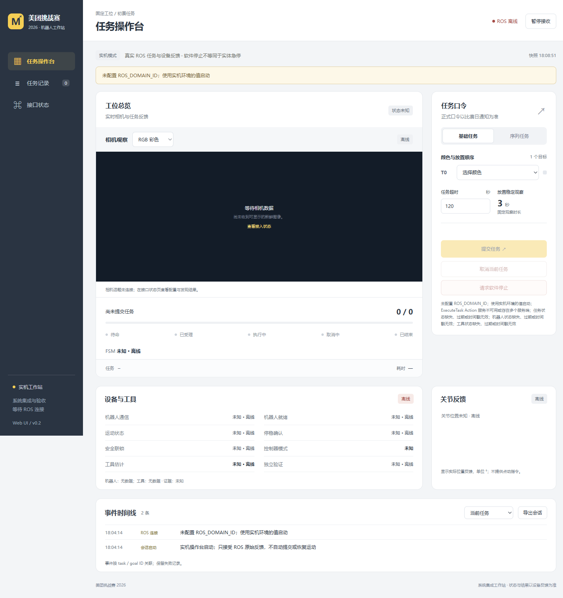
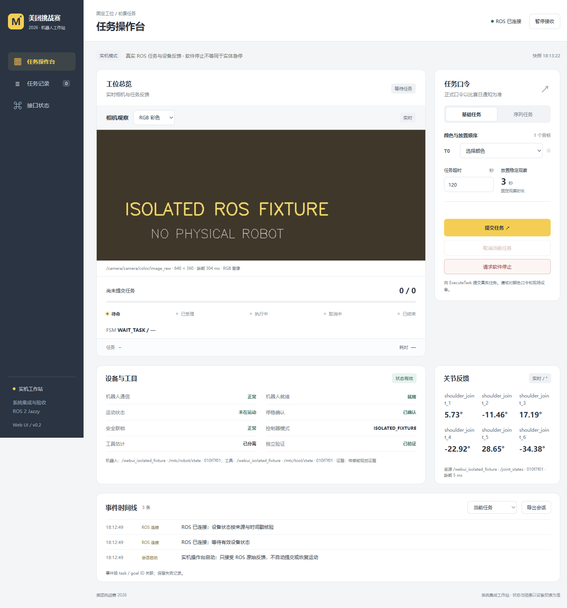

# 实机 Web 操作台：实现与验证

用户澄清“我要的是实机操作台”（USER-HW-20261011-07，2026-10-11 用户会话）。新版 `webui/` 默认连接真实 **ROS 2 Jazzy** 客户端，提供任务提交/取消、软件停止、FSM/设备/工具状态、RGB-D、关节及日志。没有配置或设备消息时显示离线、禁止提交，不生成演示状态。个人主责仍为系统集成与验收，兼做 Web UI（USER-HW-20261011-03）。

发布整理说明：P0 用户要求统一登记为 USER-HW-20261013-06。四组已冻结 UI 证据中原编号 `USER-HW-20261013` 保留原字节，仅在各自目录内映射到本条 P0 要求；该旧编号在最新主线已登记另一会话的“验收”要求。映射范围见 manifest，不合并两条不同原话。

## 2026-10-13：接口边界与兼容性

USER-HW-20261013-05（用户会话）确认现有 Web HTTP API 尽量保持不变，网页只发送顶层 ExecuteTask Goal，其他模块通过 ROS Topic 或统一只读状态接口接入。已有任务取消与软件停止保留；无 PickPlace/FJT、工具 IO 或关节点动控制按钮。缺状态发布器时仅预留结构和显示区域，由对应负责人提供正式接口。[集中约定](../webui/README.md#接口边界与当前联调范围)说明接入职责和兼容字段。

当前联合验证明确限定 **C++ Mock / GenericSystem Fake Hardware**。实机操作台是产品目标，尚无真实机械臂控制或实机验收；下方历史 NUC 配置说明不是本阶段执行入口。GenericSystem 先只读观察，完整 Task→FJT Fake 接线仍待完成，不能伪造设备状态或放宽门禁。

静态审计确认生产代码仅创建 ExecuteTask ActionClient，PickPlace/FJT 只订阅反馈/状态和读取结果。发现 P2 曾省略导出的 `note` / `tasks[].events` 并更改默认附件名，现已补回；仍保留持久事件全量导出与筛选。导出先检查快照，再读取事件，确保新产生的 UNKNOWN 回执超时记录没有遗漏。

ENV-WEBUI-API-20261013：新增 3 项兼容性检查及整套 **76 项 Python 检查通过**，覆盖旧任务请求/取消/停止 HTTP 格式、只读查询、底层控制路由返回 404、跨内存窗口的任务事件与过滤、同一导出中的超时一致性。仅用本地 HTTP 和进程内桩；本轮未运行 ROS、C++ Mock / GenericSystem 或真实机械臂，不将以往 17 项 ROS 结果重复计入。见[协议](experiments/webui-api-20261013/protocol.md)、[摘要](experiments/webui-api-20261013/summary.json)与[增量补丁](experiments/webui-api-20261013/source.patch)。P0/P1/P2 冻结证据保持原样。

## 2026-10-13：P2 系统状态与执行记录

USER-HW-20261013-04（用户会话）要求八模块三态、日志筛选、转换时间线、失败原因与父子 Goal 追踪。客户端现已实现，配置/字段见 [P2 接入约定](../webui/p2-contract.md)。

- 系统表分列在线证据、当前状态、来源与龄期；收到消息不自动视作正常。缺失、过期或浏览器暂停时未知。Task 恢复后不把历史错误码当成当前 Fault；PickPlace 终态后不继续显示之前的子状态为当前阶段。
- TF 只查询配置的坐标链；动态龄期与静态缓存明确标记，TF 可查询不等于实测标定有效。Robot / Controller 的通信、Ready、Fault、StopConfirmed 分开，缺少 fault_locked 仍显示未知。
- 原生 PickPlace / FJT Feedback、Status 与终态 GetResult 只读观察。ExecuteTask→PickPlace 使用实际 C++ UUID 日志或明确遥测，PickPlace→FJT 需要显式 UUID 声明。同一 child 的冲突父节点及后代不用于推定归属；不按时间、当前任务或原语名猜测。
- SQLite 为完整查询索引，JSONL 逐条记录；查询支持 task_id / UUID / 模块 / 转换 / 错误与分页。迟到的明确关联可以找到此前子 Goal 结果。导出不受 200/300/500 条 UI 窗口限制，完整 ROS 日志正文保留；页面短预览与完整导出分开。保留 ABORTED/520、EXCEEDS_STATE_WATCHDOG 原始错误。

TEAMMATE-WEBUI-P2-20261013 核对 PR #8 `8f11750…`、main `b418515…` 的标定与已固定 Phase 2C 参考：标定模块目前为离线检查/现场 SOP；FJT snapshot 的 UUID 尚无对应跨层实时发布器。本轮提供了消费者和可交付契约，**实际发布器、现场 TF 名称和实机证据仍待模块负责人接入**。没有生成生产 RobotState/ToolState，也没有修改 FSM/Action/Cancel/Motion 内核或推进正式 pin。

ENV-WEBUI-P2-20261013 的 [协议](experiments/webui-p2-20261013/protocol.md)、[摘要](experiments/webui-p2-20261013/summary.json)、[索引](experiments/webui-p2-20261013/index.json)和[累计补丁](experiments/webui-p2-20261013/source.patch)可复核。累计补丁以 `8f11750…` 为基准，含已有 P0/P1，仅修改 Web 模块与安装资料；在独立干净 checkout 应用后 Git 树相同，未发布或合并。

| 检查 | 本轮结果 |
| --- | --- |
| 离线 / HTTP | 73 Python 通过；含 650 条事件分页导出、迟到关联、冲突隔离、完整长日志、格式与查询边界 |
| 前端语义 | 30 Node 通过；含未知不绿、历史错误与当前 Fault 分离、TF/标定分离、过期 Status 与实际 FJT Feedback 分离、终态后不沿用旧子状态 |
| P2 原生 Jazzy / DDS | 6 项通过：缺 TF、原生动态 TF、标定消费者、三层实际 Action UUID 与导出、ACK 后注入 ABORTED/520 且不确认停稳、来源冲突与过期 |
| P0 / P1 回归 | 5 项 P0 与 6 项 P1 ROS 检查通过；demo 27 / robot 30 通过 |
| 安装包 | colcon 单包构建；同一 73 Python / 6 P2 ROS 重复通过，不累计为新用例；33 个安装文件逐字节与候选源码一致 |
| 浏览器 | 真实隔离 ROS 任务记录、三层 UUID、Goal / 模块 / 转换筛选、暂停全未知、离线禁用提交；320/390/768/1440 宽三视图无页面横向溢出 |
| 持久化 / 导出 | 两个浏览器会话各 37 条最终记录，SQLite integrity_check=ok 且与 JSONL 逐条一致；按任务导出 HTTP 200、attachment 与 23/23 条匹配 |

浏览器仍处于 hidden，使用 DOM 表单/按钮动作与真实 HTTP 交互完成检查，没有注入 UI 状态或后端快照。原生下载事件等待超时，**不声称 Chrome 下载落盘通过**；元素稳定等待和局部截图也超时/失败，已保留记录，最终采用整页截图。最后仅调整查询按钮布局，390 宽离线页面截图验证。首轮 ROS 夹具漏传 placement_stability_sec 导致 2 项输入拒绝，修正夹具后 6 项通过；原离线 FJT 测试短字符串改为合法 UUID 后回归通过。安装哈希第一次误把未安装的 run.sh 纳入，按实际 package_data/console_scripts 范围修正后 33 项一致。失败不删除。

测试容器 network=none、无设备/目录映射、域 94 / LOCALHOST；测试数据，包括 calibration valid=true 与 simulation_mode=false，均为隔离夹具刺激，不能作为实物标定或机械臂结果。测试服务/转发器与容器已停止，保留无 ROS domain 的只读预览。旧 P0/P1、C1 等冻结目录未修改，另一会话 C1 修复保持独立。完整 NUC / 实机、生产发布器仍待验收。使用 OpenAI Codex 协助实现、复核与归档。

## 2026-10-13：P1 观察客户端与接入契约

按 USER-HW-20261013-02（用户会话），新增以下三部分；默认仍连接 ROS，不产生示例设备状态。[P1 接入约定](../webui/p1-contract.md)说明每项来源、身份和时间边界。

| P1 | 已实现 | 仍需接入 / 验收 |
| --- | --- | --- |
| RGB-D 与电池检测 | 原生 `/mtc/perception/batteries`；ID、颜色、置信度、主体/提环位姿、ring_pose_valid、坐标系/独立时间戳；任务目标 ID 列表高亮；RGB/深度切换和同帧 JPEG 元数据 | 实物 D435i、标定/单位与真实视觉；原生契约没有二维框，叠图及图像帧对应待定 |
| MoveIt Planner | 独立规划状态/原语/plan_id/command_id/trajectory_id、点数、预计时长、三项显式检查、原始错误码与原因 | 当前 PR #4 提供内部 PlanReport/YAML，无所需实时发布器；可选固定来源的 JSON 消费已实现，发布端待负责人提供 |
| 工具与电池 | V1/V2 实际类型、估计状态、关联 ID、verified、证据等级、独立挂载；试提/落座分别显示验证事件和来源 | 原生 ToolState 没有试提/落座字段；可选验证记录须匹配任务/对象/工具，实际独立证据发布器仍待接入 |

`Attached` 或接合回执不等于挂载成功；只有新鲜 Attached + verified=true + 等级 2/3 + 对象 ID 才显示独立挂载。Detached 的 verified 不解释成挂载。检测位姿 NaN/Inf、不合法四元数、缺少坐标系或旧位姿均标不可用；新数组不刷新旧 PoseStamped。规划成功不补齐三项检查，另一个计划/任务的数据不混入当前结果，`EXCEEDS_STATE_WATCHDOG` 原文保留在页面和事件日志。RViz/3D 按用户优先级留在后续。

TEAMMATE-WEBUI-P1-20261013 固定核对 PR #4 `943bf37…`、PR #5 `dc76a0b…`、PR #8 `7da4322…`（均 OPEN）。PR #5 当前适配器强制 ring_pose_valid=false，无有效三维位姿时使用 NaN；页面会如实显示，不能凭可见电池认定可抓取。正式 pin 未变，也没有恢复旧监测/C1/完整 FSM 验收。

ENV-WEBUI-P1-20261013 的 [协议](experiments/webui-p1-20261013/protocol.md)、[摘要](experiments/webui-p1-20261013/summary.json)与[索引](experiments/webui-p1-20261013/index.json)保留本轮证据。62 Python、20 Node、6 项新增 P1 真实 ROS/DDS 检查与 5 项 P0 ROS 回归通过；历史 demo 27 / robot 30 通过。图像测试在独立 Jazzy 容器使用 OpenCV 4.6.0 / NumPy 1.26.4，原生 640×360 RGB 与深度消息均解码通过。安装包验证另列于摘要，同一测试重复运行不累计成新用例。

浏览器检查了合成 RGB/深度、实际反馈目标 ID 高亮、Attached 未确认、试提已验证而落座未提供、watchdog 原因、暂停清空与 ACK/ABORTED/520/停稳未确认；320/390/768/1440 宽的三视图没有页面横向溢出（表格自身可横向滚动）。当前 Windows Chrome 页面处于 hidden，原生鼠标稳定等待及动画帧轮询超时；最后用受控 DOM 按钮激活、暂停/恢复触发真实快照完成检查，**未注入前端状态或修改后端快照，不宣称前台鼠标交互全覆盖**。测试转发曾返回 502，下载依赖曾超时，夹具时间戳共享对象与首次同步失败也保留在日志；最终直接 ROS 检查已通过。

PR #8 本轮开始时为 `7da4322…`；结束核对到 `8f11750…`，两者整树对象相同，累计 UI 补丁仍适用。这里只读登记版本变化，不把另一会话的 C1 修复并入本补丁。

新[累计补丁](experiments/webui-p1-20261013/source.patch)面向 PR #8 固定 head，包含既有 P0 与本轮 P1，仅修改 Web 模块及包安装资料；[来源映射](experiments/webui-p1-20261013/source-sync.json)列出命名空间转换和哈希。旧 P0 冻结目录保持不变。本轮未发布/合并补丁，实体相机、Planner/工具真实发布器与实机闭环仍待验收。使用 OpenAI Codex 协助实现、校验与记录。

## 2026-10-13：三项 P0 已实现客户端，执行端遥测待接

以下 P0 结论保留其固定快照与当次验收范围，不涵盖其他会话的后续 C1 修复。本轮 UI 继续保留历史 ABORTED/520 的显示回归，不将该注入测试计作 C1 内核复验。

用户已将任务进度、机械臂运动状态与独立安全/停止反馈明确为必须优先实现的 P0（USER-HW-20261013-06，用户会话），取代本页早期仅按工程建议列出的优先级。默认仍是实机 ROS 客户端。新增 [遥测字段与来源约定](../webui/telemetry-contract.md)，且同步了 PR #8 的 `--cpp-mock` 兼容入口；两种模式不混用硬件证据。

| P0 | 当前实现 | 数据边界 |
| --- | --- | --- |
| 任务与 FSM | 任务 ID/模式、输入口令顺序、当前第几块、目标 ID/颜色/工位、Task 与 PickPlace 图中当前节点、完成数、最终状态/错误码/原因 | 序号来自 ExecuteTask Feedback；完成数来自 TaskState/Result。颜色明确标为输入口令，外部任务缺原始 Goal 则保留未知。图只高亮有效当前反馈，过期/暂停清除 |
| 运动与六关节 | JointState、Jazzy 控制器同帧参考/实际、FJT Feedback/Status/GetResult；实际位置/速度、目标误差、原生 UUID/状态/错误原因、控制器反馈时间 | Web 不创建 FJT send_goal/cancel_goal 客户端。实际是否运动只用独立 RobotState，不从 FSM 或 Action 成功推断 |
| 执行端扩展 | 原语、command_id/trajectory_id、预计总时长、执行端进度、执行端状态/错误码的可选订阅已实现 | PR #13 当前源码未提供这一路 Web 发布器；须由执行端按契约提供，不用计时器推算，当前缺失显示“未提供” |
| 安全与停止 | 独立区域展示 ROS 图、模块反馈、Ready、Interlock、FAULT、Stop Request、Cancel ACK、Cancel Final Result、Stop Confirmed | 服务可见与反馈在线分别显示；忙不等于锁定。取消/停止后必须有源时间戳也晚于请求的新鲜独立 RobotState，且无运动、非 simulation_mode。ACK、最终 CANCELED 和旧的 true 都不能替代独立停稳 |

正常 Mock 延迟取消的 **C1 `ABORTED/520` 未关闭**。页面将它显示为 `FAILED · ROS ABORTED / 520`，收到新鲜 FAULT 状态时同时标出锁定，不改写为 CANCELED 或安全停止。本轮以隔离夹具注入这一结果测试显示；真实 C1 的历史运行证据仍在 ENV-CPP-MOCK-WEBUI-20261012。

接口核对固定 PR #8 `7da43228…`、Phase 2C PR #13 `22b06079…`，两者 `mtc_interfaces` 无差异；没有改 IDL、FSM、Action/Cancel、Motion 内核或正式 pin。上游来源登记 TEAMMATE-WEBUI-P0-20261013；control_msgs 官方 Jazzy 类型与本机 5.10.0 运行包分别记录于 ROS2-CONTROLMSGS-20261013、ENV-WEBUI-P0-20261013。

### 本轮验证与可应用补丁

ENV-WEBUI-P0-20261013 的 [冻结索引](experiments/webui-p0-20261013/index.json)、[摘要](experiments/webui-p0-20261013/summary.json)、[协议](experiments/webui-p0-20261013/protocol.md)对应本轮新目录，旧证据未改。

- 本机 54 项 Python、12 项 Node 语义测试通过；历史 demo 27 项、robot 30 项回归通过。
- 独立 x86_64 Jazzy 容器的 5 项真实 ROS/DDS 接口测试通过：关节/控制器/FJT 反馈与结果、只读客户端归属、ACK 与注入的 520、请求后独立停止、非法遥测与断流。
- 浏览器用自选“绿—蓝—红”测试口令，观察第 2 块/完成 1/3 与最终 3/3；取消时 ACK 已受理、ABORTED/520、停稳未确认分别显示；暂停后清除实时运动和 FSM 高亮。320/390/768/1440 宽的三视图无页面横向溢出。
- PR #8 对应 `mtc_cpp_mock_bringup` 安装包构建通过；安装入口与同一 5 项 UI 接口测试通过。包内 Python 检查收集 54 项，其中 53 通过、旧相机编码测试因镜像无 OpenCV 跳过；不将它报告为本轮相机验收。

[source.patch](experiments/webui-p0-20261013/source.patch)已验证能应用到 PR #8 固定 head，应用后字节与已构建源相同。改动限定 `mtc_webui` 及本包依赖/安装资料；与个人 `webui/` 的命名空间转换和哈希见 [source-sync.json](experiments/webui-p0-20261013/source-sync.json)。补丁未自动发布或合并到团队仓库。

本轮使用新的 `network=none`、无设备/端口/挂载、2 CPU / 4 GiB 容器，仅运行 UI 消息夹具，不恢复已终止的上游监测/C1 完整验收。测试中的 RobotState、FJT 与扩展遥测值均是明确标注的刺激数据；没有启动真实 FSM、MoveIt、驱动或机械臂。原始目录 `outputs/webui-p0-20261013-130709/`，故障、终态、浏览器会话与清理记录均保留。准备阶段的复制权限/版本查询命令错误、补齐 simulation_mode 测试输入前的一次断言失败，以及服务切换时的浏览器连接错误均不隐藏。



### 部署与尚待完成项

下方保留后续现场部署的配置参考；现阶段按上文约定只在 Mock / Fake 环境联调。需要配置实际权威 RobotState、控制器/FJT 和执行端遥测来源，具体参数见 [启动说明](../webui/README.md)。NUC/实机、Phase 2C 完整 FSM 链路、真实 Motion Primitive 发布器和现场独立停稳判据仍待接入/验收；本次完成的是 UI 客户端与隔离接口验证。Q19 保持部分确认。

## 基础接入与历史验证（2026-10-11）

```bash
# 在 NUC 已 source/构建的 Jazzy 环境中；domain 沿用该实机环境的 ROS_DOMAIN_ID
bash webui/run.sh
# 本机网页：http://127.0.0.1:8767/
# 开发电脑仅预览离线页面：python3 -m webui.server
# 历史 UI 演练须明确指定：python3 -m webui.server --mock
```

[启动配置、依赖与 HTTP 契约](../webui/README.md)提供完整说明。工作空间 `/home/aaet/meituan_challenge_ws`、节点与话题来自固定队友仓库（TEAMMATE-FSM-20261011、TEAMMATE-SDK-20261011，查阅日期 2026-10-11）；当次再次核对远端 main 仍为 `1d940f7c5f12561fed6641457c0b4b630a282b05`。NUC SSH 地址、现场 ROS domain 未在该仓库确认；91 是 Fake SOP 示例，67 是旧仿真域，均不作为实机默认值。



### 当时实现

浏览器仅展示和输入，后端持有 rclpy Action 句柄。HTTP 202 表示排队；服务端受理、反馈、Result、Cancel 回执、独立停稳状态分别记录。任务完成数只取 TaskState/Result，不根据时间推算。重连不会重发请求；重复 task_id、第二个活动 Goal、错误 Goal 取消均拒绝。Goal 回执未知或取消异常时保留未决状态，不伪造失败/成功。

Task/Robot/ToolState 使用消息 stamp 与接收单调时钟检查新鲜度；同时显示来源、工具证据和独立验证。机器人需明确报告非 simulation_mode、通信/就绪/联锁/停稳正常且无运动，FSM 为 WAIT_TASK、工具已分离，才开放任务。RequestStop 只提供软件停止，回执不替代 `stop_confirmed` 或实体急停。`--readonly` 禁用全部写操作。

**发布源限制**：本次安装的 rclpy 7.1.12 回调 MessageInfo 是字典，未提供逐消息 publisher_gid。操作台因此要求话题恰有一个发布端，再核对节点名；图中的 GID 仅识别发布端更换，不冒充逐消息来源过滤。默认 robot 节点为 `/mtc_aubo_bridge`。若与 motion executor 同时发布 `/mtc/robot/state`，必须将权威机器人状态 remap 到独立话题后配置 UI；冲突、未知节点或丢失发布端时显示不可用。每条样本与提交前重新检查来源。此限制由 ENV-WEBUI-ROS-20261011 的实测登记，不是已完成团队全链路配置的声明。

彩色与深度通过实际 ROS Image/CompressedImage 接入，支持唯一相机自动发现和显式话题；显示来源、编码、尺寸与龄期，旧帧失效后隐藏。深度按 16UC1/mm 或 32FC1/m 转为固定 0–2 m 观察伪彩，处理行步长、端序和非法值；现场单位、相机同步、标定仍待核验。关节位置从 JointState 的 rad 转为 °。尚无检测叠图和任务录像关联，`recordings` 保持空。

### 当时本地与隔离 Jazzy 验证

本轮观测登记 **ENV-WEBUI-ROS-20261011**。证据见 [index.json](experiments/webui-ros-20261011/index.json)、[summary.json](experiments/webui-ros-20261011/summary.json)、[浏览器检查](experiments/webui-ros-20261011/artifacts/browser-checks.json)和[协议](experiments/webui-ros-20261011/protocol.md)。原始记录保存在 `outputs/webui-real-20261011-175646/`。旧的 FSM、接线补丁与 Mock UI 冻结目录未修改。

Jazzy 运行在独立容器 `mtc-webui-20261011`，源自保留验收环境的镜像快照，测试前断开依赖安装网络，使用 **network=none、无设备映射、无暴露端口、ROS 域 94 / LOCALHOST**。测试发布器及 Action 服务均为 `webui.ros_integration_check`。其中 simulation_mode=false 是测试输入，目的为覆盖实机门禁，**不代表物理硬件**；没有启动 FSM、SDK、MoveIt 或驱动。

| 验证 | 结果与范围 |
| --- | --- |
| 离线行为与 HTTP | 33 项通过；开发电脑 Python 3.10 与独立 Jazzy Python 3.12 均通过。涵盖输入、并发/重复、Goal 所有权、旧/重复/未来时间戳、取消/停稳分离、UNKNOWN、只读、持久化、相机编码与跨站限制 |
| 实际 Jazzy / DDS / Action | 9 项通过：状态/关节/RGB-D/ROS 日志、成功 Goal/反馈/Result、拒绝、ABORTED、Cancel/RequestStop、断流、simulation_mode 阻断、第二发布端拒绝、同名冲突与重新建立唯一来源后的恢复 |
| 浏览器 ROS 链路 | 经临时 HTTP 转发进入无网络测试容器；自选三色任务收到 3/3 的 fixture Result；另一个 Goal 收到精确 Cancel 回执与 CANCELED。RequestStop 回执为 true 而停稳仍为 false，页面继续禁止下一任务 |
| 浏览器状态恢复 | 刷新保留 task ID；暂停禁用提交并隐藏旧图像；恢复读取当前状态，没有重复提交；彩色/深度切换和六关节显示通过 |
| 布局 | 离线三视图在 320/390/768/1024/1440 宽均无页面横向溢出；连接 fixture 的桌面/手机截图已核对 |
| 导出 | 浏览器内 HTTP 200、attachment 与两任务 JSON 正确；仍未独立验证 Chrome 下载文件落盘 |
| 依赖版本 | rclpy 7.1.12、sensor_msgs 5.3.8、rcl_interfaces 2.0.4、unique_identifier_msgs 2.5.1、OpenCV 4.6.0、NumPy 1.26.4；安装包版本和许可证原始输出已冻结 |



**开发失败保留**：初始测试缺少 OpenCV，补齐后再启动 ROS；旧 QoS 常量导入失败、MessageInfo 属性访问/键访问失败分别保留，修正为实际 Jazzy API。多发布端门禁正确拒绝，但删除同名节点后图中的节点身份变为 UNKNOWN，测试夹具重建后又因旧 ActionServer 未显式销毁而不能恢复；补充 ActionServer/ActionClient 显式清理后，9 项复验通过。没有通过放宽来源检查消除失败。首次 setUp 失败后未清理线程造成进程 134 退出，随后完善失败路径清理，原始日志保留。

浏览器测试完成后主动关闭 fixture，临时转发器产生 31 次快照 HTTP 502；这是测试服务停止后的记录，不写成全程零错误。fixture Ctrl+C 的退出堆栈亦保留。浏览器截图/操作发生在最后的未知来源拒绝和 Action 销毁修复前；前端与正常操作路径未改，最后版本另以 9 项实际 ROS 回归覆盖这些改动。

### 历史未验收范围

本次完成的是**面向实机的操作台客户端与隔离接口验证**。NUC 部署、实际 SSH/domain/工作空间、权威状态独立话题、相机编码/单位/标定、真实末端与整轮抓放、任务录像仍未验收。上游 B03/B05/B06 和新 C++ ROS 外壳缺口继续见 [FSM 接线复验](fsm-wiring-fix.md)及 Q18；操作台没有接管或修复 FSM 内核。

## 早期 Mock 记录

USER-HW-20261011-06 保存当时选择，随后由 USER-HW-20261011-07 澄清为实机目标；原始记录不改写。DEMO-WEBUI-MOCK-20261011 的 [冻结索引](experiments/webui-mock-20261011/index.json)、[摘要](experiments/webui-mock-20261011/summary.json)保留 16 项 Mock/HTTP 检查、6 个浏览器演练任务及当时的失败/限制。现用 `--mock` 可继续演练，这些计时样例不作为 ROS 或实机验收。

使用 OpenAI Codex 协助前端设计、ROS 客户端、测试、浏览器 QA、证据与文档。第三方接口与依赖来源、版本、许可和改动范围见 [provenance.json](../webui/provenance.json)，按 FAQ p6/Q17 披露；本轮未复制上游 FSM 实现。
