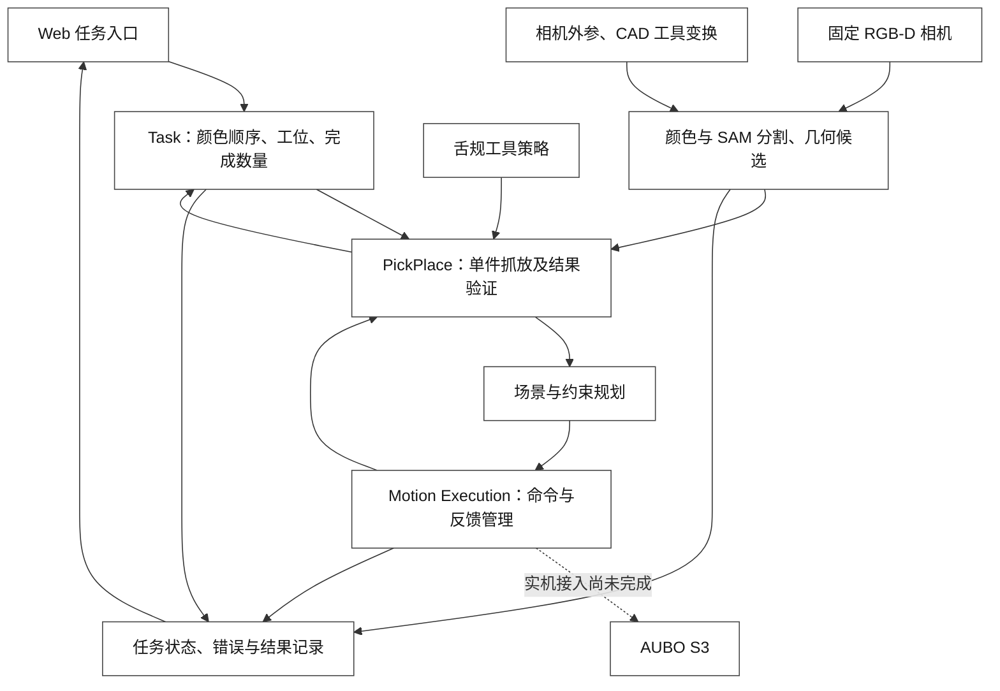
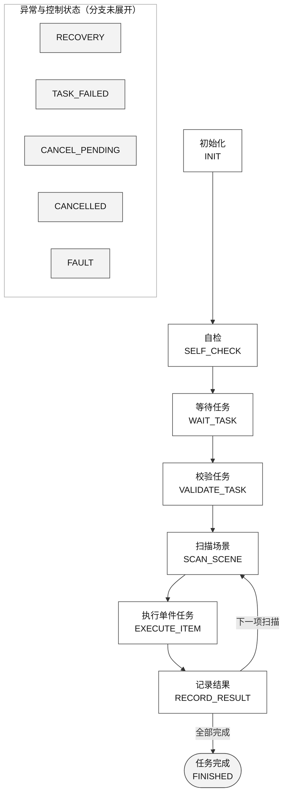
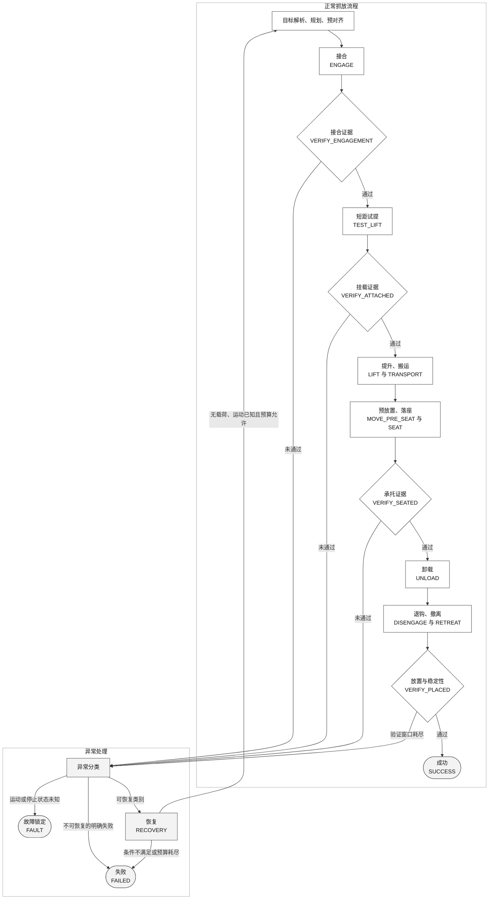

# 基于外置 RGB-D 感知与分层状态机的 AUBO S3 电池搬运技术方案

2026 美团第四届低空经济与具身智能挑战赛 · 技术报告

参赛团队：Mayday maybe　所属单位：香港理工大学　日期：2026-10-15

## 摘要

针对固定工位中多色电池道具的提环抓取与序列摆放，团队提出以 AUBO S3 机械臂、外置固定 RGB-D 相机和被动舌规为硬件基础、以分层状态机组织任务的方案。任务层管理颜色顺序与工位映射，抓放层组织穿环、试提、搬运、落座、卸载和退钩，运动执行层管理命令身份、在途执行、到位停稳及停止确认。各阶段按目标、反馈和验证条件衔接。

独立分割模块根据颜色与深度结构自动生成 SAM 2.1 tiny 的提示，结合支撑平面、可见顶部和 CAD 几何构造孔中心候选。坐标换算利用外置相机观测法兰方形标记的多姿态关系，并依据舌规 STP/STEP 模型建立法兰到工具工作点的固定变换。规划部分按舌规操作方向和接触顺序生成分段轨迹，经接触仿真、轨迹平滑与一致回放检查后准备实机执行。

软件验证包括 C++ 状态机核心的 Mock/Action 回归、抓放层的 Gazebo 接触验证，以及 SAM 候选模块的录制 RGB-D 推理与独立 ROS 接收验证。实机采用保存轨迹播放器，完成了任务一红块到 T0 的十段搬运，以及任务二黄、绿、蓝依次放入 P1、P2、P3 的三十段执行。

**关键词：** AUBO S3；分层状态机；眼在手外；RGB-D；ArUco；舌规；轨迹规划

## 1. 任务理解与设计目标

任务一根据颜色口令，将一块目标电池搬运至 T0；任务二根据三种颜色的输入次序，将对应电池依次放入 P1、P2、P3。方案需同时处理目标身份、工具进入方向、受载搬运、正确释放及放置结果核验。任务一要求提起后稳定不少于 2 秒，放置释放后稳定不少于 3 秒，分别核验提起与放置后的稳定状态（RULES p3–4）。正式颜色口令以组委会公布为准，文中的具体颜色次序仅对应示例或已有运行记录。

| 技术目标 | 设计措施 | 验证关注点 |
|---|---|---|
| 颜色与摆放次序正确 | 任务请求绑定颜色序列、对象 ID 与目标工位 | 任务输入、对象选择和完成记录一致 |
| 舌规可靠进入提环 | 顶部/孔中心定位、安装坐标换算、受约束接近 | 穿入通道、方向与工具几何匹配 |
| 电池被实际带起 | 接合后短距试提，再核验挂载 | 物体运动及承托状态 |
| 电池落座后可退出 | 落座确认、卸载、侧向退钩、撤离 | 支撑状态与工具分离结果 |
| 放置结果可核查 | 工位关联、多帧稳定检查、视频与日志 | 主体位置、稳定性及记录完整性 |
| 异常不导致盲目重复动作 | 唯一在途命令、取消确认、未知状态锁定 | 并发、超时、停止未确认及恢复条件 |

序列任务内框采用已确认的面积比例判据。设 $B$ 为电池主体在底图平面的完整垂直投影，$I$ 为对应内框，则 $\operatorname{Area}(B\cap I)/\operatorname{Area}(B)\geq 0.70$，包含恰好 70% 的边界（组委会补充答复，团队转述）。

序列内框按上述补充答复采用面积比例判据，RULES p4 原文为主体完整位于内框；T0 和序列外框仍按主体完整位于框内检查（RULES p3、p4）。颜色、位次与释放后稳定性分别核验。当前图像检查用于确认颜色与稳定性，内框面积比例需另行核验。

## 2. 系统总体方案

硬件由 AUBO S3 六轴机械臂、外置固定 RGB-D 相机、舌规和现场计算机组成。相机相对基座保持固定，观察电池与放置区域；舌规安装到法兰，依靠侧向穿环和上提承托完成搬运。计算环境采用 Ubuntu 24.04、ROS 2 Jazzy 与 C++17，辅以 Python 视觉、现场工具和 Web 服务。相机采用 RealSense D435i；控制系统版本为 ARCS `0.25.6-alpha.1+c24e317c`，AUBO SDK 版本为 `0.24.1`。

软件以 Task、PickPlace 和 Motion Execution 三层职责组织。视觉与标定模块提供目标及其坐标依据，工具策略描述接合与退出方式，规划器生成可执行运动，操作界面提供任务入口和过程记录。以下图示表示完整状态机控制架构；执行层到真实机器人之间的最终接线尚未完成。

现场搬运采用 Web→SSH→NUC→AUBO SDK 的保存轨迹执行路径。

## 3. 分层状态机与任务决策

### 3.1 分层原则与实现方式

状态机将比赛要求落实为可执行、可检查的过程条件：任务层选择当前电池，抓放层决定允许执行的接触操作，执行层判断命令是否完成。目标选择、运动结束、挂载成立与放置成立分别由对应层级管理。

核心状态逻辑与 IO 分离。Task FSM 输出动作意图，由外壳转换为子任务调用、停止或状态发布；PickPlace FSM 通过感知、规划、运动和工具四类端口接收结果。端口返回“尚未完成”时，状态机继续等待，避免轮询时重复创建运动命令。各层通过任务 ID、对象 ID 和命令 ID 关联执行过程。

### 3.2 Task FSM：从任务口令到有序完成

任务层共 13 个状态，主流程为：

任务一仅接受一个合法颜色，对应 T0；任务二接受三个互不重复的合法颜色，按索引映射到 P1、P2、P3。任务 ID、模式、颜色数量、重复颜色和显式工位冲突均在执行前校验。已有活动任务时拒绝新的并发请求；目标对象在执行期间保持绑定。

单件返回成功还必须携带 `placement_verified=true`，任务层才进入结果记录。记录成功后推进完成数量和目标工位；三件均完成才结束序列任务。

### 3.3 PickPlace FSM：围绕舌规设置证据关口

抓放层包含 22 个状态，覆盖目标解析、规划、运动、验证与异常处理。工具采用侧向接合和退钩，不需要电磁解锁。下图概括正常流程及相关异常分支。

| 关键关口 | 放行条件 | 防止的主要问题 |
|---|---|---|
| 目标解析 | 存在且唯一，颜色匹配，数据未过期，提环位姿有效 | 抓错颜色、使用旧坐标或不完整目标 |
| 接近规划 | 规划成功且具有完整可执行命令 | 只有规划成功标志，实际输出缺失 |
| 接合验证 | 工具证据达到几何级并符合接合状态 | 命令受理后实际未接合 |
| 挂载验证 | 有效挂载证据，或符合契约的视觉随动证据 | 空提后继续搬运 |
| 落座验证 | 已确认电池由目标面承托 | 未落稳就卸载或退钩 |
| 卸载与分离 | 卸载结果明确，工具分离已确认 | 带载硬拉、退钩时拖动物块 |
| 放置验证 | 新鲜观测到位且稳定达到配置时长 | 工具退出前或短暂路过目标就计为完成 |

接口要求提供“几何级证据”。Gazebo 后端通过物体高度、速度和接触状态完成检查；现有实机播放器核验最终图像，中间接触状态的观测端口需在状态机接入时补齐。

### 3.4 放置成功的时间与观测语义

`VERIFY_PLACED` 持续读取新的放置观测，检查对象、主体位姿、新鲜度、时间戳、到位及稳定标志。重复时间戳不增加稳定时长；目标丢失、观测过期、时间倒退或过长间隔会中断连续性。只有稳定窗口满足要求，才由该状态写入 `placement_verified`；即使关闭验证选项，也不会直接宣布成功。

“持续稳定”由连续有效观测确认。C++ 核心的放置配置 `placement_stability_sec` 默认 3.0 秒；提起稳定时长由任务一场景脚本写入 `lift_stability_s=2.0`，Gazebo 适配器读取该场景配置，键缺失时默认 0.0。

### 3.5 Motion Execution：唯一执行权与故障锁定

执行层区分待机、已受理、运动中、到位停稳、取消中、已停止、停止未知、超时、拒绝和故障，共 10 种执行状态。同一时刻只允许一条有效在途命令；并发请求和已下发命令的重复发送均被拒绝。运动状态未知时锁住后续自动执行。

收到取消请求后，执行层等待停止确认。有效停止证据要求命令身份一致、控制器反馈新鲜、队列为空，且低速关节反馈持续满足规定窗口。普通任务失败、用户取消与运动未知故障采用不同去向，`FAULT` 不通过普通复位自动解除。控制器保护与实体急停由各自机制承担。

恢复仅适用于允许类别的错误，并受预算限制；抓放层还需确认无载荷且运动状态已知。现场实机搬运使用的保存轨迹播放器采用不自动重试策略。

## 4. 舌规与动作协同设计

功能舌与上翘尖采用 PETG 3D 打印，已直接装机使用。实机安装盘已去除背面凹槽周围的环形凸台，并削平至原凹槽底面，目的是便于螺钉紧固、减少装配误差。

工具从电池顶部提手孔口侧向穿入，在提手横梁下承托电池并上提；放置时先使电池落到支撑面并卸载，再沿规定方向退钩。工具包络与路径需同时满足进入、承托和退出要求。

下表与四视图均基于原始 STEP 模型，表示安装盘削平前的名义 CAD 几何。

| 部件 | 削平前原始 CAD 的名义尺寸 | 坐标或使用说明 |
|---|---|---|
| 安装盘 | 外径75 mm，厚15 mm | CAD Y=-7.5～7.5 mm |
| 背面凹槽 | 直径63 mm，深7 mm | 开口面Y=-7.5 mm，槽底Y=-0.5 mm |
| 安装孔 | 4×Ø6.1 mm，孔中心圆Ø50 mm | 孔轴平行CAD Y；几何孔径不等于螺纹规格 |
| 立柱 | 截面包络30×20 mm，名义轴向跨度100 mm | 有圆角与连接过渡，不作为等截面净长 |
| 舌板 | 宽44 mm，厚5 mm，Z向总包络85 mm | Y=107.5～112.5 mm，Z=-10～75 mm；85 mm含连接部分，不等于可用插入行程 |
| 舌尖挡边 | 沿-Y额外凸起5 mm，位于Z=70～75 mm | 朝法兰方向凸起，存在圆角 |

图中红色圆点表示规划配置选取的挂环参考 TCP，深色菱形表示凹槽底面中心，均为 CAD 参考位置。削平前原始 CAD 包络为 75×120×112.5 mm（X×Y×Z），实体体积约 122.858 cm³。加工后尺寸、有效功能段长度、质量与重心需通过实物测量确定。

工具动作与状态机配合：穿入时限制方向和速度，试提时验证承托，运输时考虑载荷包络，落座后先卸载再退钩。

## 5. 颜色引导分割与 RGB-D 几何定位

自动提示分割先用颜色先验缩小候选范围，再结合支撑平面和顶部高度，生成 SAM 2.1 tiny 的正负提示及候选框。掩膜通过种子覆盖、区域溢出和面积关系等检查后，才按模型分数排序。视觉版本支持录制真实 RGB-D 上的推理及独立 ROS 接收验证，模块已用于现场感知。

孔内深度不可靠时，程序先估计可见顶部平面，求分割轮廓像素射线与平面的交点，计算顶部中心，再按 CAD 偏置推算孔中心候选。程序分别保留原始位置、几何修正及有效性信息，输出 XYZ 位置候选；生成完整可执行位姿还需判别矩形顶部的正反方向。

相机预览与几何推理分别更新，结果关联实际源帧，SDK 采集时间与 ROS 发布时刻分别保存。该视觉版本尚未将完整提环位姿与 `motion_usable` 标为有效。独立发布器提供候选 JSON 话题 `/mtc/perception/top_hole_candidates` 和可选的 `/mtc/perception/batteries` 诊断数组。控制端接入时需检查提环位姿与目标有效性。

视觉还用于执行前后的场景核对。执行前分别检查电池颜色轮廓、质心和印刷底图：底图采用 SIFT 特征匹配与 RANSAC 单应估计，检查目标中心像素相对参考图的位移，避免物块未动而底图已移动时仍沿用旧轨迹。该脚本在固定图像区域内比较参考场景，核验图像平面的一致性。

执行后比较对应工位及未搬运电池的多帧轮廓与稳定性。该检查记录固定视角下的轮廓、质心及稳定状态。视觉分支另支持以任务底图矩形和可选桌面标记确定 T0 方向；桌面定向标记与随法兰运动的标定标记分别管理。

## 6. 相机外参标定与舌规工具坐标换算

### 6.1 标记观测与法兰位姿采集

RealSense D435i 固定于工位，ArUco 标记固定在法兰侧，采用眼在手外布置。标定记录使用 `DICT_6X6_1000` 字典、ID 0 标记及 1280×720 彩色图像，相机内参和畸变参数由设备读取。标记角点经细化后，结合黑框边长求解 PnP，得到标记在彩色光学系中的位姿。

机械臂在不同位置和朝向停稳采样，使标记覆盖多轴旋转。存档会话包含 18 组位姿，每组记录 8 帧标记观测，并保存关节角、法兰位姿、角点、PnP 结果及观测质量。其中 17 组用于求解，1 组作为留出检验；角点抖动、重投影误差及位姿有效性用于检查观测质量。

机器人侧统一使用法兰位姿。控制器若配置了 TCP 偏置，须先消去偏置，再与关节正运动学比较。现场检查脚本同时核对机器人停稳状态、相机与控制器采集时段的重叠，以及控制器反馈与模型的坐标一致性。URDF 与控制柜 FK 的匹配用于统一数学模型。

### 6.2 手眼关系求解与结果

约定 ${}^{A}T_B$ 将 B 系坐标转换到 A 系。B 为基座，C 为彩色相机光学系，F 为法兰，M 为标记。第 i 组观测满足

$$
{}^{B}T_C\,{}^{C}T_{M,i}={}^{B}T_{F,i}\,{}^{F}T_M.
$$

已知量为标记观测 ${}^{C}T_{M,i}$ 和法兰位姿 ${}^{B}T_{F,i}$；求解量为固定的相机外参及标记安装变换。求解过程保留标记相对法兰的安装偏置。执行包保存的结果采用 HORAUD 初始化，并记录异常样本剔除、标记尺度估计及留出检验。

相机彩色光学系到 `base_link` 的变换为下式，平移单位为米，数值保留六位小数：

$$
{}^{B}T_C=\begin{bmatrix}
-0.123342 & 0.360303 & -0.924645 & 1.387791\\
0.991765 & 0.012388 & -0.127469 & 0.074222\\
-0.034473 & -0.932753 & -0.358864 & 0.621017\\
0 & 0 & 0 & 1
\end{bmatrix}.
$$

| 项目 | 执行包保存的标定结果 |
|---|---|
| 标记黑框边长 | 配置值 80 mm；求解估计值 76.698 mm |
| 拟合样本 | 17 组输入，剔除 2 组，保留 15 组 |
| 拟合重投影 RMS | 0.999 px |
| 留出检验 | 1 组；重投影 RMS 0.441 px |
| 留出标记中心残差 | 3.124 mm |

该结果为外参估计，留出误差用于评价观测与模型的一致性。后续依据约 76.7 mm 的标记边长和统一 FK 重算的结果单独保存为候选，执行包沿用原结果。

### 6.3 舌规工具变换与安装核对

利用舌规 STP/STEP 中的贴合面、安装转角和工作点定义，建立

$$
{}^{F}T_{TCP}={}^{F}T_{CAD}\,{}^{CAD}T_{TCP}.
$$

工具模型选取 CAD 点 $(0,110,45)$ mm 作为 TCP，即舌板中线、厚度中面、舌尖后 30 mm 的挂环参考点。安装盘已削平至原凹槽底面，模型以该面作为贴合基准；在安装角 `mount_yaw_deg=0` 的名义条件下，TCP 在 `ee_link` 中为 $(45,0,110.5)$ mm。原模型若改用外缘端面贴合，轴向坐标为 117.5 mm，相差 7 mm，因此贴合面须与实际装配对应。

安装角通过 CAD 轮廓投影核对：将四种离散安装方向投影到同步采集的彩色图像，与舌规轮廓比较重合度，再用深度观测辅助检查可见表面位置。安装角分别按法兰和 `ee_link` 记录；模型中两者相差绕法兰 Z 轴 90° 的固定旋转，TCP 换算包含该旋转。团队已完成 TCP 验证，现有资料未给出量化误差。

### 6.4 视觉目标到运动目标的换算

视觉目标 G 先转换到基座系，再按提环与工具的操作关系生成 TCP 目标，最后反解法兰目标：

$$
{}^{B}T_G={}^{B}T_C\,{}^{C}T_G,
$$

$$
{}^{B}T_{TCP}^{goal}={}^{B}T_G\,{}^{G}T_{TCP}^{goal},
$$

$$
{}^{B}T_F^{goal}={}^{B}T_{TCP}^{goal}\left({}^{F}T_{TCP}\right)^{-1}.
$$

长度统一为米，四元数接口统一为 $(x,y,z,w)$。SDK 原始六维位姿按接口约定转换姿态角；若规划器末端为 `ee_link`，则使用与该末端对应的 TCP 变换，避免重复补偿。相机位置改变后更新相机外参，工具拆装或转角改变后重新核对工具变换。

## 7. 约束规划、轨迹平滑与现场执行

每块电池的搬运分为十个动作阶段。下表按程序阶段 ID 列出现场 Web 标签及对应动作状态。规划与验证状态由状态机另行管理。

| 阶段 ID | 现场名称 | 对应动作状态 |
|---|---|---|
| `side_insert` | 接近把手 | `MOVE_PRE_ALIGN` |
| `hook_engage` | 水平插入 | `ENGAGE` |
| `test_lift` | 试提起 | `TEST_LIFT` |
| `lift` | 垂直提起 | `LIFT` |
| `transport` | 搬运 | `TRANSPORT` |
| `pre_seat` | 预放置 | `MOVE_PRE_SEAT` |
| `seat_contact` | 接触支撑面 | `SEAT` |
| `unload` | 卸载 | `UNLOAD` |
| `side_withdraw` | 退出把手 | `DISENGAGE` |
| `retreat` | 撤离 | `RETREAT` |

场景包含电池、台面、底座及周围导轨；带载运输采用保守碰撞包络，工具目标先换算到规划末端。

Gazebo 轨迹生成后端中的固定姿态方案，将预对齐拆为抬高、水平移动和下降接近三段笛卡尔路径，降低接近时工具旋转造成干涉的风险；这里的命令在仿真端标为 `simulation_only`。轨迹经导出、同命令回放及打包后，由实机播放器执行。接触敏感阶段采用规定方向与低速运动。在 Gazebo 中核查试提、承托、卸载及退出，电池运动依靠接触物理。

成功路径导出后，通过五次样条和平滑时间律调整轨迹，并检查速度、加速度与 jerk。几何重拟合通过加密采样限制关节及工具参考点偏差，再用 Bernstein 系数包络检查导出分段多项式的区间导数上界。平滑结果使用同一组命令重新回放，核验轨迹一致性。

实机执行程序通过 SDK 播放器上传并执行保存轨迹，检查轴序、单位、连续性、起点、控制器状态和停稳反馈。该执行版本对实际与目标的跟踪误差幅值只记录，同时检查起点/段末最大关节误差不超过 0.05°，并对实际与目标关节位置执行每段轨迹最小/最大值外扩 0.2° 的包络检查。

## 8. Web 操作与运行记录

Web UI 提供任务提交、当前阶段、相机图像、机器人状态、停止请求和结果展示。运行记录关联保存任务、执行包、命令阶段、控制柜反馈及最终图像，用于检查动作是否漏段并定位异常阶段。

任务二执行程序的成功判据同时要求：三十个阶段按顺序完成、收到完成回执、获得完成后的新鲜独立停稳反馈、终点六关节最大误差满足阈值、最终图像核验通过、进程退出码为 0，且收到 `player_returned` 事件。图像检查同时覆盖 P1/P2/P3 的目标颜色和原区未搬运电池，要求至少 4 个不同源时间戳的有效样本覆盖不少于 3 秒，并满足轮廓、质心稳定条件；终点六关节最大误差阈值为 0.05°。

完成状态机接入后，应继续保存各层状态转换、端口结果、观测时间及错误去向。相机预览录像用于调试追溯。比赛提交视频要求固定第三视角、连续拍摄，并覆盖机械臂、底图、全部电池和计时画面（FAQ p2–3，Q5）。

## 9. 验证结果

各模块的验证结果与当前集成状态根据测试和现场运行记录汇总如下。

| 层面 | 已有结果 | 验证范围 |
|---|---|---|
| C++ 核心及 Action | 五个受测包的 `colcon test-result` 汇总为 386 项，0 errors/failures/skipped | 五个软件包的 `colcon` 汇总统计 |
| 现场脚本与 Web UI | 159 项测试通过 | 打包、运动分段、导出/平滑、放置证据与界面等离线测试 |
| Gazebo | 给定模型与场景下有接触及同命令回放记录，具体顺序以各场景文件为准 | 仿真接触与命令回放；历史 `sequence_CAB` 与实机搬运分别记录 |
| 任务一实机 | 红块→T0，十段完成；收尾 RTDE 超时后由独立只读反馈核实停稳 | 十段搬运、收尾异常及停稳复核 |
| 任务二实机 | 黄→绿→蓝，依次 P1/P2/P3；一轮三十段完成、退出码 0、无自动重试 | 固定现场的一轮三件完整执行 |
| SAM 模块 | 已归档的视觉版本完成录制 RGB-D 推理与独立 ROS 接收验证；模块已用于现场感知 | 候选话题尚未接入 C++ 抓放控制；现场接入点、调用时机与在线重规划接入仍待核实 |
| 完整 C++ FSM 实机集成 | 实机接入尚未完成 | 后续验证实际端口接线与整机运行 |
| 标定与 TCP 精度 | 执行包保存手眼矩阵，拟合重投影 RMS 为 0.999 px，1 组留出检验为 0.441 px；TCP 已做验证 | 手眼外参估计、图像残差与 TCP 验证 |

任务二摘要记录终点六关节最大误差约 0.00384°、最终图像质心漂移约 0.062 像素，分别表征该轮关节末姿态与固定视角图像稳定性。

现场调试记录包含多次失败运行，例如旧播放器在第 11 段因 J1 跟踪误差约 0.500505° 超过 0.5° 而停止。不同配置下的调试与失败记录分别保存，用于追溯策略演变。当前尚未形成统一条件下的多轮成功率统计，独立物块定位误差测量与对照实验仍待补充。

## 10. 工程贡献与团队分工

| 工程贡献 | 验证依据 | 工程作用 |
|---|---|---|
| **接触操作的分层状态管理** | C++ 核心及 Action 离线回归；抓放层 Gazebo 接触验证 | 任务次序、接合和执行确认分别建模 |
| **任务先验引导的 SAM 分割与几何候选** | 录制真实 RGB-D 推理、独立 ROS 接收验证 | 自动生成提示并估计顶部/孔中心候选，用于现场感知 |
| **相机—法兰—舌规的坐标统一** | 多姿态标记观测、执行包手眼矩阵、CAD 工具换算及安装轮廓核对 | 相机外参、标记安装与工具偏置分别处理，统一视觉目标和运动目标的坐标关系 |
| **被动舌规与动作约束协同** | CAD 名义几何、已确认的装机结构、Gazebo 接触及实机搬运记录 | PETG 功能舌与上翘尖直接装机；安装盘去除环形凸台并削平至原槽底，便于紧固并减少装配误差 |
| **规划验证与实机执行追溯** | 仿真同命令回放；SDK 播放器的实机阶段与最终核验记录 | 关联轨迹、执行包散列、回执、停稳和最终图像 |

团队分工如下：

| 成员 | 主要职责 |
|---|---|
| 孙嘉明 | FSM、ROS 2 Action、Motion Execution 与驱动技术交接 |
| 常建烁 | MoveIt 规划、碰撞场景与轨迹有效性 |
| 孙浩然 | 电池与提手感知、目标标识与位姿质量 |
| 韩明赫 | 相机标定方法、TF、CAD 工具坐标与工位几何 |
| 张叔阳 | 系统集成、启动检查、Web UI、日志与演示材料 |

## 11. 第三方技术与 AI 辅助披露

项目使用 ROS 2、MoveIt 2、OpenCV、RealSense 软件、AUBO 模型/驱动或 SDK，以及 SAM 2.1 tiny 等第三方组件。SAM 采用预训练模型，团队工作包括任务提示、几何处理和数据适配。第三方组件及本项目使用范围如下（FAQ p6，Q17）。

| 组件 | 版本 | 本项目使用或修改范围 |
|---|---|---|
| SAM 2 / SAM 2.1 tiny | 官方源码 `2b90b9f5ceec907a1c18123530e92e794ad901a4`；检查点 `sam2.1_hiera_tiny.pt` | 使用预训练模型；团队实现自动提示、几何处理与 ROS 适配 |
| ROS 2、MoveIt 2 | ROS 2 Jazzy；MoveIt 2 2.12.4（Jazzy 最新发布版） | 状态机节点、Action/端口接线、场景与规划配置 |
| OpenCV、PyTorch、torchvision、RealSense 软件 | OpenCV `4.11.0.86`；PyTorch `2.5.1+cpu`；torchvision `0.20.1+cpu` | 颜色与深度处理、分割推理、标记检测与相机数据接入 |
| AUBO 模型、驱动与 SDK | ARCS `0.25.6-alpha.1+c24e317c`；SDK `0.24.1`；ROS 2 驱动 `53aab837`（Jazzy 部署基线） | 模型适配、运动执行与自编 SDK 封装；封装与厂商 SDK 本体分别披露 |

团队在项目开发与报告编制中使用生成式 AI 辅助：OpenAI Codex 用于文字整理、代码核对、绘图脚本编写与 PDF 排版，Claude Code 用于建模与仿真（FAQ p6，Q17）。

## 参考资料

- RULES：《2026年挑战赛规则及赛题说明》。
- FAQ：《2026挑战赛FAQ》。

正文引用页码均为 PDF 页序。
